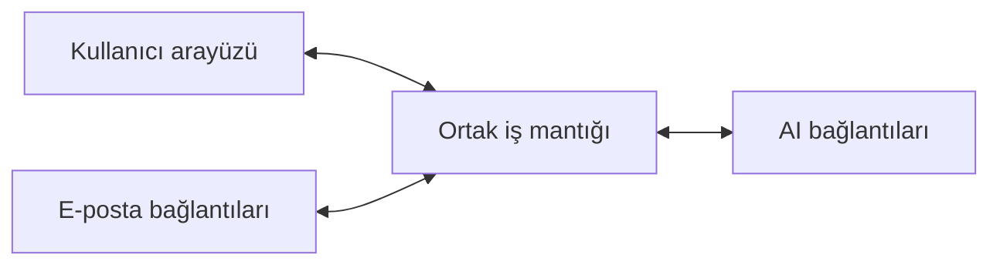

# Email Writer proje planı

Güncelleme: 15 Ekim 2026
Proje şu anda private repoda geliştiriliyor; ileride açık kaynak yayımlanması planlanıyor. Ticari model, uygulama kullanılabilir hale geldikten sonra değerlendirilecek.

## 1. Uygulamanın amacı

Email Writer, insanların kullandıkları e-posta uygulamasından ayrılmadan daha iyi mesajlar yazmasına yardımcı olacak. Kullanıcı ister ne söylemek istediğini kısaca anlatacak, ister kendi yazdığı metni düzelttirecek veya başka bir dile çevirecek. Uygulama, gerektiğinde açık konuşmadaki önceki mesajları da kullanarak uygun bir yanıt hazırlayacak.

İlk hedef, Outlook Web üzerinde çalışan ve kullanıcıların mağazadan kurabildiği bir tarayıcı eklentisini yayımlamak. Chrome, Edge, Brave ve Firefox için aynı kod tabanını kullanacağız. Gmail ve ek AI sağlayıcılarını sonraki eklenti sürümlerinde ekleyeceğiz. Windows Outlook uygulaması ikinci aşamada; mobil destek daha sonra ele alınacak. İlk yayın için masaüstü Outlook üzerinde geliştirme yapmamız gerekmiyor.

**Mimarinin temel amacı, yeni bir e-posta hizmeti veya AI sağlayıcısı eklerken uygulamanın geri kalanını yeniden yazmak zorunda kalmamak.** Bunun için kullanıcı arayüzünü, e-posta bağlantılarını, ortak iş mantığını ve AI bağlantılarını ayrı modüller halinde geliştireceğiz.

## 2. Kullanıcının izleyeceği akış

Kullanıcı Outlook veya Gmail'de bir e-posta açtığında, açık konuşmanın veya yazma alanının yakınında küçük bir simge görecek. Bu simgeye tıkladığında açılan panelden yapmak istediği işlemi seçecek. Panel kendiliğinden açılmayacak ve kullanıcının normal e-posta akışını kesmeyecek.

Üç temel kullanım olacak:

- **Yanıt hazırlama:** Kullanıcı “Durumun böyle olmadığını sakin bir dille açıkla ve yarın için toplantı öner” gibi bir talimat yazacak. Uygulama, seçilen konuşma geçmişini dikkate alarak bir taslak oluşturacak.
- **Metni düzeltme:** Kullanıcı e-postasını normal yazma alanına yazacak ve “Düzelt” düğmesine basacak. Uygulama anlamı koruyarak cümleleri daha açık ve düzgün hale getirecek.
- **Çeviri:** Kullanıcı metni ve hedef dili seçecek. Örneğin Türkçe yazdığı bir yanıtı, iş yazışmasına uygun İngilizceye çevirebilecek.

Her işlemde sonuç önce önizlemede gösterilecek. Kullanıcı sonucu değiştirebilecek, yeniden düzenlenmesini isteyebilecek veya “Taslağa uygula” düğmesiyle e-posta alanına aktarabilecek. E-postayı gönderme işlemi kullanıcıda kalacak.

Panelde yalnızca o anda gerekli seçenekleri göstereceğiz: metin alanı, hedef dil, ton ve sonuç. AI sağlayıcısı ile hesap bağlantıları ayarlar bölümünde bulunacak. Kullanıcı günlük kullanımda bu ayarları tekrar yapmak zorunda kalmayacak.

## 3. Modüler yapı

Uygulamayı dört ana bölüme ayıracağız. Her bölümün görevi belirli olacak ve diğer bölümlerle tanımlı bir veri biçimi üzerinden iletişim kuracak. Böylece bir bölümde yapılan değişiklik, diğerlerine mümkün olduğunca az yansıyacak.

### Kullanıcı arayüzü

Bu modül; küçük simgeyi, açılan paneli, metin alanlarını, ayarları ve sonuç önizlemesini içerecek. Kullanıcının hangi işlemi seçtiğini ortak iş mantığına bildirecek ve gelen sonucu gösterecek.

Arayüz, Outlook'tan e-posta okumanın veya bir AI servisine istek göndermenin ayrıntılarını bilmeyecek. Örneğin kullanıcı Claude yerine Gemini seçtiğinde panelin çalışma biçimi değişmeyecek.

### E-posta bağlantıları

Her e-posta ortamı için ayrı bir bağlantı modülü yazacağız: Outlook Web, Gmail Web ve Windows Outlook. Bu modüller aynı temel işlemleri sunacak:

- Açık e-postayı ve erişilebilen konuşma geçmişini okumak.
- Kullanıcının yazdığı taslağı veya seçtiği metni almak.
- Onaylanan sonucu doğru yazma alanına yerleştirmek.
- Kullanıcı başka bir konuşmaya geçtiğinde bunu bildirmek.

Bu tür bağlantı modülleri yazılımda **adaptör** olarak adlandırılır. Buradaki görevleri, farklı e-posta uygulamalarının sunduğu imkanları bizim uygulamamızın kullanabileceği ortak bir biçime çevirmektir.

Örneğin Outlook ve Gmail, yazma alanlarını farklı biçimde oluşturur. Her iki modül de uygulamaya “mevcut taslak metni”ni verir; bu metnin sayfadan nasıl alındığını kendi içinde çözer. Gmail eklendiğinde metin düzeltme özelliğini yeniden yazmamız gerekmez.

### Ortak iş mantığı

Bu bölüm, kullanıcının isteğini baştan sona yönetecek. Hangi metnin düzenleneceğini belirleyecek, gerekiyorsa konuşma geçmişini hazırlayacak, seçilen AI bağlantısını çağıracak ve sonucu önizlemeye iletecek.

“Düzelt”, “çevir”, “yanıt oluştur”, “daha kısa yaz” ve “daha resmi yaz” gibi özellikler burada tanımlanacak. Bu özelliklerin içinde Outlook'a veya belirli bir AI markasına özel kod bulunmayacak.

Örneğin “Daha kısa yaz” özelliğini eklediğimizde, mevcut taslağı ve bu talimatı AI modülüne gönderen ortak işlemi geliştireceğiz. Özellik daha sonra desteklediğimiz bütün e-posta ortamlarında kullanılabilecek.

### AI bağlantıları

OpenAI, Anthropic ve Google gibi her AI sağlayıcısı için ayrı bir modül bulunacak. Bu modül, ortak iş mantığından gelen isteği ilgili servisin beklediği biçime çevirecek ve cevabı uygulamaya ortak bir biçimde döndürecek.

Her AI modülü; kullanılabilir modelleri, desteklediği bağlantı yöntemlerini, metin üretme işlemini ve hata durumlarını yönetecek. Bir sağlayıcı API anahtarıyla, başka biri üyelikle veya her iki yöntemle kullanılabilecek. Sağlayıcıya özgü ayrıntılar o modülün içinde kalacak.

Bir bağlantının sunduğu özellikler uygulamaya açıkça bildirilecek. Örneğin üyelikle giriş desteklenmiyorsa ayarlarda bu seçenek gösterilmeyecek. Destek sonradan eklendiğinde yeni seçenek kullanılabilir hale gelecek.



### Yeni bir modül ekleme

Yeni bir e-posta hizmeti için o hizmetin mesaj okuma ve taslağa yazma işlemlerini uygulayan bir modül ekleyeceğiz. Ardından modülü uygulamanın desteklenen bağlantılar listesine kaydedeceğiz. Mevcut arayüz ve yazma özellikleri aynı kalacak.

Yeni bir AI sağlayıcısı için de bağlantı kurma, model seçme ve metin üretme işlemlerini uygulayan bir modül ekleyeceğiz. Ortak iş mantığı aynı isteği bu yeni modüle de gönderebilecek.

Bunu mümkün kılmak için ilk geliştirme adımında, modüllerin hangi veriyi alıp hangi sonucu döndüreceğini tanımlayacağız. Bu tanımları tek yerde tutacağız. İkinci e-posta ve ikinci AI sağlayıcısını eklemek, yapının gerçekten modüler olup olmadığını gösterecek.

## 4. API ve üyelik bağlantıları

**İlk implementasyon:** ChatGPT plan kullanımı ve OpenAI API anahtarı, `packages/ai-openai` ve `apps/ai-companion` üzerinden bağlandı. Yerel uygulama macOS/Linux native messaging ile çalışır; tarayıcı token saklamaz. Gerçek hesapta giriş ve model listesi doğrulandı; üretim OpenAI uygunluk reddinde kalıyor. Başarılı üretim doğrulaması ve Windows kurucusu bekliyor. Özel dağıtım için OpenAI erişim uygunluğu ayrıca kontrol edilmeli. Ayrıntı: [AI bağlantısı](./docs/AI_BAGLANTISI.md).

Kullanıcı AI sağlayıcısını seçtikten sonra, o sağlayıcının desteklediği yöntemle bağlantı kuracak. API kullanmak isteyen anahtarını ekleyebilecek; mevcut üyeliğini kullanmak isteyen ise destekleniyorsa hesabıyla giriş yapabilecek. Her iki yöntem de baştan bağlantı yapısının bir parçası olacak.

**AI sağlayıcısı seçimi ile giriş yöntemini ayrı tutacağız.** Örneğin aynı sağlayıcının hem API hem üyelik bağlantısı varsa, bunlar aynı metin düzenleme özelliklerine hizmet edecek. Üyelik veya API bağlantısındaki bir değişiklik, e-posta modüllerini etkilemeyecek.

Kontrol etmemiz gereken temel nokta, sağlayıcının üyeliği üçüncü taraf uygulamalarda hangi koşullarla kullandırdığı. Bu kontrol ilgili bağlantı geliştirilirken yapılacak. Bir sağlayıcının bağlantısını araştırırken arayüzü ve diğer modülleri geliştirmeye devam edebileceğiz.

Örneğin OpenAI, uygun ChatGPT hesapları için açık kaynak uygulamalarda plan kullanımına yönelik bir bağlantı sunuyor. Belgelenen giriş yöntemi bilgisayarda çalışan küçük bir yardımcı süreç gerektirebilir. Böyle bir ihtiyaç ilgili bağlantının içinde çözülecek; diğer sağlayıcılar buna bağımlı hale getirilmeyecek. [OpenAI bağlantı kapsamı](https://developers.openai.com/siwc/token-sharing-open-source), [giriş yöntemi](https://developers.openai.com/siwc/token-sharing-open-source/sign-in).

Bağlantı ekranında kullanımın üyelikten mi yoksa API hesabından mı karşılandığı açık olacak. Bir hesabın limiti dolduğunda kullanıcıdan habersiz ücretli bir bağlantıya geçilmeyecek. Sağlayıcıların üyelik ve ücretlendirme koşulları farklı olduğundan, bütün markalar için aynı kullanım hakkını varsaymayacağız.

## 5. E-posta uygulamalarına bağlantı

### Outlook Web ile başlangıç

İlk sürüm bir tarayıcı eklentisi olacak. Eklenti, Outlook sayfasındaki açık mesajı ve yazma alanını okuyarak paneli uygun yere yerleştirecek. Linux üzerinde günlük kullanımda deneyebileceğiz; desteklediğimiz tarayıcıların Windows sürümlerinde de test edeceğiz.

Bu yöntemin avantajı, küçük simge ve açılır panel deneyimini hızlıca geliştirebilmemiz. Dikkat etmemiz gereken nokta ise Outlook'un sayfa yapısının zaman içinde değişebilmesi. Sayfadan veri okuyan kodu Outlook modülünde tutarak bu değişikliklerin diğer özellikleri etkilemesini önleyeceğiz.

### Chrome, Edge, Brave ve Firefox desteği

Chrome, Edge ve Brave için ortak bir Chromium sürümü hazırlayacağız. Microsoft, Chrome eklentilerinin Edge'e küçük değişikliklerle taşınabildiğini belirtiyor; Brave de Chromium eklentilerini Chrome Web Store üzerinden destekliyor. Yine de her birinde kurulum, giriş ve taslağa yazma akışını deneyeceğiz. [Microsoft'un uyumluluk açıklaması](https://learn.microsoft.com/en-us/microsoft-edge/extensions/developer-guide/port-chrome-extension), [Brave eklenti desteği](https://support.brave.com/hc/en-us/articles/360017909112-How-can-I-add-extensions-to-Brave).

Firefox için ayrı bir uygulama yazmayacağız. Vue arayüzü, metin düzenleme özellikleri, AI bağlantıları ve e-posta modülleri büyük ölçüde ortak kalacak. Tarayıcı farkları, eklentinin yapılandırmasında ve tarayıcıyla iletişim kuran küçük yardımcı modüllerde karşılanacak. Beklenen ek çalışma aşağıdaki alanlarda olacak; gerçek kapsam ilk çalışan sürümle doğrulanacak.

| Alan | Firefox için yapacağımız iş | Kodda yeri |
| --- | --- | --- |
| Paket ve ayarlar | Aynı kaynak koddan Firefox paketi üretecek; eklenti kimliği ve Firefox'a özgü ayarları tanımlayacağız. Her iki hedefte Manifest V3 kullanacağız. | Eklentinin `wxt.config.ts` dosyası ve derleme komutları |
| Arka planda çalışan kod | Chrome'un kullandığı service worker yerine Firefox'un desteklediği background script biçiminde paketleyeceğiz. İstek durumunu yalnızca bellekte tutmayacak, arka planın kapanıp yeniden açılmasını hesaba katacağız. | Eklentinin `entrypoints/background.ts` dosyası |
| Tarayıcı işlemleri | Mesajlaşma, ayar saklama ve izin kontrollerinde WXT'nin ortak `browser` arayüzünü kullanacağız. Tarayıcıya özel bir işlem gerekirse tek yerde uyarlayacağız. | Eklenti içindeki `platform/` yardımcı modülleri |
| Sayfa içindeki panel | Aynı Vue panelini e-posta sayfasına yerleştireceğiz. Odak, metin seçimi ve taslağa yazmayı Firefox'ta da deneyeceğiz. | Sayfaya eklenen kod ve e-posta modülleri |
| İzinler ve dağıtım | Site erişimlerini kontrol edecek; Firefox'un veri paylaşımı beyanını, mağaza incelemesini ve imzalama sürecini ayrıca tamamlayacağız. | Eklenti ayarları, kurulum ekranı ve yayın süreci |

Chrome Manifest V3 arka plan kodunu service worker olarak çalıştırıyor; Firefox bu biçimi desteklemiyor ve background script kullanıyor. Bu nedenle aynı iş mantığını kullanıp tarayıcıya uygun manifest üreteceğiz. WXT'de Firefox hedefi varsayılan olarak Manifest V2 olduğundan, geliştirme ve paketleme komutlarında Manifest V3'ü açıkça seçeceğiz. [MDN arka plan farkları](https://developer.mozilla.org/en-US/docs/Mozilla/Add-ons/WebExtensions/manifest.json/background), [WXT tarayıcı hedefleri](https://wxt.dev/guide/essentials/target-different-browsers).

Paneli sayfanın içine yerleştirme kararı burada işimizi kolaylaştırıyor: Chrome'un `sidePanel` ve Firefox'un `sidebarAction` adlı farklı yan panel sistemlerine bağımlı olmayacağız. Panelin stillerini sayfadan ayırmak için WXT'nin Shadow DOM desteğini kullanacağız. Bu, Outlook'un görünümüyle eklentinin görünümünün birbirini bozmasını azaltır. [MDN yan panel farkları](https://developer.mozilla.org/en-US/docs/Mozilla/Add-ons/WebExtensions/Chrome_incompatibilities#sidebar_api), [WXT sayfa içi arayüz](https://wxt.dev/guide/essentials/content-scripts#shadow-root).

WXT ortak API kullanımını kolaylaştırır; tarayıcıda bulunmayan bir özelliği otomatik olarak sağlamaz. Giriş yöntemi tarayıcıya özel yönlendirme veya yerel yardımcı uygulama kullanırsa, bu bağlantının ayarları da tarayıcıya göre uyarlanacak. [WXT eklenti API'leri](https://wxt.dev/guide/essentials/extension-apis).

### Gmail desteği

Gmail için aynı tarayıcı eklentisinin içinde ayrı bir e-posta modülü geliştireceğiz. Panel, metin düzenleme özellikleri ve AI bağlantıları yeniden kullanılacak. Gmail'e özgü çalışma, konuşmayı bulma ve doğru taslağa yazma işlemlerinde olacak.

Google Workspace Add-on, Gmail için resmi bir alternatif. Ancak kendi arayüz kuralları ve taslak erişimi sınırları var. İlk sürümde iki web uygulamasında benzer bir deneyim sunmak için tarayıcı eklentisini tercih ediyoruz. Resmi eklenti seçeneğini mobil veya kurumsal dağıtım ihtiyacı oluştuğunda değerlendireceğiz. [Google'ın eklenti ve taslak belgeleri](https://developers.google.com/workspace/add-ons/gmail/extending-compose-ui).

### Windows Outlook desteği

Tarayıcı eklentisi yayımlandıktan sonra Windows'taki Outlook uygulamasını ele alacağız. Bunun için ilk aday Microsoft'un resmi Outlook eklenti sistemi. Bu sistem, Office.js adlı JavaScript arayüzü üzerinden açık mesajla ve taslakla çalışmamızı sağlıyor. Kullanıcı uygulamamızın panelini Outlook'un içinden açabilecek.

Ortak iş mantığı ve AI bağlantıları burada da kullanılacak. Hesap ve Outlook sürümüne göre destek değişebildiği için bu aşamaya geldiğimizde küçük bir denemeyle kapsamı belirleyeceğiz. Şimdilik bu entegrasyon için uygulama veya deneme geliştirmeyeceğiz. [Microsoft Outlook eklenti desteği](https://learn.microsoft.com/en-us/office/dev/add-ins/outlook/outlook-add-ins-overview).

### Mobil destek

Mobilde önce Outlook ve Gmail'in resmi eklenti imkanlarını inceleyeceğiz. Gerekirse kullanıcının seçtiği metni paylaşım menüsüyle uygulamaya aktarabildiği bir çözüm geliştireceğiz. Ortak metin işleme ve AI bağlantı tasarımından yararlanacağız; mobil arayüzün ayrıca geliştirilmesi gerekecek.

Masaüstündeki bütün işlemlerin mobilde aynı şekilde desteklendiğini varsaymayacağız. Örneğin Outlook mobilin mesaj okuma ve yazma sırasında sunduğu eklenti imkanları farklı. [Outlook mobil desteği](https://learn.microsoft.com/en-us/office/dev/add-ins/outlook/add-mobile-support).

## 6. Konuşma geçmişinin kullanımı

Uygulamanın iyi bir yanıt hazırlayabilmesi için kullanıcının hangi mesajı yanıtladığını ve önceki yazışmalarda neler söylendiğini doğru anlaması gerekiyor. Bu nedenle konuşma geçmişini toplama işi, e-posta modülünün temel görevlerinden biri olacak.

İlk sürümde açık konuşmadaki erişilebilir mesajları okuyacağız. Mesajları tarih sırasına koyacak, tekrar eden alıntıları ve gereksiz imzaları ayıracağız. Kullanıcı hangi mesajların kullanılacağını görebilecek ve istemediklerini çıkarabilecek.

Tarayıcıda görünen konuşma her zaman bütün geçmişi içermez. Önceki mesajlar kapalı veya henüz yüklenmemiş olabilir. Böyle bir durumda panelde “Yalnızca açık mesajlar kullanılıyor” gibi anlaşılır bir bilgi göstereceğiz. Uzun konuşmalarda da modelin alabileceği metin miktarını dikkate alacak, kapsamı daraltırsak bunu kullanıcıya göstereceğiz.

Daha geniş geçmiş gerektiğinde Outlook için Microsoft Graph, Gmail için Gmail API bağlantısı ekleyebiliriz. Bunlar kullanıcının ayrıca izin vermesini gerektirir. E-posta modülü geçmişi hangi yöntemle getirirse getirsin, ortak iş mantığına aynı mesaj biçimini verecek. Bu sayede geçmişe erişim yöntemini değiştirmek, yanıt hazırlama özelliğini yeniden yazmayı gerektirmeyecek. [Microsoft Graph bağlantısı](https://learn.microsoft.com/en-us/office/dev/add-ins/outlook/microsoft-graph), [Gmail konuşma erişimi](https://developers.google.com/workspace/gmail/api/reference/rest/v1/users.threads/get).

Sadece yazım düzeltme veya çeviri yapılırken konuşma geçmişini kullanmak zorunlu olmayacak. Kullanıcı yalnızca yazdığı metin üzerinde çalışabilecek.

## 7. Teknoloji seçimi ve proje düzeni

| Alan | Tercih | Neden bu seçim |
| --- | --- | --- |
| Programlama dili | TypeScript | Modüllerin hangi veriyi alıp döndürdüğünü açıkça tanımlamamızı ve bağlantı hatalarını erken yakalamamızı sağlar. |
| Kullanıcı arayüzü | Vue 3, Composition API ve TypeScript | Panel, ayarlar ve önizlemeyi küçük bileşenlere ayırırız. Vue'nun şablon yapısı bu arayüzü açık ve düzenli tutmamıza yardımcı olur. |
| Tarayıcı eklentisi | WXT ve Manifest V3 | Aynı kaynak koddan Chromium ve Firefox için uygun eklenti paketleri üretiriz. |
| Outlook masaüstü, sonraki aşama | Office.js | Tarayıcı sürümü yayımlandıktan sonra Outlook'un resmi mesaj ve taslak işlemlerini değerlendiririz. |
| Proje düzeni | pnpm workspace | Uygulamaları ve ortak paketleri aynı depoda tutar, kod paylaşımını kolaylaştırır. |
| Veri kontrolü | Zod | Modüller veya servisler arasında gelen verinin beklenen biçimde olduğunu çalışma sırasında kontrol eder. |
| Testler | Vitest, Playwright ve gerçek tarayıcı kontrolleri | Ortak işlemleri Vitest ile, Chromium eklenti akışlarını Playwright ile test ederiz. Firefox, Chrome, Edge ve Brave üzerinde gerçek kurulumları da kontrol ederiz. |

### Vue tercihinin gerekçesi

Bu proje için önerilen arayüz tercihi Vue 3. Ekranlarımız ağırlıklı olarak metin alanları, ayarlar ve sonuç önizlemesinden oluşuyor. Vue'nun `.vue` dosyalarında görünüm, davranış ve stilleri belirli bölümlerde tutmak, bu bileşenleri okumayı kolaylaştırabilir. `<script setup lang="ts">` ile TypeScript kullanacak; tekrar eden arayüz davranışlarını küçük fonksiyonlara ayıracağız. Vue bu fonksiyonları “composable” olarak adlandırıyor. [Vue bileşen yapısı](https://vuejs.org/guide/scaling-up/sfc.html), [Vue composable yaklaşımı](https://vuejs.org/guide/reusability/composables.html).

React de bu ürünü geliştirmek için uygun. React'i tercih etmek için mevcut React kodunu kullanmak veya React'e özgü bir kütüphaneye ihtiyaç duymak gibi bir gerekçe olabilir. Şu anda böyle bir bağımlılığımız yok. Bileşenleri paylaşabilmek de yalnızca React'e ait bir avantaj değil; Vue ile aynı yaklaşımı kurabiliriz. WXT her ikisini de destekliyor. [WXT arayüz desteği](https://wxt.dev/guide/essentials/frontend-frameworks).

Vue seçmek tek başına temiz kodu garanti etmez. Asıl sınır şu olacak: Vue bileşenleri ekranı yönetecek; e-posta okuma, AI çağrıları ve metin düzenleme işlemleri ayrı TypeScript modüllerinde kalacak. Böylece arayüz tercihi, modüler yapıyı veya tarayıcı uyumluluğunu belirlemeyecek. WXT yerine doğrudan eklenti API'leriyle geliştirmek de mümkün; WXT'yi farklı tarayıcılar için derleme ve geliştirme işlerini kolaylaştırdığı için kullanacağız.

Playwright'ın eklenti test desteği Chromium ile sınırlı. Bu nedenle Firefox paketini gerçek Firefox üzerinde WXT'nin geliştirme ortamıyla ve imzalı yayın adayıyla ayrıca deneyeceğiz; yalnızca Chromium testlerinin geçmesini yeterli saymayacağız. [Playwright eklenti desteği](https://playwright.dev/docs/chrome-extensions).

İlk sürüm için merkezi bir sunucu ve veritabanı kurmayı zorunlu görmüyoruz. Ayarlar cihazda tutulabilir; model çağrıları seçilen bağlantının gerektirdiği ortamda çalışabilir. Bir bağlantı yerel yardımcı uygulama gerektirirse başlangıç adayı TypeScript ve Node.js olacak. Sunucu ihtiyacı doğarsa bunu ilgili bağlantı veya hizmet için ekleyeceğiz.

### Önerilen klasör düzeni

```text
email-writer/
  apps/
    browser-extension/      Chromium ve Firefox eklentisi, tarayıcı yardımcıları
    outlook-addin/          Sonraki aşamada eklenecek Outlook uygulaması
  packages/
    core/                   Ortak yazma, düzeltme ve çeviri işlemleri
    contracts/              Modüllerin paylaştığı veri ve işlem tanımları
    ui/                     Vue panel, ayarlar ve önizleme bileşenleri
    mail-connectors/
      outlook-web/          Outlook sayfasını okuma ve taslağa yazma
      gmail-web/            Gmail sayfasını okuma ve taslağa yazma
      outlook-office/       Sonraki aşamada Office.js bağlantısı
    ai-connectors/
      openai/               OpenAI modelleri ve desteklenen giriş yöntemleri
      anthropic/            Claude modelleri ve desteklenen giriş yöntemleri
      google/               Gemini modelleri ve desteklenen giriş yöntemleri
  tests/                    Ortak testler ve örnek e-posta konuşmaları
```

Bu düzen, bütün klasörlerin ilk günden oluşturulmasını gerektirmiyor. Önce kullanacağımız modülleri geliştirecek, diğerlerini ihtiyaç sırasına göre ekleyeceğiz. Ortak iş mantığı belirli bir sağlayıcının kodunu doğrudan çağırmayacak; uygulama başlangıcında seçilen bağlantıyı alacak.

## 8. İlk sürümün kapsamı

İlk kullanılabilir sürüm, Outlook Web üzerinde şu işleri tamamlamalı:

1. Kullanıcı küçük simgeden paneli açabilmeli.
2. Kendi yazdığı veya seçtiği metni düzeltebilmeli ve çevirebilmeli.
3. Bir talimat vererek açık konuşmaya uygun yanıt hazırlatabilmeli.
4. Hedef dili ve temel tonu seçebilmeli.
5. Sonucu önizleyip doğru taslağa uygulayabilmeli ve bu değişikliği geri alabilmeli.
6. Kullandığı AI bağlantısını ayarlardan yönetebilmeli.

Bu akışları Chrome, Edge, Brave ve Firefox üzerinde doğrulayacağız. İlk yayın hedefi, kullanıcının eklentiyi mağazadan kurup hesap bağlantısını tamamlayarak gerçek bir e-postada kullanabilmesi. Gmail, ikinci AI sağlayıcısı ve Outlook masaüstü desteği ilk yayının ön koşulu olmayacak.

Ek dosyalarını okuma, takvimden uygun toplantı saati bulma, otomatik e-posta gönderme ve bütün posta kutusunu tarama sonraki ihtiyaçlara göre değerlendirilecek. Önce günlük yazma işini iyi yapan, küçük ve güvenilir bir ürün oluşturacağız.

## 9. Geliştirme sırası

### Birinci adım: Modüllerin temelini kurmak

Önce e-posta ve AI modüllerinin sunacağı işlemleri tanımlayacağız. Basit bir panel ve örnek cevap döndüren bir deneme modülü hazırlayacağız. Böylece arayüzü geliştirmek için gerçek hesap bağlantısını beklemek gerekmeyecek.

Vue panelini WXT ile hem Chromium hem Firefox üzerinde açacağız. İki tarayıcı için de Manifest V3 paketi üretecek; panel, mesajlaşma ve arka plan kodunun temel iletişimini kontrol edeceğiz. Aynı aşamada ilk AI sağlayıcısının bağlantı yöntemini belirleyeceğiz. Firefox uyumluluğunu geliştirme boyunca koruyacağız.

Bu adımın sonunda kullanıcı panelde metin yazabilecek, örnek bir sonuç görebilecek ve modüller arasındaki temel iletişim çalışacak.

### İkinci adım: Outlook Web üzerinde metin düzeltmek

Outlook Web modülünü ekleyecek, açık taslağı okuyacak ve seçilen ilk AI bağlantısına göndereceğiz. İlk gerçek özellik “Yazdığım metni düzelt” olacak. Bu özellik, geçmiş konuşmayı toplama işini eklemeden arayüzü, e-posta bağlantısını ve AI bağlantısını birlikte deneyebilmemizi sağlar.

İlk denemede mevcut hesapla kullanılabilen bağlantı yönteminden başlayacağız. Üyelik ve API seçeneklerini ilgili sağlayıcı modülünde geliştireceğiz; bunların ayrıntılarını ortak özelliklere taşımayacağız.

Bu adımın sonunda kullanıcı gerçek bir e-posta taslağını düzelttirebilecek, sonucu önizleyebilecek ve doğru alana aktarabilecek.

### Üçüncü adım: Yanıt hazırlama ve çeviriyi tamamlamak

Konuşma geçmişini okuma, talimattan yanıt oluşturma, çeviri, ton seçimi ve geri alma özelliklerini ekleyeceğiz. Kullanıcı bir yandan yazarken AI cevabı gelirse mevcut metnin üzerine yanlışlıkla yazılmasını engelleyeceğiz.

Bu adımın sonunda ilk sürümün temel özellikleri Outlook Web'de birlikte çalışacak. Günlük kullanımda en çok hangi işlemlerin zaman kazandırdığını değerlendirebileceğiz.

### Dördüncü adım: Eklentiyi denemek ve ilk sürümü yayımlamak

Uygulamayı 5–10 kişilik bir grupla deneyeceğiz. Chrome, Edge, Brave ve Firefox üzerinde kurulumun anlaşılır olduğunu, AI bağlantısının çalıştığını ve sonucun doğru taslağa aktarıldığını kontrol edeceğiz. İzin verilmemesi, bağlantının kopması ve arka planda çalışan kodun yeniden başlaması durumlarında da taslak korunmalı.

Yayın için mağaza açıklamalarını, ekran görüntülerini, kısa kullanım rehberini ve e-posta metninin seçilen AI sağlayıcısına nasıl aktarıldığını açıklayan gizlilik metnini hazırlayacağız. Firefox paketi için eklenti kimliği, veri paylaşımı beyanı ve imzalama işlemleri ayrıca tamamlanacak. Firefox yeni eklentilerde veri toplama ve aktarma durumunun manifest içinde belirtilmesini istiyor. [Mozilla veri paylaşımı beyanı](https://extensionworkshop.com/documentation/develop/firefox-builtin-data-consent/).

Chrome Web Store ve Firefox Add-ons için paketleri hazırlayıp incelemeye göndereceğiz. Brave kullanıcıları Chromium sürümünü Chrome Web Store'dan kurabilecek. Edge Add-ons kaydını da ayrı bir dağıtım kanalı olarak ele alacağız. Mağazaların inceleme süreleri farklı olabileceği için yayın tarihleri ayrı olabilir. [WXT yayın araçları](https://wxt.dev/guide/essentials/publishing).

Bu adım, ilk canlı sürümün tamamlandığı nokta olacak: Kullanıcı eklentiyi mağazadan kurabilmeli, bağlantısını yapabilmeli ve Outlook Web'de gerçek bir e-posta üzerinde kullanabilmeli. Bir sonraki sürüme güncellemede ayarlarının korunduğunu da doğrulayacağız.

### Beşinci adım: Gmail ve ikinci AI sağlayıcısını eklemek

Gmail bağlantısını ve ikinci bir AI markasını ekleyeceğiz. Bu aşama modüler yapının önemli bir kontrolü olacak: Yeni bağlantıları eklemek için ortak özellikleri baştan yazmamız gerekmemeli.

API ve üyelik seçenekleri de desteklendiği bağlantılarda kullanılabilir hale getirilecek. Bir yöntemi seçmek veya değiştirmek, e-posta düzenleme akışını değiştirmeyecek.

Bu adımın sonunda aynı özellikler Outlook ve Gmail'de, en az iki AI sağlayıcısıyla çalışacak. Konuşma geçmişinin eksik kalması kullanımda sorun yaratıyorsa resmi posta API'leriyle daha geniş geçmiş erişimini bu aşamada ekleyeceğiz.

### Altıncı adım: Outlook masaüstü desteğini değerlendirmek

Tarayıcı eklentisi yayımlandıktan ve günlük kullanımda yeterince iyi çalıştıktan sonra Office.js ile küçük bir deneme yapacağız. Desteklenen hesaplarda mesaj okuma, taslağa yazma ve ortak Vue arayüzünü açma işlemlerini doğrulayacağız. Ardından masaüstü sürümünün kapsamını belirleyeceğiz.

Her AI bağlantısının bu ortamda nasıl çalışacağını ayrıca kontrol edeceğiz. Örneğin tarayıcı eklentisinin kullandığı yerel iletişim yöntemi, Outlook içinde doğrudan bulunmayabilir. Böyle bir fark, ilgili bağlantının çalıştırıldığı bölümde çözülecek.

Bu aşamanın testlerini gerçek yeni ve klasik Outlook kurulumlarında yapacağız. Mobil sürüm, tarayıcı ve masaüstü kullanımından gelen ihtiyaçlara göre ayrıca planlanacak.

### Yaklaşık süre

Tek geliştiriciyle çalışıldığı ve test hesaplarının hazır olduğu varsayımıyla, Outlook Web eklentisinin geliştirilmesi için 3–5 hafta; farklı tarayıcılardaki son kontroller, kullanıcı denemesi ve yayın hazırlığı için ek 1–2 hafta ayırabiliriz. Firefox çalışmaları ilk haftadan başlayacak ve bu sürenin içinde ilerleyecek.

Bu süreler başlangıç tahminidir; ilk çalışan örnekten sonra güncellenecek. Mağaza incelemeleri ve dış hizmetlerden beklenen izinler bu tahmine dahil değil. Gmail, ek AI bağlantıları ve Outlook masaüstü için süreyi ilk yayın sonrasında ayrı planlayacağız.

## 10. Geliştirme boyunca koruyacağımız temel kurallar

**Kullanıcının yazdığı metin korunmalı.** AI cevabı hazırlanırken kullanıcı taslağı değiştirmişse, eski sonuç yeni metnin üzerine otomatik uygulanmamalı. İmza ve önceki mesaj alıntıları da yanlışlıkla silinmemeli. Geri alma işlemi, kullanıcının sonradan yazdıklarını kaybettirmemeli.

**Sonuç doğru e-postaya uygulanmalı.** Aynı anda iki taslak açık olabilir veya kullanıcı başka konuşmaya geçebilir. Uygulama, sonucu hangi taslak için hazırladığını takip etmeli.

**Metnin anlamı korunmalı.** Düzeltme ve çeviri işlemleri isimleri, tarihleri, tutarları veya verilen sözleri değiştirmemeli. Talimattan yazarken de bilinmeyen toplantı saati veya teslim tarihi uydurulmamalı. Gelen e-postaların içindeki talimatlar, kullanıcının uygulamaya verdiği komutlar olarak kabul edilmemeli.

**Veri paylaşımı anlaşılır olmalı.** Kullanıcı hangi konuşmanın ve hangi metnin seçtiği AI servisine gönderildiğini görebilmeli. E-posta açmak tek başına AI isteği başlatmamalı. Anahtarlar ve giriş bilgileri e-posta sayfasına veya hata kayıtlarına yazılmamalı; kalıcı saklama gerekiyorsa bağlantının çalıştığı ortama uygun güvenli depolama yöntemi seçilmeli.

**Bir bağlantıdaki sorun diğerlerini bozmamalı.** AI servisi cevap vermediğinde kullanıcının taslağı korunmalı. E-posta uygulamasının normal kullanımı devam etmeli. Bağlantı değişiklikleri ve ek ücret doğurabilecek seçimler kullanıcının kontrolünde olmalı.

**Modülerlik testlerle korunmalı.** E-posta modülleri aynı okuma ve yazma beklentilerine, AI modülleri aynı istek ve cevap beklentilerine göre test edilmeli. Ortak işlemler ayrı test edilmeli; yeni bir modül eklenince mevcut modüllerin testleri de geçmeye devam etmeli.

İlk sürümü hazır saymadan önce düzeltme, çeviri ve yanıt hazırlama akışlarını gerçek Outlook hesabıyla deneyeceğiz. Özellikle birden fazla taslak, uzun konuşma, bağlantı kopması ve kullanıcı metni değiştirirken cevap gelmesi durumlarını kontrol edeceğiz. Sonrasında aynı kontrolleri eklenen her e-posta ve AI modülüne uygulayacağız.
