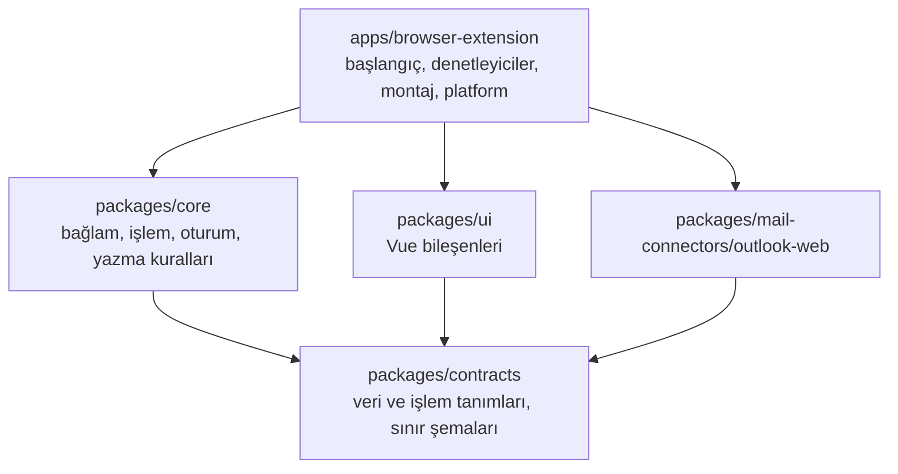

# Geliştirici rehberi

İlgili belgeler: [Proje planı](../PROJE_PLANI.md) · [İmplementasyon detayları](../implementation_details.md) · [Outlook doğrulama](./outlook-web-dogrulama.md) · [Tarayıcı matrisi](../tests/manual/browser-matrix.md) · [Yapılan işler](../YAPILAN_ISLER.md)

AI bağlantısının güncel kurulumu, veri akışı ve sınırları: [ChatGPT / OpenAI rehberi](./AI_BAGLANTISI.md).

## Gereksinimler

| Araç | Sürüm | Not |
| --- | --- | --- |
| Node.js | ≥ 22 | Geliştirme v22.23 ile yapıldı |
| pnpm | 12.x | `npm install -g pnpm@12` veya `corepack enable` |
| Firefox | ≥ 140 | Manifestteki en düşük sürüm (yerleşik veri paylaşımı beyanı) |
| Chrome / Edge / Brave | Güncel | En düşük sürüm gerçek test matrisiyle belirlenecek |

```sh
pnpm install                 # bağımlılıklar + WXT tip üretimi (postinstall)
npx playwright install chromium   # yalnızca tarayıcı testleri için, bir kez
```

## Komutlar

| Komut | Ne yapar |
| --- | --- |
| `pnpm dev` | Chromium geliştirme derlemesi; tarayıcıyı eklentiyle açar, değişiklikte yeniden yükler |
| `pnpm dev:firefox` | Aynısı Firefox için (Manifest V3) |
| `pnpm build` | Yerel AI uygulaması ve normal (üretim) paketleri: `.output/chrome-mv3`, `.output/firefox-mv3` |
| `pnpm ai:build` / `ai:install` | Yerel AI uygulamasını derler / tarayıcıya kaydeder; ayrıntılar AI rehberinde |
| `pnpm build:test` | Test paketleri: yerel örnek sayfa origin'i + etiketli örnek sonuçlar |
| `pnpm typecheck` | Bütün paketler ve testler için TypeScript/vue-tsc |
| `pnpm lint` | ESLint: doğruluk ve **modül sınırı** kuralları |
| `pnpm format` / `format:check` | Prettier |
| `pnpm test` | Vitest: birim, bağlantı sözleşmesi, Outlook bağlantısı, Vue ve denetleyici testleri |
| `pnpm test:e2e` | Playwright + Chromium: test paketini sentetik Outlook sayfasında uçtan uca dener |
| `pnpm test:firefox` | Firefox duman testi (WebDriver BiDi, başsız) |
| `pnpm outlook:dev [--restart]` | Eklentiyi, Outlook oturumu açık olan inceleme Firefox'unda canlı yenilemeyle çalıştırır (WXT geliştirme sunucusu tarayıcı açmadan başlar, derleme BiDi ile geçici eklenti olarak yüklenir). Her derlemeden sonra eklenti diskten baştan yüklenir: WXT'nin içerik betiği yenilemesi Firefox'ta güvenilir değil. Aynı anda ikinci kez çalıştırılamaz; `pnpm dev:firefox` ile de birlikte çalıştırılmaz |
| `pnpm outlook:firefox [--restart]` | Gerçek Outlook incelemesi için kalıcı profilli Firefox'u BiDi açık başlatır (profil: `~/.email-writer/firefox-outlook-profile`) |
| `pnpm outlook:inspect <komut>` | Eklentinin okuma kodunu gerçek Outlook sayfasında çalıştırır; çıktılar maskelidir. Komutlar: `rows`, `open <sıra>`, `read`, `selectors`, `structure` |
| `pnpm lint:firefox` | Mozilla `web-ext lint` ile Firefox paketi denetimi |
| `pnpm verify:packages` | Üretim paketlerinde izin, eşleşme ve geliştirme kodu kontrolü |
| `pnpm check` | typecheck + lint + format + test + build + verify (CI'da çalışacak zincir) |

Tek paket komutu: `pnpm --filter @email-writer/browser-extension exec wxt build -b firefox --mv3`.

## Eklentiyi elle yükleme

- **Chrome / Edge / Brave:** `chrome://extensions` (Edge: `edge://extensions`) → Geliştirici modu → "Paketlenmemiş öğe yükle" → `apps/browser-extension/.output/chrome-mv3` (veya `-test`).
- **Firefox:** `about:debugging#/runtime/this-firefox` → "Geçici eklenti yükle" → `apps/browser-extension/.output/firefox-mv3/manifest.json`.

`pnpm dev` her açılışta geçici bir profil kullanır. Gerçek Outlook hesabıyla geliştirmek için `pnpm outlook:dev` kullanın: Outlook'a kalıcı profilde bir kez giriş yapılır, eklenti her çalıştırmada o pencereye yüklenir.

## Mimari



| Paket | Sorumluluk | Bilemeyeceği şeyler (ESLint ile denetlenir) |
| --- | --- | --- |
| `contracts` | Ortak tipler, `MailConnector` ve `TextProcessor` arayüzleri, Zod sınır şemaları (ayarlar, mesajlar, önizleme) | Vue, WXT, tarayıcı/DOM globalleri, diğer paketler |
| `core` | `buildContext`, `prepareAction`, `reduceSession`, `validateApply/Undo`, yetenek hesaplama. Saf fonksiyonlar; saat ve kimlik dışarıdan verilir | Vue, WXT, Zod, `window`/`document`/`chrome`, UI, Outlook |
| `ui` | Panel bileşenleri; salt okunur görünüm verisi alır, olay yayar. Metinler sözlükten gelir | `core`, Outlook bağlantısı, `chrome`/`browser`/`document` |
| `outlook-web` | Sayfayı tanıma, okuma, seçim, gözlem, kontrollü yazma/geri alma. Bütün seçiciler `discovery/selectors.ts` içinde | Vue, WXT, `core`, UI, eklenti API'leri |
| `browser-extension` | Parçaları birleştirir (`bootstrap/create-extension-session.ts`); tarayıcı API'leri yalnızca `src/platform/` içinde | — |

Ek kurallar (ESLint):
- `innerHTML`/`outerHTML` yazımı yasak; Vue'da `v-html` yasak.
- `document.execCommand` yalnızca `outlook-web/src/writing/editor-writer.ts` içinde.
- Başka paketin `src/` dosyalarına doğrudan erişim yasak; yalnızca paketin dışa aktardığı arayüz kullanılır.
- `console` yasak; tek tanı çıkışı `src/platform/diagnostics.ts` (yalnızca hata kodu ve sayı, geliştirmede).

### Çalışma ortamları

| Ortam | Dosya | Görev |
| --- | --- | --- |
| Content script | `entrypoints/outlook.content.ts` | Outlook bağlantısı, panel oturumu, başlatıcılar. E-posta oturumu ve AI önizlemesi bellekte |
| Arka plan | `entrypoints/background.ts` | Kurulum, ayar okuma/yazma ve native AI mesaj yönlendirmesi. Chrome'da service worker, Firefox'ta background script |
| Araç çubuğu penceresi | `entrypoints/popup/` | Destek durumu, "Bu sayfada paneli aç", ayarlara bağlantı; geliştirmede seçici tanılaması |
| Ayarlar | `entrypoints/options/` | Arayüz dili, varsayılan hedef dil/ton, tema, sitede etkinleştirme |

Ortamlar arası mesajlar (`contracts/src/runtime-messages.ts`): `GET_PAGE_STATUS`, `OPEN_PANEL`, `GET_SELECTOR_REPORT`, `GET_SETTINGS`, `PATCH_SETTINGS`. Her mesaj şema ile doğrulanır; gönderen tarayıcının verdiği bilgiyle kontrol edilir. AI_GENERATE yalnızca kullanıcının üretmek istediği metin/bağlamı taşır; sonuç tamamlanmış düz metin olarak döner. AI_STATUS/AI_COMMAND hesap yönetimi eklenti sayfalarıyla sınırlıdır; AI_SUMMARY içerik betiğine kimlik bilgisi vermez.

### Panel akışı

Aynı oturum iki yüzeyde gösterilir (`PanelSurface`): sağdaki panel ve taslağın yanındaki sonuç kartı. İkisi aynı anda açık olmaz; karttaki "Panelde aç" çalışmayı kaybetmeden panele taşır.

1. **Yazma alanı araç çubuğu** (`ComposeToolbar`): her taslağın görünen bölümünün sağ alt köşesinde yüzer; editör kaydırılan bir kapsayıcıda ekrandan uzunsa da ekranda kalır.
   - Düğmeler: Yanıt yaz (yanıt taslağında) veya Yaz (yeni iletide, `compose` işlemi), Düzelt, Çevir ▾ (dil menüsü), panel.
   - Taslağın yanıt olduğunu alıntı (`#divRplyFwdMsg` vb.) veya bir konuşmanın altında açılmış olması gösterir. Seçili mesaj görünümünde "Reply" okuma bölmesini editöre çevirdiğinde konuşma park edilir (`discovery/track-active-thread.ts`); bağlam geçmişten gelir.
   - Düzelt ve Çevir işlemi doğrudan yapar (`PanelController.runQuickAction`): önce seçim, yoksa güvenle ayrılmış gövde kaynak olur; ardından sonuç hazırlanır ve kartta (`InlineAssistant`) gösterilir.
   - Yanıt yaz kartı talimat bekler; bağlam önceden okunur.
2. **Okuma bölmesi düğmesi** ("Yanıt hazırla"): paneli yanıt modunda açar.
3. Panel veya kart kendiliğinden açılmaz. E-posta açmak işlem başlatmaz; yalnızca okunan mesaj geçmişine eklenir (aşağıda).
4. `prepareAction` değişmez bir işlem kaydı üretir. Sonucu `TextProcessor` verir. Normal/geliştirme derlemelerinde yerel AI bağlantısı, yalnızca test derlemesinde örnek sonuç kaynağı kullanılır.
5. Önizleme elle düzenlenebilir. "Taslağa uygula" önce `core/editing/validate-apply.ts`, sonra bağlantının DOM kontrollerinden geçer. Yazma bir kez yapılır ve doğrulanır.
6. "Son uygulamayı geri al", yalnızca araya başka düzenleme girmediyse çalışır.

**E-postalar arasında geçiş:** Oturum, kullanıcının o an baktığı e-postaya aittir (`PanelController` içindeki `followThread`).
- Başka bir e-postaya geçilince veya başka bir konuşmanın taslağındaki düğmeye basılınca oturum o konuşmayla yeniden başlar; kullanıcıdan onay istenmez.
- Panel açıksa yeni bağlam kendiliğinden okunur; sonuç kartı açıksa kapanır.
- Seçili mesaj görünümünde "Reply" konuşma değişikliği sayılmaz (park etme).
- Yalnızca bir konuşmaya bağlı olmayan çalışma (yeni ileti) başka e-posta açılınca korunur.

### Bağlam ve okunan mesaj geçmişi

- `controllers/message-history.ts`, kullanıcının açtığı her mesajı sayfa oturumu boyunca bellekte tutar.
  - Okuma bölmesi yalnızca seçili mesajı gösterdiğinde, aynı konuşmanın önceki mesajlarına başka yoldan ulaşılamaz.
  - Geçmiş kalıcı saklanmaz; yalnızca üretim için seçilen bağlam OpenAI’a gönderilir. Hesap değişince silinir ve en fazla 40 mesaj tutar.
- `core/context/message-history.ts` (saf fonksiyonlar):
  - Aynı konuşmadan veya aynı konudan (`RE:`/`FW:`/`YNT:`/`İLT:` önekleri yok sayılarak) okunan mesajlar **ilişkili** sayılır ve bağlama varsayılan olarak girer.
  - Başka konuşmalardan okunanlar panelde "Diğer açılan e-postalar" altında seçilmemiş durur.
- Seçim istisna olarak tutulur (`ContextSelection { included, excluded }`). Böylece sonradan açılan ilgili mesajlar da kendiliğinden bağlama girer; kullanıcının çıkardıkları çıkarılmış kalır.
- Bağlamdaki mesaj metni panelde düzenlenebilir (`ContextEdit`). Orijinal e-posta değişmez; "Orijinale dön" düzenlemeyi kaldırır.
- Kullanıcı bir sonuç üzerinde çalışmıyorsa arka planda okunan yeni içerik bağlamı sessizce yeniler (`thread-refreshed`). Önizleme varken önizleme korunur ve "bağlam eskidi" uyarısı gösterilir.

### Görünüm

- Arayüz Fluent UI v9 tasarım diline uyumludur (`packages/ui/src/styles/`: `tokens.css`, `base.css`, `writer-panel.css`, `context.css`, `compose.css`).
- Tema ayarı "Otomatik" (`system`) ise Outlook'un o anki renkleri sayfadan okunur ve eklenti onlarla görünür (`MailPageProvider.readTheme`, `mounting/appearance.ts`). Böylece açık/koyu mod ve vurgu rengi takip edilir; okunamazsa işletim sistemi tercihi kullanılır.
- Gölge kök konumu: WXT gölge kökün dış elemanına `all: initial !important` uygular. Bu yüzden yüzen düğmelerin konumu dış elemana değil, gölge kökün içindeki kapsayıcıya verilir.

## Yeni bir modül eklemek

**Yeni e-posta hizmeti (ör. Gmail Web):**
1. `packages/mail-connectors/gmail-web/` paketi: `MailConnector` arayüzünü uygular. Seçiciler kendi `selectors.ts` dosyasında tutulur.
2. `tests/contracts/mail-connector.contract.ts` içindeki ortak sözleşme testlerini kendi örnek sayfasıyla çalıştırır.
3. `entrypoints/gmail.content.ts` bir `MailPageProvider` oluşturup `createExtensionSession` çağırır. `contracts/settings.ts` içindeki `SITE_IDS` listesine eklenir.
4. Panel, bağlam kuralları, önizleme ve yazma kuralları yeniden yazılmaz.

**AI / metin işleme bağlantısı:**
İlk bağlantı `packages/ai-openai` ve `apps/ai-companion` içinde geliştirildi. Yeni sağlayıcılar aynı TextProcessor ve AiInput sınırını kullanabilir.

1. `contracts/src/text-processor.ts` içindeki `TextProcessor` arayüzünü uygulayan ayrı bir modül yazılır.
2. Content script'te `loadTextProcessor()` bu modülü döndürür.
3. Firefox'un veri paylaşımı beyanı (`wxt.config.ts` → `data_collection_permissions`) gerçek veri akışına göre **güncellenmek zorundadır**.
4. `ui`, `core` ve bağlantı modülleri değişmez.

## Testler

| Katman | Yer | Araç |
| --- | --- | --- |
| Ortak iş kuralları | `tests/unit/` | Vitest (node) |
| Bağlantı sözleşmesi | `tests/contracts/mail-connector.contract.ts` | Her e-posta bağlantısı çalıştırır |
| Outlook bağlantısı | `tests/integration/outlook-web/` + `tests/fixtures/outlook/` | Vitest + jsdom; sentetik örnek sayfa ve gerçek yapının anonim örnekleri |
| Vue arayüzü | `tests/integration/ui/` | Vue Test Utils |
| Denetleyiciler, platform | `tests/integration/extension/` | Vitest + sahte bağlantı |
| Chromium eklentisi | `tests/e2e/extension-chromium/` | Playwright, test paketi |
| Firefox eklentisi | `tests/e2e/extension-firefox/run-smoke.mjs` | WebDriver BiDi |
| Gerçek Outlook incelemesi (elle) | `tests/manual/outlook-live/` | WebDriver BiDi + kalıcı Firefox profili |

Firefox başlatma ve BiDi bağlantısı `tests/support/firefox/` içinde ortaktır. macOS'ta Firefox, uygulama olarak `open` ile başlatılır. Terminalden doğrudan başlatılan Firefox'u macOS gizlilik koruması terminalin izinleriyle değerlendirir. Terminalin diğer uygulamaların verilerine erişim izni yoksa Firefox kendi veri klasörünü okuyamaz ve "Profile Missing" hatası verir. Aynı nedenle `pnpm dev:firefox` (web-ext) macOS'ta terminale Tam Disk Erişimi verilmeden açılmayabilir.

jsdom'da `execCommand` bulunmadığı için Outlook bağlantısı testleri DOM işlemleriyle çalışan bir test yazıcısı kullanır. Bağlantının ön kontrol ve sonradan doğrulama kuralları aynen çalışır. Gerçek `execCommand` yazıcısı Chromium ve Firefox tarayıcı testlerinde sınanır.

**Sentetik örnek sayfa testleri gerçek Outlook'un doğrulandığı anlamına gelmez.** Gerçek sayfa kontrolleri `docs/outlook-web-dogrulama.md` içinde.

## Gizlilik ve güvenlik kuralları (özet)

- E-posta içeriği, bağlam, önizleme ve geri alma verisi kalıcı saklanmaz. Üretimde seçili metin background/companion belleğinden geçer ve OpenAI’a iletilir. Ayarlar `storage.local` içinde, tek sürümlü kayıt olarak tutulur.
- Kullanıcı üretim istediğinde seçili metin OpenAI’a gönderilir. Analitik ve hata toplama hizmeti yoktur. OAuth token’ları tarayıcı depolamasında bulunmaz; credential dosyası yerel uygulamanın kullanıcı dizinindedir.
- Kayıtlarda e-posta gövdesi, konu, adres, kaynak metin, önizleme veya tam URL bulunmaz.
- Gelen e-posta güvenilmeyen veridir: HTML çalıştırılmaz, bağlantı/görsel açılmaz, içindeki talimatlar komut sayılmaz.
- İzinler: `storage`, `nativeMessaging` ve desteklenen Outlook adreslerine statik content script eşleşmeleri. Firefox veri paylaşımı beyanı AI akışını içerir.

## Bilinen sınırlar ve bekleyen kararlar

| Konu | Durum |
| --- | --- |
| Gerçek Outlook doğrulaması | Okuma tarafı kısmen yapıldı (15 Ekim 2026; iş hesabı, İngilizce, Firefox, seçili mesaj görünümü). Konuşma görünümü, taslak ve yazma kontrolleri bekliyor. Ayrıntı: `docs/outlook-web-dogrulama.md` §3 |
| Firefox eklenti kimliği | Geçici değer `email-writer@example.invalid`. **AMO kaydından önce kalıcı kimlik seçilmeli**; sonradan değiştirmek güncellemeleri koparır |
| Eklenti simgeleri | Henüz yok (tarayıcı varsayılan simgeyi gösterir). Mağaza öncesi `apps/browser-extension/public/icon/` altına 16/32/48/128 px eklenmeli |
| `web-ext lint` uyarıları | 0 hata, 5 uyarı. Hepsi kütüphane kodundan: Zod'un `eval` desteği yoklaması (çalışma zamanında kapalı, `jitless`) ve Vue çalışma zamanının `innerHTML` yolu. Mağaza incelemesi için açıklama hazırlanmalı |
| Geri alma biçimi | Geri alma önceki metni **düz metin** olarak getirir; değişen bölümdeki kalın/bağlantı gibi biçimler geri gelmez. Panel bunu belirtir |
| Ayrı pencerede taslak, iframe editörler | Desteklenmiyor (`all_frames` kapalı) |
| Paket boyutu | Content script ~270 kB (Vue + Zod dahil, sıkıştırılmamış) |
| Eklenti güncellemesi | Eski content script temizlenir. Sekme yenilenene kadar araç çubuğu penceresi "ulaşılamıyor, sayfayı yenileyin" der |
