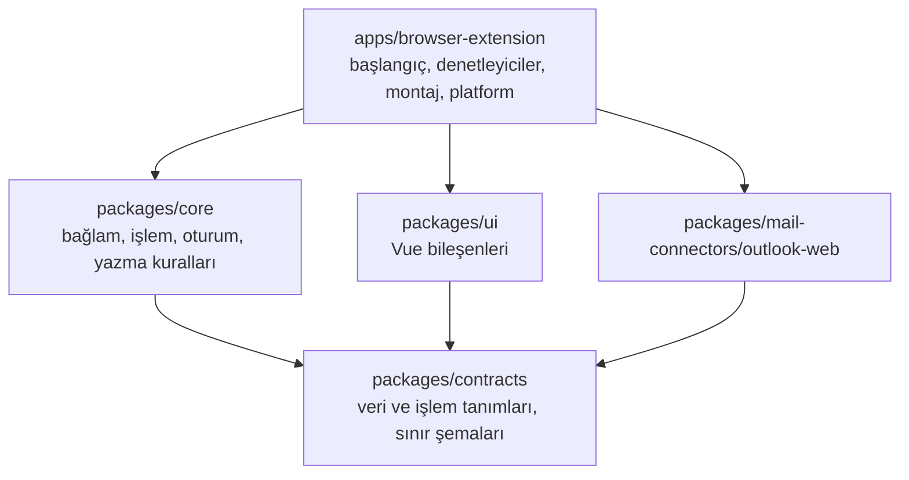

# Geliştirici rehberi

İlgili belgeler: [Proje planı](../PROJE_PLANI.md) · [İmplementasyon detayları](../implementation_details.md) · [Outlook doğrulama](./outlook-web-dogrulama.md) · [Tarayıcı matrisi](../tests/manual/browser-matrix.md) · [Yapılan işler](../YAPILAN_ISLER.md)

## Gereksinimler

| Araç | Sürüm | Not |
| --- | --- | --- |
| Node.js | ≥ 22 | Geliştirme v22.23 ile yapıldı |
| pnpm | 12.x | `npm install -g pnpm@12` veya `corepack enable` |
| Firefox | ≥ 140 | Manifestteki en düşük sürüm (yerleşik veri paylaşımı beyanı) |
| Chrome / Edge / Brave | Güncel | En düşük sürüm gerçek test matrisiyle belirlenecek |

```sh
pnpm install                 # bağımlılıklar + WXT tip üretimi (postinstall)
npx playwright install chromium   # yalnızca tarayıcı testleri için, bir kez
```

## Komutlar

| Komut | Ne yapar |
| --- | --- |
| `pnpm dev` | Chromium geliştirme derlemesi; tarayıcıyı eklentiyle açar, değişiklikte yeniden yükler |
| `pnpm dev:firefox` | Aynısı Firefox için (Manifest V3) |
| `pnpm build` | Normal (üretim) paketleri: `.output/chrome-mv3`, `.output/firefox-mv3` |
| `pnpm build:test` | Test paketleri: yerel örnek sayfa origin'i + etiketli örnek sonuçlar |
| `pnpm typecheck` | Bütün paketler ve testler için TypeScript/vue-tsc |
| `pnpm lint` | ESLint: doğruluk ve **modül sınırı** kuralları |
| `pnpm format` / `format:check` | Prettier |
| `pnpm test` | Vitest: birim, bağlantı sözleşmesi, Outlook bağlantısı, Vue ve denetleyici testleri |
| `pnpm test:e2e` | Playwright + Chromium: test paketini sentetik Outlook sayfasında uçtan uca dener |
| `pnpm test:firefox` | Firefox duman testi (WebDriver BiDi, başsız) |
| `pnpm lint:firefox` | Mozilla `web-ext lint` ile Firefox paketi denetimi |
| `pnpm verify:packages` | Üretim paketlerinde izin, eşleşme ve geliştirme kodu kontrolü |
| `pnpm check` | typecheck + lint + format + test + build + verify (CI'da çalışacak zincir) |

Tek paket komutu: `pnpm --filter @email-writer/browser-extension exec wxt build -b firefox --mv3`.

## Eklentiyi elle yükleme

- **Chrome / Edge / Brave:** `chrome://extensions` (Edge: `edge://extensions`) → Geliştirici modu → "Paketlenmemiş öğe yükle" → `apps/browser-extension/.output/chrome-mv3` (veya `-test`).
- **Firefox:** `about:debugging#/runtime/this-firefox` → "Geçici eklenti yükle" → `apps/browser-extension/.output/firefox-mv3/manifest.json`.

`pnpm dev` her açılışta geçici bir profil kullanır. Outlook oturumunu korumak için `docs/outlook-web-dogrulama.md` §2.1'deki `web-ext.config.ts` örneğine bakın.

## Mimari



| Paket | Sorumluluk | Bilemeyeceği şeyler (ESLint ile denetlenir) |
| --- | --- | --- |
| `contracts` | Ortak tipler, `MailConnector` ve `TextProcessor` arayüzleri, Zod sınır şemaları (ayarlar, mesajlar, önizleme) | Vue, WXT, tarayıcı/DOM globalleri, diğer paketler |
| `core` | `buildContext`, `prepareAction`, `reduceSession`, `validateApply/Undo`, yetenek hesaplama. Saf fonksiyonlar; saat ve kimlik dışarıdan verilir | Vue, WXT, Zod, `window`/`document`/`chrome`, UI, Outlook |
| `ui` | Panel bileşenleri; salt okunur görünüm verisi alır, olay yayar. Metinler sözlükten gelir | `core`, Outlook bağlantısı, `chrome`/`browser`/`document` |
| `outlook-web` | Sayfayı tanıma, okuma, seçim, gözlem, kontrollü yazma/geri alma. Bütün seçiciler `discovery/selectors.ts` içinde | Vue, WXT, `core`, UI, eklenti API'leri |
| `browser-extension` | Parçaları birleştirir (`bootstrap/create-extension-session.ts`); tarayıcı API'leri yalnızca `src/platform/` içinde | — |

Ek kurallar (ESLint):
- `innerHTML`/`outerHTML` yazımı yasak; Vue'da `v-html` yasak.
- `document.execCommand` yalnızca `outlook-web/src/writing/editor-writer.ts` içinde.
- Başka paketin `src/` dosyalarına doğrudan erişim yasak; yalnızca paketin dışa aktardığı arayüz kullanılır.
- `console` yasak; tek tanı çıkışı `src/platform/diagnostics.ts` (yalnızca hata kodu ve sayı, geliştirmede).

### Çalışma ortamları

| Ortam | Dosya | Görev |
| --- | --- | --- |
| Content script | `entrypoints/outlook.content.ts` | Outlook bağlantısı, panel oturumu, başlatıcılar. E-posta metinleri yalnızca burada, bellekte |
| Arka plan | `entrypoints/background.ts` | Kurulum, ayar okuma/yazma (sıralı). Chrome'da service worker, Firefox'ta background script |
| Araç çubuğu penceresi | `entrypoints/popup/` | Destek durumu, "Bu sayfada paneli aç", ayarlara bağlantı; geliştirmede seçici tanılaması |
| Ayarlar | `entrypoints/options/` | Arayüz dili, varsayılan hedef dil/ton, tema, sitede etkinleştirme |

Ortamlar arası mesajlar (`contracts/src/runtime-messages.ts`): `GET_PAGE_STATUS`, `OPEN_PANEL`, `GET_SELECTOR_REPORT`, `GET_SETTINGS`, `PATCH_SETTINGS`. Her mesaj şema ile doğrulanır; gönderen tarayıcının verdiği bilgiyle kontrol edilir. E-posta ve önizleme içeriği bu protokolde taşınmaz.

### Panel akışı

1. Kullanıcı başlatıcıya basar. Panel kendiliğinden açılmaz; e-posta açmak okuma başlatmaz.
2. Taslak düğmesinde önce seçim, yoksa güvenle ayrılmış gövde kaynak olur. Konuşma düğmesinde yanıt modu açılır ve açık mesajlar okunur.
3. `prepareAction` değişmez bir işlem kaydı üretir. Sonucu `TextProcessor` verir. Bu aşamada yalnızca geliştirme derlemesinde etiketli örnek sonuç kaynağı vardır; normal derlemede düğme nedenini açıklar.
4. Önizleme elle düzenlenebilir. "Taslağa uygula" önce `core/editing/validate-apply.ts`, sonra bağlantının DOM kontrollerinden geçer. Yazma bir kez yapılır ve doğrulanır.
5. "Son uygulamayı geri al", yalnızca araya başka düzenleme girmediyse çalışır.

## Yeni bir modül eklemek

**Yeni e-posta hizmeti (ör. Gmail Web):**
1. `packages/mail-connectors/gmail-web/` paketi: `MailConnector` arayüzünü uygular. Seçiciler kendi `selectors.ts` dosyasında tutulur.
2. `tests/contracts/mail-connector.contract.ts` içindeki ortak sözleşme testlerini kendi örnek sayfasıyla çalıştırır.
3. `entrypoints/gmail.content.ts` bir `MailPageProvider` oluşturup `createExtensionSession` çağırır. `contracts/settings.ts` içindeki `SITE_IDS` listesine eklenir.
4. Panel, bağlam kuralları, önizleme ve yazma kuralları yeniden yazılmaz.

**AI / metin işleme bağlantısı (sonraki aşama):**
1. `contracts/src/text-processor.ts` içindeki `TextProcessor` arayüzünü uygulayan ayrı bir modül yazılır.
2. Content script'te `loadTextProcessor()` bu modülü döndürür.
3. Firefox'un veri paylaşımı beyanı (`wxt.config.ts` → `data_collection_permissions`) gerçek veri akışına göre **güncellenmek zorundadır**.
4. `ui`, `core` ve bağlantı modülleri değişmez.

## Testler

| Katman | Yer | Araç |
| --- | --- | --- |
| Ortak iş kuralları | `tests/unit/` | Vitest (node) |
| Bağlantı sözleşmesi | `tests/contracts/mail-connector.contract.ts` | Her e-posta bağlantısı çalıştırır |
| Outlook bağlantısı | `tests/integration/outlook-web/` + `tests/fixtures/outlook/` | Vitest + jsdom, sentetik örnek sayfa |
| Vue arayüzü | `tests/integration/ui/` | Vue Test Utils |
| Denetleyiciler, platform | `tests/integration/extension/` | Vitest + sahte bağlantı |
| Chromium eklentisi | `tests/e2e/extension-chromium/` | Playwright, test paketi |
| Firefox eklentisi | `tests/e2e/extension-firefox/run-smoke.mjs` | WebDriver BiDi |

jsdom'da `execCommand` bulunmadığı için Outlook bağlantısı testleri DOM işlemleriyle çalışan bir test yazıcısı kullanır. Bağlantının ön kontrol ve sonradan doğrulama kuralları aynen çalışır. Gerçek `execCommand` yazıcısı Chromium ve Firefox tarayıcı testlerinde sınanır.

**Sentetik örnek sayfa testleri gerçek Outlook'un doğrulandığı anlamına gelmez.** Gerçek sayfa kontrolleri `docs/outlook-web-dogrulama.md` içinde.

## Gizlilik ve güvenlik kuralları (özet)

- E-posta içeriği, bağlam, önizleme ve geri alma verisi kalıcı saklanmaz. Yalnızca content script belleğinde, sayfa ömrü boyunca kalır. Ayarlar `storage.local` içinde, tek sürümlü kayıt olarak tutulur.
- Bu aşamada hiçbir veri harici bir servise gönderilmez. Analitik ve hata toplama hizmeti yoktur.
- Kayıtlarda e-posta gövdesi, konu, adres, kaynak metin, önizleme veya tam URL bulunmaz.
- Gelen e-posta güvenilmeyen veridir: HTML çalıştırılmaz, bağlantı/görsel açılmaz, içindeki talimatlar komut sayılmaz.
- İzinler: yalnızca `storage` ve desteklenen Outlook adreslerine statik content script eşleşmeleri.

## Bilinen sınırlar ve bekleyen kararlar

| Konu | Durum |
| --- | --- |
| Gerçek Outlook doğrulaması | Yapılmadı; giriş gerektiriyor. Protokol: `docs/outlook-web-dogrulama.md` |
| Firefox eklenti kimliği | Geçici değer `email-writer@example.invalid`. **AMO kaydından önce kalıcı kimlik seçilmeli**; sonradan değiştirmek güncellemeleri koparır |
| Eklenti simgeleri | Henüz yok (tarayıcı varsayılan simgeyi gösterir). Mağaza öncesi `apps/browser-extension/public/icon/` altına 16/32/48/128 px eklenmeli |
| `web-ext lint` uyarıları | 0 hata, 5 uyarı. Hepsi kütüphane kodundan: Zod'un `eval` desteği yoklaması (çalışma zamanında kapalı, `jitless`) ve Vue çalışma zamanının `innerHTML` yolu. Mağaza incelemesi için açıklama hazırlanmalı |
| Geri alma biçimi | Geri alma önceki metni **düz metin** olarak getirir; değişen bölümdeki kalın/bağlantı gibi biçimler geri gelmez. Panel bunu belirtir |
| Ayrı pencerede taslak, iframe editörler | Desteklenmiyor (`all_frames` kapalı) |
| Paket boyutu | Content script ~270 kB (Vue + Zod dahil, sıkıştırılmamış) |
| Eklenti güncellemesi | Eski content script temizlenir. Sekme yenilenene kadar araç çubuğu penceresi "ulaşılamıyor, sayfayı yenileyin" der |
