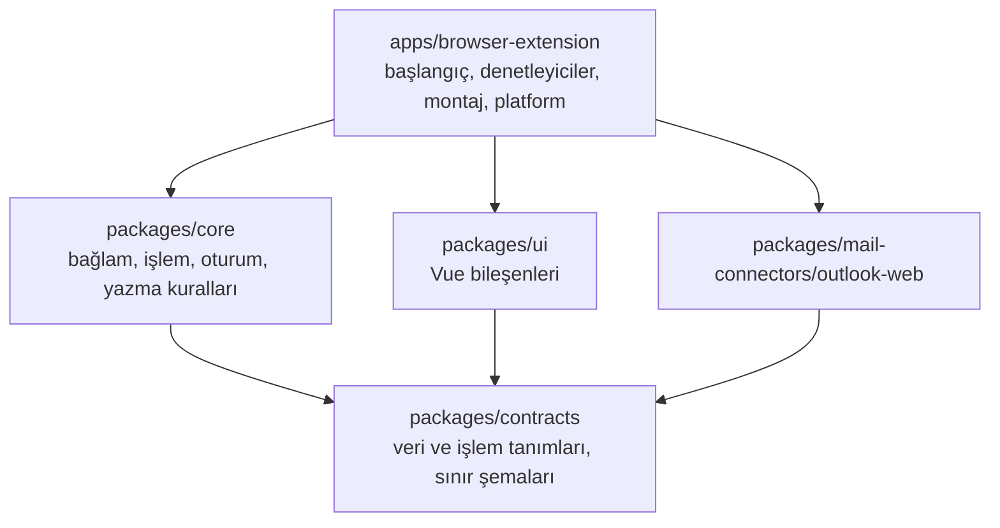

# Geliştirici rehberi

İlgili belgeler: [Proje planı](../PROJE_PLANI.md) · [İmplementasyon detayları](../implementation_details.md) · [Outlook doğrulama](./outlook-web-dogrulama.md) · [Tarayıcı matrisi](../tests/manual/browser-matrix.md) · [Yapılan işler](../YAPILAN_ISLER.md)

AI bağlantısının güncel kurulumu, veri akışı ve sınırları: [AI bağlantısı rehberi (ChatGPT, OpenAI API, Claude Code)](./AI_BAGLANTISI.md).

## Gereksinimler

| Araç | Sürüm | Not |
| --- | --- | --- |
| Node.js | ≥ 22 | Geliştirme v22.23 ile yapıldı. Tek dosyalık yardımcı uygulama Node.js 24 LTS ile derlenir (`pnpm ai:sea`) |
| pnpm | 12.x | `npm install -g pnpm@12` veya `corepack enable` |
| Firefox | ≥ 140 | Manifestteki en düşük sürüm (yerleşik veri paylaşımı beyanı) |
| Chrome / Edge / Brave | Güncel | En düşük sürüm gerçek test matrisiyle belirlenecek |

```sh
pnpm install                 # bağımlılıklar + WXT tip üretimi (postinstall)
npx playwright install chromium   # yalnızca tarayıcı testleri için, bir kez
```

## Komutlar

| Komut | Ne yapar |
| --- | --- |
| `pnpm dev` | Chromium geliştirme derlemesi; tarayıcıyı eklentiyle açar, değişiklikte yeniden yükler |
| `pnpm dev:firefox` | Aynısı Firefox için (Manifest V3) |
| `pnpm build` | Yardımcı uygulamanın Node.js derlemesi ve normal (üretim) paketleri: `.output/chrome-mv3`, `.output/firefox-mv3` |
| `pnpm ai:build` | Yardımcı uygulamayı tek Node.js betiği olarak derler (`apps/ai-companion/dist/cli.mjs`) |
| `pnpm ai:install [--extension-id=ID]` | Bu derlemeyi geliştirme kurulumu olarak bütün tarayıcılara kaydeder (`cli.mjs install --dev`); ayrıntılar AI rehberinde |
| `pnpm ai:sea` | Tek dosyalık yardımcı uygulama ve sürüm arşivi (`dist/release/writehand-<sistem>-<mimari>.*`); Node.js 24 ile ve hedef sistemde çalıştırılır |
| `pnpm release:version <x.y.z>` | Kök `package.json` sürümünü günceller ve `CHANGELOG.md`'de sürüm başlığı açar (bkz. "Sürümleme ve yayın") |
| `pnpm build:test` | Test paketleri: yerel örnek sayfa origin'i + etiketli örnek sonuçlar |
| `pnpm typecheck` | Bütün paketler ve testler için TypeScript/vue-tsc |
| `pnpm lint` | ESLint: doğruluk ve **modül sınırı** kuralları |
| `pnpm format` / `format:check` | Prettier |
| `pnpm test` | Vitest: birim, bağlantı sözleşmesi, Outlook bağlantısı, Vue ve denetleyici testleri |
| `pnpm test:e2e` | Playwright + Chromium: test paketini sentetik Outlook sayfasında uçtan uca dener |
| `pnpm test:firefox` | Firefox duman testi (WebDriver BiDi, başsız) |
| `pnpm outlook:dev [--restart]` | Eklentiyi, Outlook oturumu açık olan inceleme Firefox'unda canlı yenilemeyle çalıştırır (WXT geliştirme sunucusu tarayıcı açmadan başlar, derleme BiDi ile geçici eklenti olarak yüklenir). Her derlemeden sonra eklenti diskten baştan yüklenir: WXT'nin içerik betiği yenilemesi Firefox'ta güvenilir değil. Aynı anda ikinci kez çalıştırılamaz; `pnpm dev:firefox` ile de birlikte çalıştırılmaz |
| `pnpm outlook:firefox [--restart]` | Gerçek Outlook incelemesi için kalıcı profilli Firefox'u BiDi açık başlatır (profil: `~/.email-writer/firefox-outlook-profile`) |
| `pnpm outlook:inspect <komut>` | Eklentinin okuma kodunu gerçek Outlook sayfasında çalıştırır; çıktılar maskelidir. Komutlar: `rows`, `open <sıra>`, `read`, `selectors`, `structure` |
| `pnpm lint:firefox` | Mozilla `web-ext lint` ile Firefox paketi denetimi |
| `pnpm verify:packages` | Üretim paketlerinde izin, eşleşme ve geliştirme kodu kontrolü |
| `pnpm check` | typecheck + lint + format + test + build + verify (CI'da üç sistemde çalışan zincir) |

Tek paket komutu: `pnpm --filter @email-writer/browser-extension exec wxt build -b firefox --mv3`.

## Eklentiyi elle yükleme

- **Chrome / Edge / Brave:** `chrome://extensions` (Edge: `edge://extensions`) → Geliştirici modu → "Paketlenmemiş öğe yükle" → `apps/browser-extension/.output/chrome-mv3` (veya `-test`).
- **Firefox:** `about:debugging#/runtime/this-firefox` → "Geçici eklenti yükle" → `apps/browser-extension/.output/firefox-mv3/manifest.json`.

`pnpm dev` her açılışta geçici bir profil kullanır. Gerçek Outlook hesabıyla geliştirmek için `pnpm outlook:dev` kullanın: Outlook'a kalıcı profilde bir kez giriş yapılır, eklenti her çalıştırmada o pencereye yüklenir.

## Windows'ta geliştirme

16 Ekim 2026'da Windows 11 Pro (Node.js 24, pnpm 12.11, Chrome 155, Edge 155, Firefox 157) üzerinde `pnpm check`, `pnpm test:e2e` ve `pnpm test:firefox` geçti.

- **Kurulum:** Node.js 22+ ve Git for Windows. `corepack enable` `Program Files\nodejs` içine yazmak için yönetici izni ister; bunun yerine `npm install -g pnpm@12` kullanılabilir. Ardından `pnpm install` ve `npx playwright install chromium`.
- **Kabuk:** Komutlar PowerShell'de ve Git Bash'te aynıdır. Windows PowerShell 5.1, pnpm'in stderr'e yazdığı satırları kırmızı `NativeCommandError` olarak gösterebilir; sonucu çıkış kodu belirler.
- **Satır sonları:** `.gitattributes` bütün metin dosyalarında LF'yi zorunlu kılar; `core.autocrlf` ayarına gerek yoktur.
- **Testler:** Birkaç birim testi yalnızca macOS/Linux'ta çalışır (çalıştırma izni, sh başlatıcısı, gerçek `tar` ile güncelleme akışı), Windows'ta atlanır. Windows'a özgü testler (kimlik klasörünün ACL'i ve geliştirme `.cmd` başlatıcısının `cmd.exe` ile `ş`, boşluk, `&`, `%` içeren bir klasörden başlatılması) yalnızca Windows'ta çalışır. Her işletim sisteminin kurulum planı her makinede sınanır (`tests/unit/ai-companion-install.test.ts`); tek dosyalık programın Windows'ta kurulması, kaldırılması ve kayıt defteri CI'daki Windows koşucusunda denenir.
- **Firefox testleri:** Firefox PATH'te değil `%ProgramFiles%`, `%ProgramFiles(x86)%` ve `%LOCALAPPDATA%` altındaki `Mozilla Firefox\firefox.exe` olarak aranır; `FIREFOX_BIN` ile değiştirilebilir. Bir profile ait Firefox, `pkill` yerine PowerShell (`Get-CimInstance`) ile kapatılır.
- **Chrome'da paketlenmemiş eklenti:** Chrome 137 ve sonrası `--load-extension` bayrağını yok sayar (Chrome 155'te doğrulandı). Elle yükleme `chrome://extensions` üzerinden yapılır. Otomasyonda Playwright `launchPersistentContext` (Chrome'un yolu, `--enable-unsafe-extension-debugging`) ve CDP `Extensions.loadUnpacked` kullanılabilir. Playwright testleri Chromium kullandığı için etkilenmez; Edge, Brave ve Opera bayrağı hâlâ kabul eder.
- **Eklenti kimliği:** Paketlenmemiş eklentinin kimliği klasör yolundan türetilir; Windows'ta macOS'takinden farklıdır. Kurucuya kendi kimliğinizi verin.
- **Windows araçları:** `reg`, `icacls`, `whoami` ve `rundll32` her zaman `%SystemRoot%\System32` altındaki tam yolla çağrılır. Git Bash PATH'te kendi `whoami` programını öne koyar.
- **Toplu iş dosyaları:** `cmd.exe` `.cmd` dosyalarını konsol kod sayfasıyla (ör. 437) okur. Geliştirme kurulumunun başlatıcısı bu yüzden UTF-8 yazılır ve `chcp 65001 >nul` ile başlar. Sürüm kurulumunda başlatıcı yoktur; manifest `writehand.exe`'yi gösterir.
- **Kayıt defteri:** Kurulumdan sonra `reg query "HKCU\Software\Google\Chrome\NativeMessagingHosts\com.dervisgenc.writehand"` manifest yolunu göstermelidir. Ayrıntılar ve tarayıcı başına anahtarlar: [AI bağlantısı rehberi](./AI_BAGLANTISI.md#windowsta-kurulum).

## Mimari



| Paket | Sorumluluk | Bilemeyeceği şeyler (ESLint ile denetlenir) |
| --- | --- | --- |
| `contracts` | Ortak tipler, `MailConnector` ve `TextProcessor` arayüzleri, Zod sınır şemaları (ayarlar, mesajlar, önizleme) | Vue, WXT, tarayıcı/DOM globalleri, diğer paketler |
| `core` | `buildContext`, `prepareAction`, `reduceSession`, `validateApply/Undo`, yetenek hesaplama. Saf fonksiyonlar; saat ve kimlik dışarıdan verilir | Vue, WXT, Zod, `window`/`document`/`chrome`, UI, Outlook |
| `ui` | Panel bileşenleri; salt okunur görünüm verisi alır, olay yayar. Metinler sözlükten gelir | `core`, Outlook bağlantısı, `chrome`/`browser`/`document` |
| `outlook-web` | Sayfayı tanıma, okuma, seçim, gözlem, kontrollü yazma/geri alma. Bütün seçiciler `discovery/selectors.ts` içinde | Vue, WXT, `core`, UI, eklenti API'leri |
| `email-format` | Modelin Markdown alt kümesini ayrıştırma; e-postaya uygun HTML, düz metin ve taslaktan geri okunacak metin üretme (saf fonksiyonlar) | Vue, WXT, tarayıcı API'leri, diğer iç paketler (yalnızca Zod kullanır) |
| `browser-extension` | Parçaları birleştirir (`bootstrap/create-extension-session.ts`); tarayıcı API'leri yalnızca `src/platform/` içinde | — |

Ek kurallar (ESLint):
- `innerHTML`/`outerHTML` yazımı yasak; Vue'da `v-html` yasak. Tek istisna `ui/src/components/RichPreview.vue`: HTML yalnızca `email-format`'ın ayrıştırılmış yapıdan, bütün metni kaçışlayarak ürettiği çıktıdır.
- `document.execCommand` yalnızca `outlook-web/src/writing/editor-writer.ts` içinde.
- Başka paketin `src/` dosyalarına doğrudan erişim yasak; yalnızca paketin dışa aktardığı arayüz kullanılır.
- `console` yasak; tek tanı çıkışı `src/platform/diagnostics.ts` (yalnızca hata kodu ve sayı, geliştirmede).

### Çalışma ortamları

| Ortam | Dosya | Görev |
| --- | --- | --- |
| Content script | `entrypoints/outlook.content.ts` | Outlook bağlantısı, panel oturumu, başlatıcılar. E-posta oturumu ve AI önizlemesi bellekte |
| Arka plan | `entrypoints/background.ts` | Kurulum, ayar okuma/yazma ve native AI mesaj yönlendirmesi. Chrome'da service worker, Firefox'ta background script |
| Araç çubuğu penceresi | `entrypoints/popup/` | Destek durumu, "Bu sayfada paneli aç", ayarlara bağlantı; geliştirmede seçici tanılaması |
| Karşılama sihirbazı | `entrypoints/welcome/` | İlk kurulumda açılır (`runtime.onInstalled`); ayarlardan ve araç çubuğu penceresinden yeniden açılır. Neden yardımcı uygulama, tek komutla kurulum (`nativeMessaging` izni burada istenir), yöntem seçimi, uydurma e-postayla deneme |
| Ayarlar | `entrypoints/options/` | Yardımcı uygulama kartı (durum, sürüm, güncelleme, kaldırma), AI bağlantısı, arayüz dili (Otomatik, Türkçe, English, Deutsch, Français, Español), varsayılan ve favori çeviri dilleri, kalıcı yazım talimatı, ton, tema, sitede etkinleştirme. Şema v2; v1 kayıtları taşınır |

Ortamlar arası mesajlar (`contracts/src/runtime-messages.ts`): `GET_PAGE_STATUS`, `OPEN_PANEL`, `GET_SELECTOR_REPORT`, `GET_SETTINGS`, `PATCH_SETTINGS`; yardımcı uygulamaya giden `AI_*` ve `HOST_INFO` / `HOST_UPDATE_CHECK` / `HOST_UPDATE` (yalnızca eklenti sayfalarından). Her mesaj şema ile doğrulanır; gönderen tarayıcının verdiği bilgiyle kontrol edilir. AI_GENERATE yalnızca kullanıcının üretmek istediği metin/bağlamı taşır; sonuç tamamlanmış düz metin olarak döner. AI_STATUS/AI_COMMAND hesap yönetimi eklenti sayfalarıyla sınırlıdır; AI_SUMMARY içerik betiğine kimlik bilgisi vermez.

### Panel akışı

Aynı oturum iki yüzeyde gösterilir (`PanelSurface`): sağdaki panel ve taslağın yanındaki sonuç kartı. İkisi aynı anda açık olmaz; karttaki "Panelde aç" çalışmayı kaybetmeden panele taşır.

1. **Yazma alanı araç çubuğu** (`ComposeToolbar`): her taslağın görünen bölümünün sağ alt köşesinde yüzer; editör kaydırılan bir kapsayıcıda ekrandan uzunsa da ekranda kalır.
   - Düğmeler: Yanıt yaz (yanıt taslağında) veya Yaz (yeni iletide, `compose` işlemi), Düzelt, Çevir ▾ (dil menüsü), panel.
   - Taslağın yanıt olduğunu alıntı (`#divRplyFwdMsg` vb.) veya bir konuşmanın altında açılmış olması gösterir. Seçili mesaj görünümünde "Reply" okuma bölmesini editöre çevirdiğinde konuşma park edilir (`discovery/track-active-thread.ts`); bağlam geçmişten gelir.
   - Düzelt ve Çevir işlemi doğrudan yapar (`PanelController.runQuickAction`): önce seçim, yoksa güvenle ayrılmış gövde kaynak olur; ardından sonuç hazırlanır ve kartta (`InlineAssistant`) gösterilir.
   - Yanıt yaz kartı talimat bekler; bağlam önceden okunur.
2. **Okuma bölmesi düğmesi** ("Yanıt hazırla"): paneli yanıt modunda açar.
3. Panel veya kart kendiliğinden açılmaz. E-posta açmak işlem başlatmaz; yalnızca okunan mesaj geçmişine eklenir (aşağıda).
4. `prepareAction` değişmez bir işlem kaydı üretir. Sonucu `TextProcessor` verir. Normal/geliştirme derlemelerinde yerel AI bağlantısı, yalnızca test derlemesinde örnek sonuç kaynağı kullanılır.
5. Önizleme elle düzenlenebilir. "Taslağa uygula" önce `core/editing/validate-apply.ts`, sonra bağlantının DOM kontrollerinden geçer. Yazma bir kez yapılır ve doğrulanır.
6. "Son uygulamayı geri al", yalnızca araya başka düzenleme girmediyse çalışır. Doğrulanmış geri almadan sonra aynı sonuç gövdeye yeniden uygulanabilir; seçim hedefinde yeniden seçim gerekir.
7. **Sonucu değiştir** (`RefineBar`): Tablo yap / Madde madde / Grafik ekle / Kısalt / Daha resmî / Daha samimi veya serbest istek. Form sürümü değişmez; önceki sonuç işlem kaydına `refinement` olarak girer.
8. **Biçimli sonuç:** Önizleme (`RichPreview`) e-postadaki görünümü gösterir; yazma `insertHTML` ile yapılır ve "görünen metin" (liste imleri, ` | ` hücre ayırıcıları) ile doğrulanır. Cümle içindeki seçime biçimli içerik yazılmaz.

**Taslak sürümü ve Outlook'un kendi değişiklikleri:**
- Sürüm (`observe-editor.ts`) yalnızca kullanıcının bölgesindeki metin (boşluklar sadeleştirilmiş) veya tablo/resim sayısı değişince artar. Outlook'un alıntıyı sonradan doldurması, sondaki boş satırı silmesi veya yazılan tabloyu yeniden düzenlemesi çalışmayı geçersiz kılmaz.
- Outlook yanıtı konuşmaya geç bağlayabilir; bağlantı modülü bunu `composer-rebound` olarak bildirir (editör, sürüm, seçim ve geri alma kayıtları korunur). Araç çubuğunun anahtarı konuşma bağını içermez; etiket yerinde değişir.
- Yazmadan önce editöre odak verilip Outlook'un tepkisi beklenir; son kontrol ile yazma arasında bekleme yoktur. Korunan bölge (imza, alıntı) aynı kalmalı ya da yalnızca sonuna içerik eklenmiş olmalıdır.
- Kartın alt bölümü (Kopyala / Taslağa uygula) sabittir; kullanıcı düğmeye basılı tutarken araç çubuğu ve kart yer değiştirmez.

**E-postalar arasında geçiş:** Oturum, kullanıcının o an baktığı e-postaya aittir (`PanelController` içindeki `followThread`).
- Başka bir e-postaya geçilince veya başka bir konuşmanın taslağındaki düğmeye basılınca oturum o konuşmayla yeniden başlar; kullanıcıdan onay istenmez.
- Panel açıksa yeni bağlam kendiliğinden okunur; sonuç kartı açıksa kapanır.
- Seçili mesaj görünümünde "Reply" konuşma değişikliği sayılmaz (park etme).
- Yalnızca bir konuşmaya bağlı olmayan çalışma (yeni ileti) başka e-posta açılınca korunur.

### Bağlam ve okunan mesaj geçmişi

- `controllers/message-history.ts`, kullanıcının açtığı her mesajı sayfa oturumu boyunca bellekte tutar.
  - Okuma bölmesi yalnızca seçili mesajı gösterdiğinde, aynı konuşmanın önceki mesajlarına başka yoldan ulaşılamaz.
  - Geçmiş kalıcı saklanmaz; yalnızca üretim için seçilen bağlam seçili AI sağlayıcısına (OpenAI veya Anthropic) gönderilir. Hesap değişince silinir ve en fazla 40 mesaj tutar.
- `core/context/message-history.ts` (saf fonksiyonlar):
  - Aynı konuşmadan veya aynı konudan (`RE:`/`FW:`/`YNT:`/`İLT:` önekleri yok sayılarak) okunan mesajlar **ilişkili** sayılır ve bağlama varsayılan olarak girer.
  - Başka konuşmalardan okunanlar panelde "Diğer açılan e-postalar" altında seçilmemiş durur.
- Seçim istisna olarak tutulur (`ContextSelection { included, excluded }`). Böylece sonradan açılan ilgili mesajlar da kendiliğinden bağlama girer; kullanıcının çıkardıkları çıkarılmış kalır.
- Bağlamdaki mesaj metni panelde düzenlenebilir (`ContextEdit`). Orijinal e-posta değişmez; "Orijinale dön" düzenlemeyi kaldırır.
- Kullanıcı bir sonuç üzerinde çalışmıyorsa arka planda okunan yeni içerik bağlamı sessizce yeniler (`thread-refreshed`). Önizleme varken önizleme korunur ve "bağlam eskidi" uyarısı gösterilir.

### Görünüm

- Arayüz Fluent UI v9 tasarım diline uyumludur (`packages/ui/src/styles/`: `tokens.css`, `base.css`, `writer-panel.css`, `context.css`, `compose.css`).
- Tema ayarı "Otomatik" (`system`) ise Outlook'un o anki renkleri sayfadan okunur ve eklenti onlarla görünür (`MailPageProvider.readTheme`, `mounting/appearance.ts`). Böylece açık/koyu mod ve vurgu rengi takip edilir; okunamazsa işletim sistemi tercihi kullanılır.
- Gölge kök konumu: WXT gölge kökün dış elemanına `all: initial !important` uygular. Bu yüzden yüzen düğmelerin konumu dış elemana değil, gölge kökün içindeki kapsayıcıya verilir.
- Katman sırası: araç çubuğu/kart `999990`, panel `999991`; Outlook'un açılır katmanları (iletişim kutuları, menüler) `1000000`. Eklenti sayfa içeriğinin üstünde, Outlook'un onay pencerelerinin altında kalır.

## Yeni bir modül eklemek

**Yeni e-posta hizmeti (ör. Gmail Web):**
1. `packages/mail-connectors/gmail-web/` paketi: `MailConnector` arayüzünü uygular. Seçiciler kendi `selectors.ts` dosyasında tutulur.
2. `tests/contracts/mail-connector.contract.ts` içindeki ortak sözleşme testlerini kendi örnek sayfasıyla çalıştırır.
3. `entrypoints/gmail.content.ts` bir `MailPageProvider` oluşturup `createExtensionSession` çağırır. `contracts/settings.ts` içindeki `SITE_IDS` listesine eklenir.
4. Panel, bağlam kuralları, önizleme ve yazma kuralları yeniden yazılmaz.

**AI / metin işleme bağlantısı:**
Sağlayıcılar `packages/ai-openai` ve `packages/ai-claude-code` içindedir; `apps/ai-companion` seçili yönteme göre yönlendirir. Sağlayıcı paketleri birbirini içe aktarmaz; ortak istem (`buildTaskPrompt`, `contracts/src/ai-prompt.ts`) ve `AiInput` `contracts`'tadır.

1. `contracts/src/text-processor.ts` içindeki `TextProcessor` arayüzünü uygulayan ayrı bir modül yazılır.
2. Content script'te `loadTextProcessor()` bu modülü döndürür.
3. Firefox'un veri paylaşımı beyanı (`wxt.config.ts` → `data_collection_permissions`) gerçek veri akışına göre **güncellenmek zorundadır**.
4. `ui`, `core` ve bağlantı modülleri değişmez.

**Yeni arayüz dili:**
1. `contracts/src/languages.ts`: `UI_LANGUAGES` listesine kodu, `UI_LANGUAGE_NAMES`'e dilin kendi dilindeki adını ekleyin.
2. `apps/browser-extension/src/locales/` içinde `<kod>.ts`, `ai-<kod>.ts`, `helper-<kod>.ts` ve `welcome-<kod>.ts` dosyalarını İngilizce dosyalardan çevirin; `index.ts`'teki tabloya ekleyin. Manifestteki ad ve açıklama (`description`, en fazla 132 karakter) derlemede `_locales/<kod>/messages.json` olarak yazılır. Tipler (`ExtensionText`, `AiText`) eksik anahtarı derlemede yakalar.
3. Sayılı metinlerde `countWith('<kod>')` kullanın; tekil/çoğul kuralı `Intl.PluralRules`'tan gelir, dosyaya dile özel koşul yazılmaz. Dil adları (ör. çeviri menüsü) `Intl.DisplayNames` ile arayüz dilinde gösterilir.
4. Marka ve düğme adları çevrilmez: ürün adı (`PRODUCT_NAME`, metinlere değişkenle eklenir), "Claude Code", OpenAI'ın zorunlu tuttuğu "Continue with ChatGPT" ve ChatGPT menü adları (Security and login → Sign in with ChatGPT).
5. `tests/integration/extension/locales.test.ts` boş metni ve İngilizce bırakılmış cümleyi yakalar. Uzun etiketler için araç çubuğunu ve kartı dar pencerede görsel olarak kontrol edin.

## Testler

| Katman | Yer | Araç |
| --- | --- | --- |
| Ortak iş kuralları | `tests/unit/` | Vitest (node) |
| Bağlantı sözleşmesi | `tests/contracts/mail-connector.contract.ts` | Her e-posta bağlantısı çalıştırır |
| Outlook bağlantısı | `tests/integration/outlook-web/` + `tests/fixtures/outlook/` | Vitest + jsdom; sentetik örnek sayfa ve gerçek yapının anonim örnekleri |
| Vue arayüzü | `tests/integration/ui/` | Vue Test Utils |
| Denetleyiciler, platform | `tests/integration/extension/` | Vitest + sahte bağlantı |
| Chromium eklentisi | `tests/e2e/extension-chromium/` | Playwright, test paketi |
| Firefox eklentisi | `tests/e2e/extension-firefox/run-smoke.mjs` | WebDriver BiDi |
| Gerçek Outlook incelemesi (elle) | `tests/manual/outlook-live/` | WebDriver BiDi + kalıcı Firefox profili |

Firefox başlatma ve BiDi bağlantısı `tests/support/firefox/` içinde ortaktır. macOS'ta Firefox, uygulama olarak `open` ile başlatılır. Terminalden doğrudan başlatılan Firefox'u macOS gizlilik koruması terminalin izinleriyle değerlendirir. Terminalin diğer uygulamaların verilerine erişim izni yoksa Firefox kendi veri klasörünü okuyamaz ve "Profile Missing" hatası verir. Aynı nedenle `pnpm dev:firefox` (web-ext) macOS'ta terminale Tam Disk Erişimi verilmeden açılmayabilir. Windows'ta Firefox kurulum klasöründen doğrudan başlatılır (bkz. "Windows'ta geliştirme").

jsdom'da `execCommand` bulunmadığı için Outlook bağlantısı testleri DOM işlemleriyle çalışan bir test yazıcısı kullanır. Bağlantının ön kontrol ve sonradan doğrulama kuralları aynen çalışır. Gerçek `execCommand` yazıcısı Chromium ve Firefox tarayıcı testlerinde sınanır.

**Sentetik örnek sayfa testleri gerçek Outlook'un doğrulandığı anlamına gelmez.** Gerçek sayfa kontrolleri `docs/outlook-web-dogrulama.md` içinde.

## Sürümleme ve yayın

**Tek sürüm kaynağı:** kök `package.json` → `version` (semver). Eklenti manifesti (`wxt.config.ts`) ve yardımcı uygulama (`apps/ai-companion/src/version.ts`) bu değeri derlemede alır; iç paketlerde sürüm alanı yoktur. Etiket biçimi `vX.Y.Z`. İç paket adları (`@email-writer/*`) ve depo adı ürün adından bağımsızdır; kullanıcıya görünen ad ve dış kimlikler `packages/contracts/src/brand.ts` içindedir.

**Sürüm uyumu:**
- Mesaj zarfının sürümü (`PROTOCOL_VERSION`) yalnızca zarfın biçimi değişirse artar. Yeni yetenekler yeni istek türleriyle eklenir; eski bir yardımcı uygulama tanımadığı isteğe hemen `AI_VERSION_MISMATCH` döner ve eklenti "Güncelleme gerekli" gösterir.
- `MIN_HOST_VERSION` (`packages/contracts/src/host.ts`), eklentinin birlikte çalıştığı en eski yardımcı uygulamadır. **Kural:** yeni bir eklenti sürümü, yardımcı uygulamanın iki ara sürüm (minor) eski hâliyle çalışmaya devam eder; ör. 0.5.0 eklentisi 0.3.x yardımcı uygulamayla çalışır. Yeni bir istek eklendiğinde eklenti, onu tanımayan yardımcı uygulamada ilgili özelliği gizler veya güncelleme önerir. `MIN_HOST_VERSION` yalnızca bu süre dolduktan sonra yükseltilir.
- Eklenti mağazalardan kendiliğinden güncellenir. Yardımcı uygulama kullanıcı onayıyla güncellenir (Ayarlar → Yardımcı uygulama → Güncelle veya `writehand update`); güncelleme denetimi günde en fazla bir kezdir.

**Yayın adımları:**
1. Değişiklikleri `CHANGELOG.md` → `## [Unreleased]` altına yazın.
2. `pnpm release:version 0.2.0`: sürümü yükseltir ve `Unreleased` altındakileri `## [0.2.0] - <tarih>` başlığına taşır. `pnpm check`, ardından commit (`chore: release v0.2.0`).
3. `main`'e alın, `git tag v0.2.0` ve `git push origin main v0.2.0`.
4. `release.yml` çalışır: etiketin `package.json` ile eşleştiği ve changelog bölümü olduğu denetlenir → `helper.yml` beş sistemde tek dosyalık programı derler ve kurulum betikleriyle dener → mağaza paketleri (`wxt zip`) ve `git archive` kaynak arşivi → `SHA256SUMS` ve `SHA256SUMS.sig` → bütün dosyalar için derleme kaynağı kanıtı (`actions/attest-build-provenance`) → **taslak** GitHub sürümü; notlar `scripts/release-notes.mjs` ile changelog'dan ve kurulum komutlarından üretilir.
5. Taslağı kontrol edin:
   - Dosyalar: beş arşiv (`writehand-darwin-arm64.tar.gz`, `-darwin-x64`, `-linux-x64`, `-linux-arm64`, `writehand-windows-x64.zip`), `writehand-<sürüm>-chromium.zip`, `-firefox.zip`, `-source.zip`, `install.sh`, `install.ps1`, `SHA256SUMS`, `SHA256SUMS.sig`.
   - Taslağın dosyaları herkese açık değildir; `gh release download v0.2.0 --dir taslak` ile indirip `cd taslak && sha256sum -c SHA256SUMS` (macOS: `shasum -a 256 -c SHA256SUMS`) ve `gh attestation verify writehand-linux-x64.tar.gz --repo dervisgenc/email-writer` çalıştırın.
   - İmza OpenSSL 3 ile bağımsız olarak denetlenebilir: `release-key.json`'daki değeri `-----BEGIN PUBLIC KEY-----` satırları arasına koyup `openssl pkeyutl -verify -pubin -inkey pub.pem -rawin -in SHA256SUMS -sigfile <(base64 -d SHA256SUMS.sig)`.
   - Yayından önce bir makinede deneme: `WRITEHAND_DOWNLOAD_BASE=file://$PWD/taslak sh taslak/install.sh`, ardından eklentinin ayarlarında kartın "Bağlı" olduğunu görün; `writehand uninstall` ile kaldırın.
6. **Publish release**. `releases/latest` artık bu sürümü gösterir; kurulu yardımcı uygulamalar güncellemeyi en geç bir gün içinde görür.
7. Mağazalar (gönderim elle yapılır): önce `writehand-<sürüm>-firefox.zip` → AMO (kaynak istenirse `-source.zip`; derleme notu `docs/BUILD.md`) ve `-chromium.zip` → Edge Add-ons; 1–2 gün sonra aynı `-chromium.zip` → Chrome Web Store (Brave buradan kurar).

**Mağaza kimlikleri gelince:** Edge Add-ons ve Chrome Web Store kimliklerini `packages/contracts/src/brand.ts` → `CHROMIUM_EXTENSION_IDS` listesine ekleyin ve yeni bir sürüm yayımlayın. Yardımcı uygulama bu kimliklere `--extension-id` olmadan izin verir; sihirbaz mağaza sürümünde komuta kimlik eklemez. Var olan kurulumlar güncellemeyle yeni listeyi alır; kayıtlar yenilenirken önceden izin verilen kimlikler korunur.

**İmza anahtarı:** `node scripts/generate-release-key.mjs <depo dışında bir dosya>` Ed25519 anahtar çifti üretir; açık anahtarı `apps/ai-companion/release-key.json`'a, özel anahtarı yalnızca verilen dosyaya yazar (depo içindeki bir yolu reddeder). GitHub'a eklemek: `gh secret set WRITEHAND_RELEASE_SIGNING_KEY < <dosya>` (veya depo ayarları → Secrets and variables → Actions). `scripts/sign-release.mjs` imzayı depodaki açık anahtarla doğrular; secret ile açık anahtar uyuşmazsa yayın durur. Özel anahtar parola yöneticisinde yedeklenmelidir. Anahtar değişirse eski yardımcı uygulamalar yeni sürümleri doğrulayamaz; kullanıcılar kurulum komutunu yeniden çalıştırmalıdır.

**CI (`.github/workflows/`):** `ci.yml` her PR'da ve `main` push'unda `pnpm check`'i Ubuntu, macOS ve Windows'ta; Chromium uçtan uca ve Firefox duman testini Ubuntu'da çalıştırır ve `helper.yml`'ı çağırır. `helper.yml` tek dosyalık programı macOS arm64/x64, Linux x64/arm64 ve Windows x64'te derler; yerel bir klasörden `install.sh`/`install.ps1` ile kurar, `writehand status` çalıştırır, programı tarayıcı gibi en az ortamla başlatıp native çerçeveyle `HOST_INFO` sorar (`scripts/smoke-helper.mjs`), kaldırır ve dosyaların (Windows'ta kayıt defteri anahtarlarının da) gittiğini denetler. pnpm deposu `pnpm/action-setup` ile önbelleklenir.

## Gizlilik ve güvenlik kuralları (özet)

- E-posta içeriği, bağlam, önizleme ve geri alma verisi kalıcı saklanmaz. Üretimde seçili metin background/companion belleğinden geçer ve seçili sağlayıcıya iletilir; Claude Code yönteminde oturum kaydı kapalıdır. Ayarlar `storage.local` içinde, tek sürümlü kayıt olarak tutulur.
- Kullanıcı üretim istediğinde seçili metin seçili sağlayıcıya (OpenAI veya Anthropic) gönderilir. Analitik ve hata toplama hizmeti yoktur. OAuth token’ları tarayıcı depolamasında bulunmaz; credential dosyası yerel uygulamanın kullanıcı dizinindedir.
- Kayıtlarda e-posta gövdesi, konu, adres, kaynak metin, önizleme veya tam URL bulunmaz.
- Güncelleme denetimi açıkken yardımcı uygulama günde en fazla bir kez GitHub API'sinden en son sürüm numarasını alır; istekte e-posta veya hesap bilgisi yoktur. Güncellemeler yalnızca bu deponun sürümlerinden, imza ve sağlama doğrulandıktan sonra kurulur.
- Gelen e-posta güvenilmeyen veridir: HTML çalıştırılmaz, bağlantı/görsel açılmaz, içindeki talimatlar komut sayılmaz.
- İzinler: `storage`, isteğe bağlı `nativeMessaging` (karşılama sihirbazı ister) ve desteklenen Outlook adreslerine statik content script eşleşmeleri. Firefox veri paylaşımı beyanı AI akışını içerir.

## Bilinen sınırlar ve bekleyen kararlar

| Konu | Durum |
| --- | --- |
| Gerçek Outlook doğrulaması | Okuma tarafı kısmen yapıldı (15 Ekim 2026; iş hesabı, İngilizce, Firefox, seçili mesaj görünümü). Konuşma görünümü, taslak ve yazma kontrolleri bekliyor. Ayrıntı: `docs/outlook-web-dogrulama.md` §3 |
| Firefox eklenti kimliği | `writehand@dervisgenc.com` (`contracts/src/brand.ts`). Yayından sonra değiştirilmemeli; değişirse mağaza güncellemeleri kopar |
| Chromium'da isteğe bağlı `nativeMessaging` | Manifest uyarısız kabul ediliyor; izin penceresi başsız testte onaylanamadığı için izin sonrası service worker'ın `connectNative`'i hemen alması Chrome/Edge'de elle doğrulanmalı (Firefox'ta doğrulandı) |
| Eklenti simgeleri | Henüz yok (tarayıcı varsayılan simgeyi gösterir). Mağaza öncesi `apps/browser-extension/public/icon/` altına 16/32/48/128 px eklenmeli |
| `web-ext lint` uyarıları | 0 hata, 5 uyarı. Hepsi kütüphane kodundan: Zod'un `eval` desteği yoklaması (çalışma zamanında kapalı, `jitless`) ve Vue çalışma zamanının `innerHTML` yolu. Mağaza incelemesi için açıklama hazırlanmalı |
| Geri alma biçimi | Geri alma önceki metni **düz metin** olarak getirir; değişen bölümdeki kalın/bağlantı gibi biçimler geri gelmez. Panel bunu belirtir |
| Ayrı pencerede taslak, iframe editörler | Desteklenmiyor (`all_frames` kapalı) |
| Paket boyutu | Content script ~270 kB (Vue + Zod dahil, sıkıştırılmamış) |
| Eklenti güncellemesi | Eski content script temizlenir. Sekme yenilenene kadar araç çubuğu penceresi "ulaşılamıyor, sayfayı yenileyin" der |
