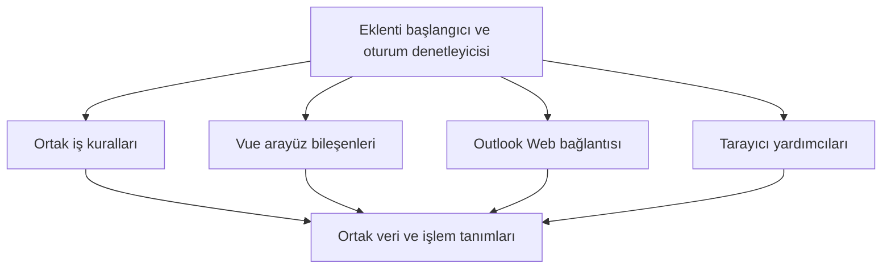
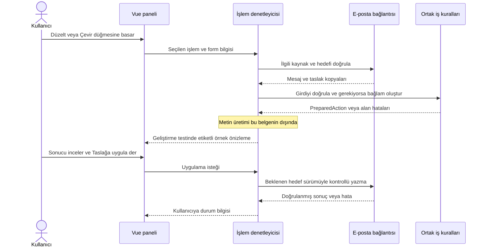

# Email Writer — implementasyon detayları

Tarih: 13 Ekim 2026  
Durum: İlk aşamanın tasarımı; 15 Ekim 2026 AI bağlantısı ekleri aşağıdadır.
İlgili belge: [Proje planı](./PROJE_PLANI.md)

Bu doküman, tarayıcı eklentisinin AI bağlantısı dışındaki bütün temel parçalarının nasıl geliştirileceğini tanımlar. Amaç; e-postayı doğru okumak, kullanılacak konuşma bağlamını hazırlamak, kullanıcıya anlaşılır bir düzenleme paneli sunmak ve kullanıcının onayladığı metni doğru taslağa güvenli biçimde aktarmaktır.

Bu belgenin 1–20 bölümleri ilk aşamanın tasarım kaydıdır. Güncel implementasyon ve sapmalar [YAPILAN_ISLER.md](./YAPILAN_ISLER.md) içinde tutulur. **15 Ekim 2026 güncellemesi:** Kullanıcının AI bağlantısı talebiyle §1.2'deki AI kapsam dışı kararı sonraki aşama için kaldırıldı. §15–17'deki yalnızca sayfa belleği, içeriksiz mesajlaşma, yalnızca storage izni ve harici servise veri gönderilmemesi ifadeleri AI üretimi için artık geçerli değildir. Güncel sınırlar aşağıdaki §21 ve [AI bağlantı rehberidir](./docs/AI_BAGLANTISI.md).

## İçindekiler

1. [Kapsam ve tamamlanma ölçütü](#bolum-1)
2. [Temel ürün kuralları](#bolum-2)
3. [Mimari ve çalışma ortamları](#bolum-3)
4. [Klasörler ve sorumluluklar](#bolum-4)
5. [Ortak veri modeli](#bolum-5)
6. [E-posta bağlantısının arayüzü](#bolum-6)
7. [Outlook sayfasını tanıma ve izleme](#bolum-7)
8. [Mesajları ve taslağı okuma](#bolum-8)
9. [Konuşma bağlamını oluşturma](#bolum-9)
10. [Eklenti arayüzleri](#bolum-10)
11. [Düğmelerin iş kuralları](#bolum-11)
12. [Oturum ve durum yönetimi](#bolum-12)
13. [İşlem hazırlama ve sonuç önizleme](#bolum-13)
14. [Taslağa uygulama ve geri alma](#bolum-14)
15. [Ayarlar, depolama ve mesajlaşma](#bolum-15)
16. [Tarayıcı uyumluluğu ve izinler](#bolum-16)
17. [Hatalar, gizlilik ve performans](#bolum-17)
18. [Temiz kod kuralları](#bolum-18)
19. [Test planı](#bolum-19)
20. [Geliştirme sırası ve teslim koşulları](#bolum-20)
21. [ChatGPT ve OpenAI bağlantısı](#bolum-21)

<a id="bolum-1"></a>

## 1. Kapsam ve tamamlanma ölçütü

### 1.1 Bu aşamada geliştirilecekler

İlk e-posta bağlantısı Outlook Web olacak. Eklenti Chrome, Edge, Brave ve Firefox için hazırlanacak. Vue 3, TypeScript, WXT ve Manifest V3 kullanılacak. Gmail'in daha sonra aynı yapıya eklenebilmesi için e-posta uygulamasına özgü kod ayrı tutulacak.

Bu aşama aşağıdaki işleri kapsıyor:

- Açık konuşmayı ve açık taslakları tanımak.
- Kullanıcı istediğinde erişilebilir mesajları ve taslak metnini okumak.
- Konuşma bağlamını temizlemek, sıralamak ve kapsamını kullanıcıya göstermek.
- Küçük başlatma simgesi, sayfa içi panel, araç çubuğu açılır penceresi ve ayarlar ekranını geliştirmek.
- “Düzelt”, “Çevir” ve “Yanıt hazırla” işlemlerinin girişlerini doğrulamak ve ortak bir işlem kaydı hazırlamak.
- Sonuç önizlemesini, elle düzenlemeyi, kopyalamayı, taslağa uygulamayı ve güvenli geri almayı geliştirmek.
- Farklı tarayıcıları, birden fazla taslağı ve değişen sayfa yapısını test etmek.

### 1.2 Bu aşamaya dahil olmayanlar

AI sağlayıcıları, model seçimi, API anahtarları, üyelikle giriş, prompt tasarımı, metin üretimi, gerçek çeviri, gerçek dil düzeltme, token hesabı ve ağ üzerinden sonuç alma bu belgenin dışında. Bunlara ait paket, ayar ekranı veya bağlantı kodu oluşturulmayacak.

Microsoft Graph ve Gmail API bağlantıları da bu aşamada yok. Bağlam, kullanıcının açık e-posta sayfasında erişilebilen içerikten oluşturulacak. Dosya eklerinin içeriği okunmayacak; otomatik e-posta gönderilmeyecek. Outlook masaüstü, mobil uygulama ve Gmail bağlantısının gerçek implementasyonu sonraki aşamalarda ele alınacak.

### 1.3 AI olmadan neyi doğrulayacağız?

“Düzelt” düğmesine basıldığında doğru metnin seçildiğini, gerekli alanların kontrol edildiğini ve değişmez bir işlem kaydı oluşturulduğunu doğrulayabiliriz. Önizleme ve taslağa yazma işlemleri için geliştirme ortamında sabit örnek sonuçlar kullanılabilir. Örneğin bir test, önizlemeye önceden belirlenmiş “Toplantıyı yarın yapabiliriz.” metnini yerleştirebilir.

Bu örnekler gerçek düzeltme veya çeviri yapılmış gibi gösterilmeyecek. Geliştirme ekranında “Örnek sonuç — geliştirme modu” etiketi bulunacak. Normal derlemede örnek sonuç üreticisi yer almayacak. Metin işleme henüz bağlanmadığında işlem düğmeleri bunun nedenini açıklayacak; kullanıcıya başarı bildirimi verilmeyecek.

**Bu aşamanın çıktısı, AI eklenmesine hazır ve bağımsız olarak test edilmiş eklenti altyapısıdır.** Gerçek çeviri veya düzeltme yapabilen ürünün genel yayını, sonraki bağlantı çalışmasıyla tamamlanacak. Geliştirme sırasında önizlemeye alınan örnek bir sonucu elle değiştirme, kopyalama ve uygun taslağa uygulama işlemleri gerçek editör üzerinde doğrulanacak.

<a id="bolum-2"></a>

## 2. Temel ürün kuralları

Bu kurallar bütün modüller için geçerlidir. Bir özellik eklenirken aynı kararlar farklı dosyalarda yeniden verilmez.

| Konu | Uygulanacak kural | Kullanıcı açısından sonucu |
| --- | --- | --- |
| Başlatma | Panel yalnızca kullanıcı simgeye, bir işlem düğmesine veya araç çubuğundaki açma düğmesine bastığında açılır. | Eklenti normal e-posta akışını kesmez. |
| Okuma | Panel kapalıyken yalnızca gerekli arayüz bölgeleri tanınır; bütün konuşmaların metni arka planda toplanmaz. | Kullanıcı çalışacağı yazışmayı kendisi belirler. |
| Yazma | Sonuç kendiliğinden taslağa uygulanmaz. | Mevcut metin beklenmedik biçimde değişmez. |
| Hedef | Her yazma işlemi tek bir hesap, sayfa ve taslak örneğine bağlıdır. | Diğer açık taslaklar etkilenmez. |
| İçerik değişikliği | İşlem hazırlanırken alınan taslak sonradan değişmişse eski hedef geçersiz sayılır. | Kullanıcının sonradan yazdıkları korunur. |
| Konuşma kapsamı | Görünen mesajlardan alınan bağlam, bütün posta geçmişiymiş gibi sunulmaz. | Kullanıcı eksik bağlamı fark edebilir. |
| Alıcılar | To, CC, BCC ve konu alanları okunabildiği ölçüde hedefi tanımaya yardımcı olur; değiştirilmez. | Eklenti mesajın kime gideceğine karar vermez. |
| Biçim | İlk sürümde sonuç düz metindir. Değiştirilen bölümün dışındaki imza, alıntı ve biçim korunur. | Düzenleme sınırı önizleme yanında açıkça belirtilir. |
| Gönderme | Eklenti gönder düğmesine basmaz ve gönderme kısayolunu çalıştırmaz. | Son kontrol ve gönderme kullanıcıda kalır. |
| Belirsizlik | Editör, hedef veya yazma sınırı güvenle belirlenemiyorsa doğrudan yazma kapatılır. | Sonuç kopyalanabilir; yanlış yere yazılmaz. |

**Örnek:** Kullanıcı A konuşmasında bir paragraf seçip “Düzelt” işlemini başlattıktan sonra B konuşmasına geçerse, A için hazırlanan sonuç B'ye uygulanamaz. Sonuç panelde kalabilir; hedefin artık etkin olmadığı açıklanır.

<a id="bolum-3"></a>

## 3. Mimari ve çalışma ortamları

### 3.1 Uygulamanın nerede çalışacağı

Eklenti üç ayrı çalışma ortamından oluşacak:

1. **Sayfaya eklenen kod (content script):** Outlook ekranını okur, paneli açar, kullanıcı oturumunu yönetir ve taslakla etkileşir. E-posta metinlerinin ve panel oturumunun sahibi bu ortamdır.
2. **Eklentinin arka plan kodu:** Kurulum, ayar geçişleri ve gerekli tarayıcı olaylarını yönetir. E-posta metinlerini saklamaz; panelin açık kalması bu kodun sürekli çalışmasına bağlı değildir.
3. **Eklenti sayfaları:** Tarayıcı araç çubuğundaki küçük açılır pencere ve ayarlar ekranıdır. Araç çubuğu penceresi ana yazma editörü değildir; kapanması paneldeki metni kaybettirmez.

Chrome, arka plan service worker'ını durdurup yeniden başlatabilir. Bu nedenle e-posta oturumu ve geri alma bilgisi burada tutulmayacak. Kalıcı tercihler tarayıcının eklenti depolamasına yazılacak. [Chrome arka plan yaşam döngüsü](https://developer.chrome.com/docs/extensions/develop/concepts/service-workers/lifecycle).

### 3.2 Kod bağımlılıkları



`core`, Vue'yu, WXT'yi ve Outlook sayfasını bilmez. Metni hangi ekrandan okuduğunu değil, aldığı verinin hangi kurallara uyması gerektiğini bilir. Örneğin bağlamı tarihe göre düzenleyen fonksiyon bir DOM elemanı değil, mesaj listesi alır.

Outlook bağlantısı sayfayı tanır, fakat panelin hangi rengi kullanacağını veya işlemin hangi hedef dile yönelik olduğunu belirlemez. Vue bileşenleri de Outlook seçicilerini veya tarayıcı API çağrılarını içermez.

Bu parçalar `apps/browser-extension/src/bootstrap/create-extension-session.ts` içinde bir araya getirilir. Bağımlılıklar fonksiyon parametreleriyle verilir. Başlangıçta ayrı bir bağımlılık enjeksiyonu kütüphanesi, genel eklenti yükleyicisi veya uygulama çapında olay otobüsü kullanılmaz.

### 3.3 Sayfa ile yalıtım sınırı

Content script, e-posta uygulamasının JavaScript değişkenlerini kullanmaya çalışmayacak. Sayfanın görünen yapısıyla çalışacak; Outlook'un dahili React durumuna, belgelenmemiş ağ uçlarına veya oturum çerezlerine bağlanmayacak. [Chrome content script çalışma ortamı](https://developer.chrome.com/docs/extensions/develop/concepts/content-scripts).

Panel Shadow DOM içinde oluşturulacak. Bu, CSS çakışmalarını azaltan bir arayüz sınırıdır; gizli verileri sayfadan koruyan bir güvenlik kasası değildir. Panelde HTML olarak gelen e-posta içeriği çalıştırılmayacak.

<a id="bolum-4"></a>

## 4. Klasörler ve sorumluluklar

Aşağıdaki yapı, proje planındaki paket ayrımının bu aşama için somutlaştırılmış halidir. Kullanılmayan Gmail, Outlook masaüstü ve AI bağlantı klasörleri şimdilik oluşturulmaz.

```text
email-writer/
  apps/
    browser-extension/
      wxt.config.ts
      package.json
      entrypoints/
        outlook.content.ts
        background.ts
        popup/                 index.html, main.ts, PopupApp.vue
        options/               index.html, main.ts, OptionsApp.vue
      src/
        bootstrap/             create-extension-session.ts
        controllers/           panel-controller.ts, action-controller.ts
                               apply-controller.ts
        composables/           use-panel-session.ts
        platform/              settings-store.ts, runtime-messaging.ts
                               clipboard.ts, permission-status.ts
        mounting/              mount-panel.ts, mount-launchers.ts
        locales/               tr.ts, en.ts
        development/           fixture-results.ts
  packages/
    contracts/src/             mail.ts, context.ts, actions.ts
                               mail-connector.ts, errors.ts
                               settings.ts, runtime-messages.ts
    core/src/
      context/                 build-context.ts, normalize-text.ts
                               remove-duplicate-quotes.ts, order-messages.ts
                               context-policy.ts
      actions/                 prepare-action.ts, validate-action.ts
      session/                 session-state.ts, reduce-session.ts
      editing/                 validate-apply.ts, validate-undo.ts
    mail-connectors/
      outlook-web/src/
        index.ts
        discovery/             detect-page.ts, locate-thread.ts
                               locate-composers.ts, selectors.ts
        reading/               read-thread.ts, read-composer.ts
                               extract-message-blocks.ts
        identity/              identity-registry.ts
        observation/           observe-page.ts, observe-editor.ts
        selection/             capture-selection.ts, text-range-map.ts
        writing/               editor-writer.ts, apply-text.ts, undo-change.ts
        mounting/              locate-launcher-anchors.ts
    ui/src/
      components/              LauncherButton.vue, WriterPanel.vue
                               OperationSelector.vue, SourceEditor.vue
                               ContextInspector.vue, ResultPreview.vue
                               ApplyControls.vue, StatusNotice.vue
      styles/                  tokens.css, panel.css
  tests/
    fixtures/                  outlook/, synthetic-mail/
    unit/                      context/, actions/, session/, editing/
    contracts/                 mail-connector.contract.ts
    integration/               outlook-web/, ui/
    e2e/                       extension-chromium/
    manual/                    browser-matrix.md
  pnpm-workspace.yaml
  package.json
```

Her çalışma alanı paketinin kendi `package.json` ve TypeScript yapılandırması olacak. `pnpm-workspace.yaml`, `apps/*`, doğrudan `packages/*` paketleri ve `packages/mail-connectors/*` altındaki gerçek paketleri kapsayacak. `mail-connectors` üst klasörü ayrıca bir paket olmayacak.

### 4.1 Önemli dosyaların sahip olduğu işler

| Dosya veya bölüm | Sorumluluk | Buraya konulmayacak işler |
| --- | --- | --- |
| `contracts/src/` | Katmanlar arasında paylaşılan veri biçimleri ve bağlantı arayüzü | DOM sorguları, Vue durumu, işletim kuralları |
| `core/context/build-context.ts` | Seçilen mesajlardan tutarlı bir bağlam üretmek | Sayfaya tıklamak, mesaj indirmek |
| `core/actions/prepare-action.ts` | Kaynak, işlem ve bağlamı doğrulayıp işlem kaydı üretmek | Gerçek düzeltme veya çeviri |
| `outlook-web/reading/` | Outlook elemanlarını ortak veri biçimine dönüştürmek | Kullanıcı tercihlerine göre işlem seçmek |
| `outlook-web/writing/` | Tek bir taslağa kontrollü yazmak ve sonucu kontrol etmek | Başka konuşmayı hedef seçmek, e-posta göndermek |
| `controllers/panel-controller.ts` | Panelin açılması, hedef seçimi ve kullanıcı olaylarını koordine etmek | HTML ayıklama, seçici listeleri |
| `controllers/action-controller.ts` | İşlem hazırlığını ve geç gelen sonuçların kontrolünü yönetmek | Sağlayıcı bağlantısı |
| `controllers/apply-controller.ts` | Yazma ve geri alma iş kurallarını bağlantı modülüne uygulatmak | Editörün DOM ayrıntıları |
| `ui/components/` | Veriyi göstermek, alanları toplamak ve kullanıcı olaylarını bildirmek | E-posta okumak, tarayıcıdan veri istemek |
| `platform/` | Depolama, tarayıcı mesajları, izin kontrolü ve panoya kopyalama | Konuşma bağlamının kuralları |

Tablolarda ve sonraki bölümlerde kısa yazılan dosya yolları, bu klasör ağacındaki karşılıklarını ifade eder.

<a id="bolum-5"></a>

## 5. Ortak veri modeli

### 5.1 Kimlik ve sürüm kavramları

Bir mesajın konusu veya içeriği onun güvenilir kimliği değildir. İki farklı konuşmanın konusu aynı olabilir. Hedefler, hesap ve sayfa kapsamıyla birlikte tanımlanacak.

- `accountScopeId`, açık posta hesabını ayıran yerel ve opak kimliktir. Depolama anahtarı olarak kullanıcının e-posta adresi kullanılmaz.
- `documentInstanceId`, sayfa yeniden yüklendiğinde değişir. Farklı sekmeler aynı değeri paylaşmaz.
- `threadKey`, bağlantı modülünün tanıdığı konuşma kimliğidir. Güvenilir bir sayfa kimliği yoksa yalnızca mevcut DOM örneği boyunca geçerli yerel kimlik üretilir.
- `composerKey`, tek bir yazma alanını tanımlar. Bir editör silinip yeniden oluşturulursa yeni kimlik alır. Eski yazma yetkisi yeni editöre otomatik taşınmaz.
- `revision`, okunan veri değiştiğinde artan sayıdır. Taslak sürümü sadece düz metni değil; yapıyı, korunan bölümleri ve hedef alıcıların değişmesini de kapsar.

Bu kimlikler yetkilendirme token'ı değildir; uygulamanın yanlış hedefi kullanmasını engelleyen yerel ilişkilerdir. DOM referansları ve gerçek `Range` nesneleri bağlantı modülünün içinde kalır.

### 5.2 Mesaj ve konuşma

`contracts/src/mail.ts` temel tanımları taşır:

```ts
export interface MailScope {
  providerId: string;
  accountScopeId: string;
  documentInstanceId: string;
}

export interface ThreadRef {
  scope: MailScope;
  threadKey: string;
}

export interface ComposerRef {
  scope: MailScope;
  composerKey: string;
  threadKey: string | null;
}

export interface TextBlock {
  kind: 'body' | 'quote' | 'signature' | 'unknown';
  text: string;
  certainty: 'certain' | 'uncertain';
}

export type CoverageReason =
  | 'collapsed-messages'
  | 'virtualized-content'
  | 'read-limit'
  | 'unverified-history';

export interface MessageSnapshot {
  messageKey: string;
  senderLabel: string | null;
  sentAt: string | null;
  displayOrder: number;
  blocks: readonly TextBlock[];
}

export interface ContextCoverage {
  source: 'visible-dom';
  status: 'partial' | 'unknown';
  readableMessageCount: number;
  knownUnreadableMessageCount: number | null;
  reasons: readonly CoverageReason[];
}

export interface ThreadSnapshot {
  ref: ThreadRef;
  revision: number;
  capturedAt: string;
  subject: string | null;
  activeMessageKey: string | null;
  messages: readonly MessageSnapshot[];
  coverage: ContextCoverage;
}
```

`Snapshot`, verinin belirli bir andaki kopyasıdır. Kullanıcı başka mesaja geçtiğinde önceki kopyanın içeriği kendiliğinden değişmez. Tarihler güvenilir biçimde okunabiliyorsa ISO biçiminde tutulur; okunamıyorsa `null` bırakılır. Görünmeyen gönderici, tarih veya mesaj sayısı tahmin edilmez.

DOM'dan okumak, posta kutusundaki bütün konuşma geçmişine erişildiğini kanıtlamaz. Bu nedenle bu aşamada `complete` gibi bir kapsam değeri kullanılmaz. “Ekrandan 4 mesaj alındı” denebilir; “Konuşmanın tamamı alındı” denmez.

### 5.3 Taslak ve seçili metin

```ts
export interface ComposerSnapshot {
  ref: ComposerRef;
  revision: number;
  capturedAt: string;
  editableText: string;
  canReplaceBody: boolean;
  canReplaceSelection: boolean;
  canInsertIntoEmptyBody: boolean;
  containsRichContent: boolean;
}

export interface DraftSelection {
  selectionId: string;
  composerRef: ComposerRef;
  composerRevision: number;
  start: number;
  end: number;
  text: string;
}
```

`editableText`, kullanıcının kendi yazdığı ve güvenle düzenlenebilen bölgedir. İmza veya önceki yazışma bu bölgeden kesin olarak ayrılamıyorsa `canReplaceBody` değeri `false` olur. Böylece her `contenteditable` alanı tümüyle değiştirilebilir sayılmaz.

Seçim aralıkları, aynı editör metni üzerinde UTF-16 indisleri olarak tutulur; JavaScript ve DOM metin indisleriyle aynı ölçü kullanılır. Bağlamı temizlemek için yapılan normalizasyon bu indislere uygulanmaz. `selectionId`, bağlantı modülünde saklanan ve sürümü doğrulanabilen bir seçim kaydına karşılık gelir.

### 5.4 Hazırlanmış bağlam ve işlem

`contracts/src/context.ts`, seçim ve temizlik sonrası kalan mesajları tanımlar. `omissions`, çıkarılan her mesajın veya bloğun kimliğini ve çıkarılma nedenini kaydeder. Henüz okunamamış içerik bu listede tamamlanmış bir mesaj gibi temsil edilmez; `coverage` içinde belirtilir.

```ts
export interface ContextMessage {
  messageKey: string;
  senderLabel: string | null;
  sentAt: string | null;
  text: string;
}

export interface ContextOmission {
  messageKey: string;
  blockIndex?: number;
  reason:
    | 'user-excluded'
    | 'signature'
    | 'duplicate-quote'
    | 'duplicate-message'
    | 'message-limit'
    | 'size-limit';
}

export interface ContextSnapshot {
  contextId: string;
  threadRef: ThreadRef;
  threadRevision: number;
  messages: readonly ContextMessage[];
  coverage: ContextCoverage;
  omissions: readonly ContextOmission[];
  policyVersion: number;
  createdAt: string;
}
```

`contracts/src/actions.ts` işlemin aşağıdaki biçimini tanımlar:

```ts
export type Operation = 'revise' | 'translate' | 'reply';

export type ApplyTarget =
  | {
      mode: 'replace-selection';
      composerRef: ComposerRef;
      expectedRevision: number;
      selectionId: string;
    }
  | {
      mode: 'replace-body' | 'insert-empty';
      composerRef: ComposerRef;
      expectedRevision: number;
    };

export interface PreparedAction {
  requestId: string;
  sessionId: string;
  formRevision: number;
  operation: Operation;
  source: {
    origin: 'panel' | 'draft' | 'draft-selection' | 'received-message';
    text: string;
  };
  instruction: string;
  targetLanguage: string | null;
  tone: 'neutral' | 'formal' | 'friendly';
  context: ContextSnapshot | null;
  target: ApplyTarget | null;
  createdAt: string;
}
```

Kod örneklerinde kullanılan `ComposerRef` ve `ContextSnapshot`, ilgili sözleşme dosyalarından içe aktarılır. Buradaki kodlar veri sözleşmesini anlatır; kopyalanıp derlenmiş uygulama dosyaları değildir.

Düzeltme ve çeviride `source.text` asıl girdidir. Yanıt hazırlamada `instruction` kullanıcının isteğidir ve açık konuşmanın bağlamı ayrıca taşınır. E-posta içeriği ile kullanıcının talimatı aynı metin alanında birleştirilmez. Bu aşamada prompt üretilmez.

`PreparedAction`, alanların doğru olup olmadığının kontrol edilmiş halidir. Ekrandaki değişken Vue nesnesinin referansı bu kayda verilmez; bağımsız bir veri kopyası oluşturulur.

<a id="bolum-6"></a>

## 6. E-posta bağlantısının arayüzü

E-posta bağlantısının dışarı açtığı arayüz `contracts/src/mail-connector.ts` içinde tanımlanır. Uygulama Outlook'a doğrudan seçici göndermez; anlamlı işlemler ister.

| İşlem | Girdi | Çıktı ve sorumluluk |
| --- | --- | --- |
| `getPageState` | Yok | Destek durumu, etkin konuşma ve görünen taslak referansları. Mesaj gövdelerini toplamaz. |
| `readThread` | `ThreadRef`, iptal sinyali | `ThreadSnapshot`; yalnızca istenen konuşmanın erişilebilir içeriğini okur. |
| `readComposer` | `ComposerRef` | `ComposerSnapshot`; yazılabilir bölüm ve güncel sürümü verir. |
| `captureDraftSelection` | `ComposerRef` | Geçerli bir `DraftSelection` veya seçim yoksa `null`. |
| `readSelectedMessageText` | `ThreadRef` | Gelen mesaj içindeki seçimi, ait olduğu mesaj kimliğiyle verir. |
| `subscribe` | Olay dinleyicisi | Hesap, konuşma, editör veya içerik değişikliklerini bildirir; abonelikten çıkma fonksiyonu döndürür. |
| `applyText` | İşlem kimliği, `ApplyTarget`, düz metin | Hedefi tekrar doğrular, bir kez yazar ve `applied`, `rejected` veya `uncertain` döndürür. |
| `undoChange` | Geri alma kaydı kimliği | Sadece koşulları hâlâ geçerli olan son değişikliği geri alır. |
| `dispose` | Yok | Gözlemcileri, seçim kayıtlarını, DOM bağlantılarını ve geçici verileri temizler. |

Okuma ve yazma işlemleri, beklenen hataları `Result<T, AppError>` biçiminde döndürür. `Result`, başarıda `value`, başarısızlıkta `error` alanı olan ayrımlı bir tiptir. Beklenmeyen programlama hataları sessizce başarıya çevrilmez; uygulama sınırında yakalanır ve güvenli hata durumuna geçilir.

DOM elemanlarını arayüzün yakınına yerleştirmek için gereken bağlantılar ayrı tutulur. `outlook-web/mounting/locate-launcher-anchors.ts`, eklentinin montaj koduna uygun düğme konumlarını verir. Bu dar arayüzde `HTMLElement` kullanılabilir; bu nesneler `core`, işlem kayıtları veya depolamaya geçirilmez.

**Yeni bir e-posta hizmeti eklenirken değişecek yer:** Aynı sözleşmeyi uygulayan yeni bağlantı paketi, sayfa başlangıç dosyası ve bağlantı seçimi eklenir. Bağlam oluşturma, düğme kuralları ve önizleme tekrar yazılmaz. Yeni bağlantı, ortak bağlantı testlerini geçmek zorundadır.

<a id="bolum-7"></a>

## 7. Outlook sayfasını tanıma ve izleme

### 7.1 Başlangıç akışı

Sorumlu dosyalar: `entrypoints/outlook.content.ts`, `bootstrap/create-extension-session.ts`, `outlook-web/discovery/` ve `outlook-web/observation/`.

1. Content script desteklenen Outlook alan adında başlar. İlk adaylar `outlook.live.com`, `outlook.office.com` ve `outlook.office365.com` adresleridir; gerçek test hesaplarının yönlendiği adreslerle liste doğrulanır.
2. `detect-page.ts`, görünen alanın posta arayüzü olup olmadığını kontrol eder. Aynı alan adındaki takvim veya giriş ekranına yazma düğmeleri eklenmez.
3. `identity-registry.ts`, sayfa örneğini ve hesap kapsamını oluşturur.
4. `locate-thread.ts` ve `locate-composers.ts`, konuşma alanını ve yazma alanlarını bulur. Bu aşamada bütün mesaj gövdeleri okunmaz.
5. Doğrulanan arayüz bölgelerine birer başlatma düğmesi eklenir. Aynı konuma ikinci kez düğme eklenmez.
6. Sayfa ve editör gözlemcileri başlatılır. Kullanıcı bir işlem istediğinde ilgili içerik okunur.

Sayfa henüz yükleniyorsa bağlantı `waiting` durumunda kalır. Desteklenen arayüz bulunamazsa sayfa değiştirilmez; araç çubuğu penceresinde “Bu ekrandaki e-posta alanı tanınamadı” bilgisi gösterilir. Bir seçici eşleşmediğinde tüm sayfanın metnini yedek yöntem olarak almak yasaktır.

### 7.2 Seçicilerin yönetimi

`selectors.ts`, Outlook'a özgü bütün seçici tanımlarının tek yeridir. Seçiciler ne UI bileşenlerinde ne ortak iş mantığında bulunur.

Öncelik, gerçek sayfada doğrulanan yapısal işaretler ve kararlı niteliklerdir. Erişilebilirlik rolleri yardımcı olabilir; ancak `role="textbox"` tek başına e-posta editörü demek değildir. Arama kutusu, kişi seçici ve konu alanı da ayrıca elenir. Bir adayın görünürlüğü, düzenlenebilirliği, üst bölgesi ve aynı taslağa ait diğer işaretlerle ilişkisi kontrol edilir.

Üretilmiş CSS sınıfları ve “Yanıtla” gibi dile bağlı yazılar tek dayanak olmaz. Dile bağlı metin zorunluysa seçici varyantı ve desteklenen arayüz dili açıkça kaydedilir.

İlk araştırmada her desteklenen sayfa biçimi için şu bilgiler kaydedilir: hesap türü, arayüz dili, tarayıcı, konuşma görünümü, editör türü ve doğrulama tarihi. Gerçek e-posta içeriği test deposuna eklenmez. Seçici değişikliğinin yanında onu doğrulayan anonim bir sayfa örneği ve test bulunur.

### 7.3 Sayfa yenilenmeden konuşma değişmesi

Outlook içinde gezinmek her zaman tam sayfa yüklemesi oluşturmaz. Sadece ilk yüklemeyi dinlemek yeterli değildir. WXT'nin konum değişikliği olayı ile dar kapsamlı `MutationObserver` birlikte kullanılacak. Konum değişikliği, yeniden keşif için bir işarettir; tek başına doğru konuşmayı belirlediği varsayılmaz. [WXT sayfa gezinme desteği](https://wxt.dev/guide/essentials/content-scripts#handling-spa-navigation).

Gözlemci her DOM değişikliğinde bütün sayfayı taramayacak. Önce ilgili konuşma veya taslak kökünün değişip değişmediğine bakacak; değişiklikleri kısa aralıkta birleştirerek yalnızca etkilenen bölgeyi yeniden değerlendirecek. Eklentinin kendi Shadow DOM kökü ve düğmeleri bu gözlemden dışlanacak.

Hesap değişimi tespit edilirse eski hesap kapsamı ve içerikleri temizlenir. Hesap ilişkisi belirsizleşirse önceki konuşmadan veri taşınmaz. Bir editör yeniden oluşturulursa eski seçim, yazma hedefi ve geri alma kaydı geçersiz olur.

### 7.4 Birden fazla açık taslak

Her taslak kendi `composerKey` değerine ve düğmesine sahip olur. Kullanıcının bastığı düğme hedefi belirler. “Sayfadaki ilk editörü seç” gibi bir davranış uygulanmaz.

Araç çubuğundan açıldığında son kullanılan editör hâlâ geçerliyse panelde hedef olarak gösterilir. Birden fazla aday varsa kullanıcıya hangi taslakla çalışacağı seçtirilir. Hedef seçmeden hiçbir editöre yazılamaz.

Ayrı pencerede açılan Outlook taslağı, kendi sayfa oturumudur. İlk sürümde sekmeler veya pencereler arasında taslak devretme yapılmaz.

### 7.5 Temizleme

Content script geçersiz olduğunda, eklenti güncellendiğinde veya sayfa kapandığında şu işlemler yapılır: Vue uygulaması kaldırılır, gözlemciler durdurulur, olay dinleyicileri sökülür, zamanlayıcılar iptal edilir ve geçici seçim/yazma kayıtları temizlenir. WXT'nin yaşam döngüsü araçları bu işler için kullanılır. Kapanmış oturuma geç gelen işlemler sonuç yazamaz. [WXT content script yaşam döngüsü](https://wxt.dev/guide/essentials/content-scripts#context).

<a id="bolum-8"></a>

## 8. Mesajları ve taslağı okuma

### 8.1 Konuşma okuma

Sorumlu dosyalar: `read-thread.ts`, `extract-message-blocks.ts` ve `identity-registry.ts`.

`readThread` yalnızca istenen `ThreadRef` kapsamındaki mesajları okur. Gelen kutusundaki satır önizlemeleri, başka açık konuşmalar ve taslak metni mesaj geçmişine karışmaz. İşlem başında ve sonunda konuşma kimliği kontrol edilir. Okuma sürerken konuşma değişmişse yarım sonuç kullanılmaz.

Her mesaj için gönderici, güvenilir tarih, ekran sırası ve metin blokları ayrı toplanır. Gövdesi kapalı veya henüz yüklenmemiş mesaj, okunmuş sayılmaz. Eklenti “önceki mesajları göster” düğmesine kendiliğinden basmaz, sayfayı otomatik kaydırmaz veya ekleri açmaz. Kullanıcı eski mesajları açtıktan sonra “Konuşmayı yeniden oku” düğmesiyle bağlamı yeniler.

Bilinen kapalı mesaj sayısı gösterilebilir; sayfadan belirlenemiyorsa sayı uydurulmaz. Görünen bütün mesajlar açık olsa bile yalnızca ekrandan okunabilen bölümün alındığı belirtilir.

### 8.2 HTML'den düz metne geçiş

Mevcut mesaj gövdesi üzerinde kontrollü DOM gezintisi yapılır. E-posta HTML'i yeniden sayfaya eklenmez veya çalıştırılmaz. `script`, `style`, form kontrolleri, görünmeyen izleme elemanları ve eklenti düğmeleri metne dahil edilmez. Resimler indirilmez; dosya eklerinin içeriği ve gömülü belgeler okunmaz.

Paragraflar ve satır sonları korunur. Listeler okunabilir satırlara çevrilir. Tablo hücreleri arasına ayırıcı konulur; örneğin tutar ile açıklamanın birleşip anlam değiştirmesi önlenir. Görünen bağlantı metni alınır; bağlantının adresi gerekiyorsa yalnızca güvenli URL şemaları düz metin olarak gösterilir, bağlantı açılmaz.

Mesajın görünür gövdesiyle önceki yazışma alıntısı ayrılabiliyorsa blok türleri atanır. Ayrılamıyorsa `unknown` veya belirsiz blok olarak korunur. Tüm HTML'i tek bir `textContent` çağrısıyla almak, gizli metinleri ve kontrol etiketlerini karıştırabileceği için ana yöntem değildir.

### 8.3 İmza ve alıntı ayırma

Konuşma bağlamında gereksiz tekrarları azaltmak ile editörden metin silmek farklı işlemlerdir. Bağlamdan çıkarılan bir imza, gerçek e-posta taslağından silinmez.

İmza ve alıntı işaretleri güvenilir biçimde bulunabiliyorsa sınıflandırılır. Bir cümlenin “Regards” veya “Teşekkürler” içermesi tek başına imza olduğu anlamına gelmez. Emin olunmayan bölüm korunur. Kullanıcı bağlam denetleyicisinden çıkarılan bölümü görebilir ve geri dahil edebilir.

Tekrarlanan alıntı, başka bir erişilebilir mesajın metniyle yeterli yapısal kanıtla aynıysa çıkarılabilir. Sadece aynı cümleyi içeriyor diye ayrı mesajlar birleştirilmez. Aynı “Tamam” yanıtının iki kez gönderilmesi iki gerçek mesaj olabilir.

### 8.4 Taslağı okuma

`read-composer.ts`, önce hedef editörün hâlâ aynı taslağa ait olduğunu kontrol eder. Kullanıcının yazdığı bölüm, imza ve alıntı alanları güvenilir şekilde ayrılır. Bu ayrım yapılamıyorsa tüm gövdeyi değiştirme özelliği kapatılır; güvenli seçim değişimi veya kopyalama kullanılabilir.

Taslağın yazılabilir metni, mesaj bağlamından ayrı tutulur. İsimler, tutarlar, noktalama, büyük/küçük harfler ve kullanıcının boş satırları kaynak metinde korunur. İşlem için boşluk kontrolü yapılabilir, ancak kaynak kaydı sessizce kısaltılmaz.

Editörde tablo, görsel veya karmaşık biçim varsa `containsRichContent` bilgisi verilir. İlk sürüm bunları düzenleme iddiasında bulunmaz. Basit bir metin aralığı güvenle belirlenebiliyorsa yalnızca o aralık üzerinde çalışılır.

### 8.5 Seçili metni yakalama

Sorumlu dosyalar: `capture-selection.ts`, `text-range-map.ts` ve `observe-editor.ts`.

Düğmeye basmak odağı editörden panele taşıyabilir. Bu nedenle fare veya dokunma ile düğmeye basıldığında seçim, odak kaybolmadan yakalanır. Klavye kullanımında son geçerli seçim konumu takip edilir; işlem başlatılırken içerik ve editör sürümü tekrar doğrulanır.

Geçerli seçim için iki uç da aynı düzenlenebilir alanda bulunmalıdır. Seçim imza, alıntı, başka mesaj veya panel alanına taşıyorsa taslak seçimi olarak kabul edilmez. Kullanıcının salt okunur mesajdan yaptığı seçim ayrı sınıflandırılır; bu seçim o mesaja yazma hakkı oluşturmaz.

DOM yeniden çizildiğinde eski `Range` doğrudan kullanılmaz. Bağlantı modülü, seçim kaydını editör kimliği, sürüm, aralık ve seçili metinle doğrular. Eşleşmiyorsa kullanıcıdan yeniden seçim yapması istenir. Aynı kelimeyi sayfanın başka yerinde arayıp değiştirmek yasaktır.

IME ile yazım sürerken, yani kullanıcı bir karakter birleşimini henüz tamamlamamışken, taslağa yazma bekletilir. Değişiklik takibinde sadece `beforeinput` kullanılmaz; `input`, composition olayları ve gerekli DOM değişiklikleri birlikte izlenir. [MDN giriş olaylarının sınırları](https://developer.mozilla.org/en-US/docs/Web/API/Element/beforeinput_event).

<a id="bolum-9"></a>

## 9. Konuşma bağlamını oluşturma

### 9.1 Bağlamın görevi

Sorumlu dosyalar: `core/context/`.

Bu belgedeki **context**, kullanıcının işlem sırasında kullanmayı seçtiği mesajların düzenli veri paketidir. Bir prompt, özet veya AI çıktısı değildir. Hazırlanırken ağ isteği yapılmaz ve anlam üzerinden yeni cümleler üretilmez.

`buildContext`, bir `ThreadSnapshot`, kullanıcı seçimi ve `ContextPolicy` alır. Sonuç olarak `ContextSnapshot` veya açıklanabilir bir hata döndürür. Saat ve kimlik üretimi dışarıdan verilir; aynı veri ve politika aynı içerik sonucunu üretir.

### 9.2 İşlem sırası

1. **Kimliği doğrula:** Mesajlar tek bir hesap ve konuşma kapsamına ait olmalı. Birden fazla kapsam varsa işlem durur.
2. **Mesajları belirle:** Otomatik seçimde aktif mesaj korunur ve yakın geçmiş eklenir. Kullanıcının açıkça seçtiği bir liste varsa o liste esas alınır.
3. **Metni normalize et:** Satır sonları tek biçime getirilir; bağlam kopyasındaki gereksiz son boşluklar temizlenir. Sayılar, harfler, adresler ve paragraf sırası değiştirilmez.
4. **Tekrarları azalt:** Aynı mesaj kimliğinin tekrar okunması elenir. Kesin olarak tanınan tekrar alıntılar ve seçime göre imzalar çıkarılır. Belirsiz içerik korunur.
5. **Sırala:** Bütün seçili mesajların tarihleri güvenilir ise eskiden yeniye sıralanır. Tarih bilgileri eksikse güvenilir görsel sıra korunur ve bu durum açıklanır. Bilinmeyen tarih için yapay tarih atanmaz.
6. **Boyutu kontrol et:** Mesaj sayısı ve toplam metin sınırı uygulanır. Kararların tamamı `omissions` içinde gerekçesiyle tutulur.
7. **Kapsamı ekle:** Okunamayan, kullanıcı tarafından çıkarılan ve boyut nedeniyle dahil edilmeyen içerikler birbirinden ayrılır.
8. **Kopyayı dondur:** İşlem kaydına gidecek bağlam, oturumun canlı mesaj listesinden bağımsız hale getirilir.

Yenileme sırasında ekrana yeni mesaj gelirse mevcut işlem kaydı değişmez. Panel “Konuşmada yeni içerik var” bilgisi gösterir. Kullanıcı yeniden okuma yaptığında yeni bağlam sürümü hazırlanır.

### 9.3 Başlangıç sınırları

Bu değerler `context-policy.ts` ve işlem doğrulama sabitlerinde tek yerde tanımlanacak. Ölçülmüş ürün sınırları değil, ilk implementasyon için başlangıç kararlarıdır.

| Sınır | Başlangıç değeri | Sınır aşılırsa |
| --- | --- | --- |
| Bağlama alınan mesaj sayısı | 20 | Otomatik seçimde daha eski mesajlar dışarıda bırakılır ve sayısı gösterilir. |
| Bağlamın toplam metni | 60.000 UTF-16 birimi | Otomatik seçimde bütün mesajlar halinde azaltılır; kesilen cümlelerden bağlam kurulmaz. |
| Düzeltme veya çeviri kaynağı | 20.000 UTF-16 birimi | Kullanıcıdan daha küçük bir bölüm seçmesi istenir. |
| Yanıt talimatı | 5.000 UTF-16 birimi | Alan altında uzunluk hatası gösterilir. |
| Önizlemeye kabul edilen metin | 30.000 UTF-16 birimi | Sonuç uygulanabilir hale getirilmez; anlaşılır hata gösterilir. |

Bu sınırlar token hesabı değildir. UI'da gerektiğinde “Metin çok uzun; daha küçük bir bölüm seçin” açıklaması kullanılır.

Otomatik seçim, bütçe içinde aktif mesajı ve mümkün olan en yakın geçmişi alır. Aktif mesaj tek başına sığmıyorsa sessizce kırpılmaz; kullanıcı ilgili bölümü seçmeye yönlendirilir. Kullanıcı mesajları elle seçmiş ve toplam sınırı aşmışsa, seçimi habersizce daraltmak yerine hata gösterilir.

### 9.4 Hangi işlem hangi bağlamı kullanır?

| İşlem | Varsayılan bağlam | Kullanıcı değiştirebilir mi? |
| --- | --- | --- |
| Düzelt | Yalnızca seçilen kaynak metin | “Konuşmayı da kullan” seçeneğiyle mevcut konuşmayı dahil edebilir. |
| Çevir | Yalnızca seçilen kaynak metin | Mevcut konuşmayı ayrıca dahil edebilir. |
| Yanıt hazırla | Açık konuşmadan seçilmiş en az bir mesaj | Aktif mesajı koruyarak diğer mesajları çıkarabilir veya dahil edebilir. |

Yeni e-posta yazma alanında geçmiş yoksa düzeltme ve çeviri kullanılabilir. “Yanıt hazırla” işlemi ise yanıt verilecek mesaj olmadan etkinleşmez. Sıfırdan e-posta oluşturma, bu işlemle gizlice aynı kabul edilmez; ileride ayrı bir kullanım olarak eklenebilir.

### 9.5 Kullanıcının göreceği açıklamalar

- “Bağlamda 4 mesaj var.”
- “2 eski mesaj kapalı; içerikleri okunmadı.”
- “Mesajların tamamına erişildiği doğrulanamıyor.”
- “1 mesajı bağlamdan çıkardınız.”
- “Uzunluk sınırı nedeniyle 3 eski mesaj dahil edilmedi.”
- “Tarih bilgisi eksik; mesajlar ekrandaki sırayla kullanılıyor.”

Bu açıklamalar genel bir “Bağlam hazır” mesajının arkasına saklanmaz. Ayrıntılar açılıp kapatılabilir; eksik kapsamı belirten kısa bilgi panelde görünür kalır.

<a id="bolum-10"></a>

## 10. Eklenti arayüzleri

### 10.1 Başlatma simgesi ve hızlı düğmeler

`LauncherButton.vue`, konuşma alanının veya ilgili taslağın yakınında bulunur. Bir taslakta, uygun yer varsa “Düzelt” ve “Çevir” hızlı işlemleri de gösterilir. Her hızlı işlem kendi taslak referansını taşır.

Simgenin erişilebilir adı “Yazma yardımcısını aç” olur. Simge tek başına anlam taşımak zorunda değildir; fare üzerinde açıklama gösterilir ve klavyeyle ulaşılabilir. Eklenti, Outlook'un gönderme veya biçimlendirme düğmelerini gizlemez.

### 10.2 Sayfa içi panel

Ana arayüz sayfanın sağında açılan, sayfayı kullanmayı engellemeyen bir diyalog panelidir. Başlangıç genişliği 440 px, en fazla görünüm genişliği eksi 24 px olur. Yüksekliği görünüm alanına sığar; panelin içeriği gerektiğinde kendi içinde kayar. Dar pencerede sağa sabitlenmiş geniş bir panel yerine aynı bileşenin daha dar yerleşimi kullanılır.

Panel dışına tıklamak yazılan metni silmez veya paneli otomatik kapatmaz. Kullanıcı Outlook'ta yazmaya devam edebilir. Panel bunu algılar ve gerekiyorsa önceki hedefin güncelliğini kaybettiğini gösterir.

Aşağıdaki düzen, alanların sırasını gösterir; görsel tasarımın son hali değildir:

```text
Yazma yardımcısı                            [Kapat]
Hedef: Açık yanıt taslağı

[ Düzelt ] [ Çevir ] [ Yanıt hazırla ]
Kaynak: Taslağım / Seçili metin / Buraya yazdığım metin

Metin veya yanıt talimatı
┌─────────────────────────────────────────────────┐
│ Kullanıcının düzenleyeceği giriş alanı            │
└─────────────────────────────────────────────────┘

Hedef dil: İngilizce          Ton: Nötr
Konuşmayı kullan: açık/kapalı
Bağlam: 4 mesaj, 2 kapalı mesaj okunmadı    [İncele]

[Düzelt / Çevir / Yanıt hazırla]

Sonuç
┌─────────────────────────────────────────────────┐
│ Önizleme ve kullanıcının son düzenlemesi          │
└─────────────────────────────────────────────────┘
Değişecek bölüm: Seçili paragraf
[Kopyala] [Taslağa uygula] [Son uygulamayı geri al]
```

Hedef dil sadece gerekli işlemlerde gösterilir. Ton seçimi düzeltme ve yanıt hazırlamada kullanılabilir. İlk sürümde çeviri için ayrıca ton ayarı açılmaz; gereksiz seçenekler gizlenir.

### 10.3 Bileşenlerin görevleri

| Bileşen | Görevi | Ürettiği başlıca olay |
| --- | --- | --- |
| `WriterPanel.vue` | Alanları yerleştirir, oturum görünümünü gösterir. | `close`, `change-target` |
| `OperationSelector.vue` | Düzelt, çevir ve yanıt işlemlerinden birini seçtirir. | `operation-change` |
| `SourceEditor.vue` | Kaynak metni veya talimatı gösterir; boşluk ve uzunluk hatasını sunar. | `source-change`, `instruction-change`, `reload-source` |
| `ContextInspector.vue` | Kullanılan mesajları, çıkarılan bölümleri ve kapsamı gösterir. | `context-selection-change`, `refresh-context` |
| `ResultPreview.vue` | Sonuç metnini gösterir ve elle düzenletir. | `preview-change` |
| `ApplyControls.vue` | Uygulama kapsamını, yazma ve geri alma düğmelerini gösterir. | `apply`, `copy`, `undo` |
| `StatusNotice.vue` | Bekleme, hata, eski kaynak ve eksik kapsam durumlarını açıklar. | Gerekirse `retry` |

Bileşenler salt okunur görünüm verisi alır, kullanıcı olaylarını dışarı verir. “Taslağa uygula” düğmesi doğrudan `document.querySelector` çağırmaz; olay `apply-controller.ts` tarafından işlenir.

`use-panel-session.ts`, denetleyiciyle Vue arasındaki ince bağlantıdır. Yeni bağlam kuralları burada yazılmaz. Başlangıçta tek panel oturumu için ayrı bir Pinia deposu gerekmez; Vue'nun standart durum araçları yeterlidir. Durum uygulama büyüdüğünde paylaşılması gereken başka ekranlara yayılırsa bu karar yeniden değerlendirilebilir. [Vue durum yönetimi yaklaşımı](https://vuejs.org/guide/scaling-up/state-management.html).

### 10.4 Kaynağı değiştirme davranışı

Kullanıcı paneldeki metni değiştirmişse “Taslağı yeniden al” veya “Açık mesajı al” işlemi bu metni sessizce silmez. Alanın yanında mevcut metni değiştireceğini açıklayan bir seçim sunulur. Kaynak değişince eski işlem sonucu uygulanabilir durumdan çıkar.

Düzeltme ve çeviri arasında geçerken kullanıcı metni korunur. Yanıt talimatı ayrı alanda tutulur; işlem türü değiştiğinde taslak metni yanlışlıkla talimat olarak yorumlanmaz. Gizlenen hedef dil veya ton tercihi aynı oturumda saklanabilir, fakat o işlemde kullanılmayan alan hazırlanmış talebe etki etmez.

### 10.5 Bağlam denetleyicisi

Bağlam bölümü varsayılan olarak kısa özet gösterir. “İncele” açıldığında mesajlar gönderici, tarih, kısa önizleme ve seçim kutusuyla listelenir. Mesaj gövdesi ayrıca açılabilir; e-posta HTML'i render edilmez.

Kullanıcı çıkarılan imza veya alıntı bloklarını görebilir. Bir blok tekrar dahil edilirse bağlam boyutu yeniden hesaplanır. “Konuşmayı yeniden oku” güncel bir snapshot oluşturur; eski mesaj seçimleri sadece aynı güvenilir mesaj kimlikleri hâlâ bulunuyorsa korunur.

Yanıt hazırlama işleminde aktif mesajın seçim kutusu kilitli olur ve neden zorunlu olduğu açıklanır. Aktif mesaj tanınamıyorsa kullanıcı yanıt verilecek mesajı açıkça seçmeden bu işlem hazırlanmaz. Diğer mesajlar kullanıcı tarafından çıkarılabilir.

### 10.6 Erişilebilirlik ve görünüm

Panel `role="dialog"` ve görünür başlığa bağlı `aria-labelledby` kullanır. Sayfa kullanılmaya devam ettiği için `aria-modal="true"` verilmez ve klavye odağı panelde hapsedilmez. Kapatıldığında odak mümkünse paneli açan düğmeye döner. WAI-ARIA, modal olarak işaretlenen bir diyaloğun gerçekten dış etkileşimi kapatmasını gerektirir; bu panelin davranışı modal değildir. [WAI-ARIA diyalog davranışı](https://www.w3.org/WAI/ARIA/apg/patterns/dialog-modal/).

`Escape`, panelde açık alt menü varsa önce onu kapatır; yoksa paneli kapatır ve oturum verisini bellekte tutar. Enter, çok satırlı metin alanında yeni satır oluşturur. E-posta göndermeye benzeyen varsayılan bir klavye kısayolu eklenmez.

Bekleme ve başarı mesajları `aria-live="polite"` üzerinden kısa biçimde duyurulur; her metin değişiminde konuşma gövdesi seslendirilmez. Hatalar ilgili alanla ilişkilendirilir. Düğmenin kapalı olma nedeni sadece renkle anlatılmaz.

Açık ve koyu tema, yüzde 200 yakınlaştırma, Türkçe karakterler, emoji, sağdan sola metin ve uzun bağlantılar test edilir. Düzenleme alanlarında `dir="auto"` kullanılabilir. Shadow DOM dışına açılan Vue Teleport içerikleri kullanılmaz; açılır menüler panelin kendi köküne yerleştirilir. CSS değişkenleri panel kökünde tanımlanır; global `body`, `button` veya Outlook sınıflarına stil uygulanmaz.

### 10.7 Araç çubuğu penceresi ve ayarlar

Tarayıcı araç çubuğundaki pencere yalnızca destek durumunu, “Bu sayfada paneli aç” düğmesini ve ayarlara bağlantıyı gösterir. E-posta gövdesini burada tekrar tutmaz. Desteklenmeyen sayfada neden çalışmadığını kısa biçimde açıklar.

Ayarlar ekranında bu aşamada arayüz dili, varsayılan hedef dil, varsayılan ton, tema ve desteklenen sitede eklentiyi etkinleştirme bulunur. API veya üyelik alanları gösterilmez. Veri saklama davranışı kısa bir açıklamayla belirtilir: tercihler cihazda kalır; e-posta ve panel metinleri kalıcı kaydedilmez.

<a id="bolum-11"></a>

## 11. Düğmelerin iş kuralları

Sorumlu dosyalar: `core/actions/validate-action.ts`, `prepare-action.ts` ve `controllers/action-controller.ts`.

### 11.1 Kaynak seçimi

Bir hızlı işlem taslak üzerinde başlatılmışsa geçerli seçili metin önceliklidir. Seçim yoksa güvenle ayrılmış taslak gövdesi alınır. Panel zaten açık ve kullanıcı kaynak alanını elle değiştirmişse bu metin önceliğini korur; taslak arka planda otomatik yeniden yüklenmez.

Salt okunur mesajdan seçilmiş metin yalnızca açıkça “Gelen mesajdaki seçimi al” işlemiyle kaynak olur. Outlook arama kutusundaki veya başka sayfa bölümündeki seçim kaynak kabul edilmez. Panel, kaynağın nereden geldiğini her zaman gösterir.

### 11.2 İşlemlerin koşulları

| İşlem | Gerekli veri | İşlem kaydına giren bilgiler | İlk aşamada doğrulanacak sonuç |
| --- | --- | --- | --- |
| Düzelt | Boş olmayan kaynak metin | `revise`, kaynak metin, ton, varsa seçilen bağlam | Kaynak doğru alınır; hedef ve bağlam doğru kaydedilir. Gerçek dil düzeltmesi yapılmaz. |
| Çevir | Boş olmayan kaynak ve seçilmiş hedef dil | `translate`, kaynak, hedef dil, varsa bağlam | Hedef dil ve kaynak doğru kaydedilir. Gerçek çeviri yapılmaz. |
| Yanıt hazırla | Boş olmayan talimat ve aktif mesajı içeren bağlam | `reply`, talimat, hedef dil, ton, konuşma kopyası | Talimat mesaj geçmişinden ayrı tutulur ve doğru konuşmaya bağlanır. |

İşlem boş metin, sadece boşluk, geçersiz seçim veya izin verilen boyutu aşan kaynakla hazırlanmaz. Boşluk kontrolü kaynağın kırpılmış bir kopyasıyla yapılır; asıl metin değiştirilmez.

Düzeltmede `targetLanguage` değeri `null` olur; dil korunacak işlemin sınırı böyle ifade edilir. Çeviri ve yanıt için hedef dil açıkça seçilir; varsayılan değer ayarlardan gelir. Bu aşamada otomatik dil algılama yapılmaz. İlk dil listesi Türkçe, İngilizce, Almanca, Fransızca ve İspanyolca olabilir; liste tek dosyada tutulur ve işlem kaydında dil kodu kullanılır.

### 11.3 Gelen mesajı çevirme

Kullanıcı gelen mesajı veya bir bölümünü çeviri kaynağı olarak alabilir. Bu mesaj salt okunurdur. Sonuç sadece önizlenebilir ve kopyalanabilir; ilk sürümde gelen mesajı çevirme işlemine doğrudan taslak hedefi atanmaz.

Böylece “Okuduğum mesajı çevir” ile “Yazdığım yanıtı çevir” birbirine karışmaz. Kullanıcı kendi yanıtını çevirmek için taslak veya panel metnini kaynak seçer.

### 11.4 İşlem sırasında düğmeler

Kaynak okunurken veya taslağa uygulama sürerken aynı işlem tekrar başlatılmaz. Düğmenin etiketi ve durum açıklaması güncellenir. Kullanıcı kaynak alanını değiştirebilir; bu değişiklik önceki hazırlığı geçersiz kılar.

İlk aşamanın normal derlemesinde metin işleme bağlantısı olmadığı için “Düzelt”, “Çevir” ve “Yanıt hazırla” düğmelerinin neden kullanılamadığı açıklanır. Geliştirme derlemesinde bu düğmeler gerçek veri hazırlama akışını çalıştırır; sonrasında açıkça etiketlenmiş örnek sonuç önizlemeye verilir. İş kurallarının test edilmesi için normal derlemede sahte çeviri çalıştırılmaz.

### 11.5 Taslak henüz açılmamışsa

Kullanıcı bir mesajı okurken paneli açabilir ve yanıt talimatını hazırlayabilir. Bu durumda `target` değeri `null` olur. Eklenti otomatik olarak Outlook'un yanıt düğmesine basmaz.

Kullanıcı Outlook'ta yanıt alanını açınca panelde “Bu yanıt taslağını kullan” seçeneği gösterilebilir. Bağlantı ancak aynı hesap ve konuşma ilişkisini güvenilir biçimde doğrulayabiliyorsa yapılır. Kullanıcı seçtiğinde editörün yeni kopyası alınır ve hedef sürümü kaydedilir. Aynı konu başlığı, ilişki kurmak için yeterli değildir.

Editör boşsa sonuç yazılabilir alana eklenir. Editörde yazı varsa panel hangi bölümün değişeceğini gösterir ve ayrı bir “Mevcut yanıt metnini değiştir” seçimi ister. Bu, yalnızca daha önce hedefi olmayan yanıt önizlemesinin hedefe bağlanmasıdır; değişmiş eski bir hedefi sessizce yeniden geçerli kılmak için kullanılmaz.

Hazırlanmış işlem kaydı bu bağlantı sırasında değiştirilmez. Oturum, sonradan açıkça seçilen hedefi ayrı bir `applyTarget` olarak tutar. İlk anda hedef varsa bu alan işlemdeki hedef kopyasından başlatılır; hedef yoksa ancak yukarıdaki bağlama akışıyla doldurulur. Yazmada kullanılacak güncel hedefin tek sahibi oturumdur; işlem kaydındaki hedef, hazırlık anının değişmez kaydıdır.

<a id="bolum-12"></a>

## 12. Oturum ve durum yönetimi

### 12.1 Oturumun kapsamı

Her sayfa örneğinde aynı anda tek açık panel oturumu bulunur. Oturum bir konuşmaya ve varsa bir taslağa bağlıdır. Başka taslakla çalışmaya geçiş açık bir kullanıcı eylemidir.

Oturum; kullanıcı metnini, talimatı, işlem seçimini, bağlam kopyasını, hedefi, son işlem kaydını, önizlemeyi ve son geri alma kaydının kimliğini tutar. DOM düğümleri, ağ istemcileri veya tüm uygulamaya yayılan değişkenler bu duruma eklenmez.

Paneli kapatmak oturumun form verisini silmez. Devam eden okuma ve örnek sonuç beklemesi iptal edilir; tamamlanmış giriş ve önizleme aynı sayfanın belleğinde kalır. Sayfa yenilenince veya kapanınca bu içerik kaybolur. Hesap değişince içerik temizlenir. İlk kullanım açıklamasında kalıcı kaydın olmadığı belirtilir.

Başka konuşmaya geçildiğinde mevcut panel eski çalışmaya bağlı kalır; yeni konuşmanın içeriği ona otomatik karıştırılmaz. Uygulama kapatılmadan yeni hedefe geçilecekse “Bu konuşmayla yeni çalışma başlat” seçimi kullanılır. Kaydedilmemiş metin varsa kullanıcıya önce kopyalama veya eski çalışmaya devam etme imkanı verilir.

### 12.2 Tek bir durum modeli

`session-state.ts` veri modelini, `reduce-session.ts` ise olayların bu modeli nasıl değiştirdiğini tanımlar. Vue, bu durumdan üretilen görünümü gösterir. Birbiriyle çelişebilen çok sayıda bağımsız `isLoading`, `hasResult` ve `isDone` değişkeni oluşturulmaz.

| Durum | Anlamı | İzin verilen temel davranış |
| --- | --- | --- |
| `idle` | Panel açılmış, içerik henüz hazırlanmadı. | Kaynak veya hedef seçmek |
| `reading` | Mesaj veya taslak okunuyor. | İptal etmek; aynı okumayı tekrar başlatmamak |
| `editing` | Kullanıcı girişini hazırlıyor. | Kaynak, talimat, dil ve bağlamı değiştirmek |
| `prepared` | Geçerli ve değişmez işlem kaydı var. | Bu aşamada örnek sonucu beklemek veya girdiyi değiştirmek |
| `preview` | Kabul edilmiş bir önizleme var. | Elle düzenlemek, kopyalamak, uygunsa taslağa uygulamak |
| `applying` | Tek bir yazma işlemi devam ediyor. | Aynı yazmayı tekrar başlatmamak |
| `applied` | Yazma işleminin editördeki sonucu doğrulandı. | Uygunsa geri almak veya yeni çalışma yapmak |
| `error` | Son işlem tamamlanamadı. | Korunan girişle uygun işlemi yeniden başlatmak |

Panelin açık veya kapalı olması bu işlem durumundan ayrıdır. `staleReason`, kaynak veya hedefin neden geçersiz olduğunu belirtir. Düğmelerin etkinliği durum ve doğrulama kurallarından hesaplanır; ayrıca başka bir değişkende saklanmaz.

### 12.3 Sürüm ve geç gelen sonuç kontrolü

Üç farklı sürüm ayrı amaçlara hizmet eder:

- `formRevision`: Kaynak, işlem türü, talimat, dil, ton veya bağlam seçimi değişince artar.
- `composerRevision`: Outlook editörünün anlamlı içeriği veya hedef bilgileri değişince artar.
- `previewRevision`: Kullanıcı önizleme metnini düzenlediğinde artar.

Bir sonuç kabul edilmeden önce `sessionId`, `requestId` ve `formRevision` güncel işlemle eşleşmelidir. Kullanıcı ikinci bir işlem başlattıktan sonra gelen birinci sonuç gösterilmez. İptal edilen işlemin cevabı daha sonra gelse de tekrar etkinleşmez.

Önizlemeyi elle düzenlemek yeni bir metin üretme işlemi değildir; yalnızca `previewRevision` artar. Kaynak alanını değiştirmek ise mevcut önizlemeyi eski hale getirir. Eski önizleme kullanıcı isterse kopyalanabilir, fakat taslağa uygulanamaz.

### 12.4 Dışarıdaki değişikliklere tepki

| Olay | Yapılacak işlem |
| --- | --- |
| Kullanıcı Outlook'ta taslağı değiştirdi | Hedef sürümü geçersiz olur; “Taslak değişti” açıklaması ve kaynağı yeniden alma seçeneği gösterilir. |
| Seçili metin değişti veya editör yeniden oluştu | Eski seçim iptal edilir; aynı metin başka yerde aranmaz. |
| Konuşmaya yeni içerik geldi | Bağlam güncelliğini kaybeder. Yeni okuma yapılmadan o bağlamla yeni işlem hazırlanmaz. |
| Aktif konuşma değişti | Eski çalışmanın yazma düğmesi kapanır; metin yeni konuşmaya taşınmaz. |
| Taslak kapandı veya gönderildi | Hedef ve geri alma kaydı geçersiz olur. Önizleme kopyalanabilir. |
| Hesap değişti | Eski hesabın içerikleri ve devam eden işlemleri temizlenir. |
| Arka plan kodu yeniden başladı | Sayfa oturumu çalışmaya devam eder; ayarlar gerektiğinde depodan tekrar okunur. |
| Eklenti güncellendi | Eski content script temizlenir; sayfanın yenilenmesi gerektiği açıklanır. |

Okumalarda `AbortController`, UI olaylarında monoton işlem kimlikleri kullanılır. İptal edilen okumanın bir kısmı daha önce tamamlanmış olsa bile kimlik ve sürüm kontrolleri eski verinin geri dönmesini engeller.

<a id="bolum-13"></a>

## 13. İşlem hazırlama ve sonuç önizleme

### 13.1 Baştan sona akış



### 13.2 `prepareAction` işlemi

`prepare-action.ts` sırasıyla işlem türünü, kaynak kapsamını, boş alanları, uzunlukları, dil seçimini ve bağlam gereksinimini kontrol eder. Bir alan geçersizse ilgili alan koduyla hata verir. Veri doğruysa kimlik ve sürüm bilgileriyle birlikte `PreparedAction` oluşturur.

Bu fonksiyon UI metinlerini üretmez, DOM okumaz, tarayıcı depolamasına yazmaz. Kullanıcının düğmeye basmasıyla hangi snapshot'ların okunacağı denetleyicinin görevidir. Aynı doğrulama hem hızlı düğmelerde hem panelde kullanılır; iki ayrı iş kuralı dizisi oluşturulmaz.

Panelde kaynak metni değiştirmek, önce yakalanmış seçim aralığının eski metnini veya hedef sürümünü değiştirmez. İşlenecek yeni metin ile Outlook'ta değiştirilecek eski bölüm ayrı kayıtlardır. Yeni işlem hazırlanırken hedef ayrıca yeniden doğrulanır.

İşlem kaydı üzerinde test ortamında inceleme yapılabilir. Normal hata kayıtlarına kaynak veya bağlam metni yazılmaz.

### 13.3 AI bağlantısına girmeden sınırı tanımlamak

Bu aşamada yalnızca iki uygulama olayı gerekir: “işlem hazırlandı” ve “bu işleme ait sonuç önizlemeye geldi”. Sonucun hangi servis veya yöntemle üretileceği tanımlanmaz.

Önizlemeye kabul edilen kayıt; `requestId`, `sessionId`, `formRevision` ve `text` taşır. Geliştirme kaynağı ayrıca `sample` etiketi ekler. Gelen kaydın kimlikleri ve boyutu doğrulanmadan önizleme açılmaz. HTML çıktı kabul edilmez; metin Vue'nun normal metin gösterimi veya textarea değeri olarak sunulur.

`development/fixture-results.ts`, test senaryosuna göre sabit bir sonuç döndürür. Gecikme, hata veya iptal davranışını da kontrollü biçimde taklit edebilir. Metni iyileştirdiğini iddia eden basit kurallar veya sahte bir çeviri sözlüğü yazılmaz. Testler belirli metinleri doğrudan verir.

Bu geliştirme kodu yalnızca geliştirme/test girişinden bağlanır. Yayın paketinde modülün bulunmadığı derleme kontrolüyle doğrulanır. Kullanıcının ayarlardan açabildiği gizli bir “gerçekmiş gibi çalıştır” modu olmayacak.

### 13.4 Önizlemeyi düzenleme

Önizleme kaydı oluştuktan sonra kullanıcı metni elle değiştirebilir. Uygulanacak metin her zaman önizleme alanının son halidir. Kaynak metin ve konuşma kopyası bundan etkilenmez.

Boş veya sadece boşluk içeren önizleme taslağa uygulanmaz. Bu düğme metin silme aracı olarak kullanılmaz. Önizleme kaynağın aynısıysa “Metinde değişiklik yok” bilgisi gösterilir ve gereksiz yazma yapılmaz.

Kopyalama işlemi kullanıcı tıklamasıyla başlar. `navigator.clipboard.writeText` kullanılamıyorsa metin seçilebilir halde tutulur ve standart kopyalama kısayolu açıklanır. Pano okunmaz ve kullanıcı eylemi olmadan panoya yazılmaz. [MDN panoya metin yazma](https://developer.mozilla.org/en-US/docs/Web/API/Clipboard/writeText).

<a id="bolum-14"></a>

## 14. Taslağa uygulama ve geri alma

Bu bölüm, veri kaybını önleyen en önemli implementasyon sınırıdır. Yazma ve geri alma kararlarını `core/editing/` verir; gerçek editör işlemini `outlook-web/writing/` uygular.

### 14.1 Uygulama türleri

| Tür | Kullanılacağı durum | Değiştirilecek alan |
| --- | --- | --- |
| `replace-selection` | Kaynak, aynı taslak içindeki doğrulanmış seçimden alındı. | Yalnızca o seçim |
| `replace-body` | Kullanıcının yazdığı gövde imza ve alıntıdan güvenle ayrıldı. | Yalnızca kullanıcının yazdığı gövde |
| `insert-empty` | Yeni yanıt taslağının kullanıcıya ait yazma bölümü boş. | Boş yazma bölgesi; varsa imzanın öncesi |

İlk sürümde rastgele imleç konumuna ekleme veya bütün Outlook editörünü değiştirme genel bir seçenek olarak sunulmaz. Bu sınır, aynı sonucun yanlışlıkla birkaç kez eklenmesini ve imza kaybını azaltır.

Kaynak panelde elle yazılmışsa yazma hedefi ayrıca açıkça seçilir. “Panel metni” olmak, açık taslak içeriğinin üzerine otomatik yazma yetkisi vermez.

### 14.2 Yazmadan önce kontroller

Denetleyici ve e-posta bağlantısı aşağıdaki koşulları birlikte kontrol eder. Oturum, sürüm ve işlem kuralları `validate-apply.ts` içinde; DOM elemanının bağlılığı, görünürlüğü ve gerçek seçim sınırı bağlantı modülünde değerlendirilir:

1. Oturum ve önizleme hâlâ güncel olmalı.
2. Hedef hesap, sayfa ve taslak kimliği eşleşmeli.
3. Editör bağlı, görünür ve düzenlenebilir olmalı.
4. Güncel editör sürümü `expectedRevision` ile aynı olmalı.
5. Seçim değiştiriliyorsa seçim kimliği, aralığı ve eski metin hâlâ eşleşmeli.
6. İşlem, imza veya önceki yazışma gibi korunan alanı kapsamamalı.
7. IME yazımı veya başka bir uygulama işlemi sürmemeli.
8. Aynı uygulama kimliği daha önce uygulanmış veya belirsiz sonuçlanmış olmamalı.

Denetleyicideki kontrol tek başına yeterli değildir. `applyText`, DOM'a yazmadan hemen önce kendi içinde güncel editörü tekrar okur. Gözlemci olayları henüz işlenmemiş olabileceğinden yalnızca bellekteki sürüme güvenmez. Son kontrol ile DOM değişikliği arasına bekleme veya ağ işlemi konulmaz.

Sürüm uyuşmazlığı, `expectedRevision` değerini güncel sayıya çevirerek giderilmez. Kullanıcı güncel taslağı yeniden kaynak almalı veya ilgili bölümü yeniden seçmelidir. Böylece eski metinle hazırlanmış sonuç, yeni taslağın üzerine yeniden onaylanmış gibi uygulanamaz.

### 14.3 Editöre yazma yöntemi

Outlook editörüne doğrudan `innerHTML = ...` veya `textContent = ...` atamak varsayılan yöntem olmayacak. Bu işlemler editörün kendi durumunu, imzayı, biçimi ve geri alma geçmişini bozabilir. Sentetik bir `input` olayı göndermek de Outlook'un değişikliği kaydettiğini tek başına kanıtlamaz.

`editor-writer.ts`, bu farkları saklayan dar bir arayüz sunar. İlk teknik denemede mevcut `Selection`/`Range` ile hedef aralık seçilerek `document.execCommand('insertText', ...)` uyumluluğu incelenir. Bu API kullanımdan kaldırılmıştır; buna rağmen düzenleme geçmişini koruma özelliği nedeniyle bazı editör senaryolarında kullanımı sürmektedir. Kullanılacaksa yalnızca bu dosyada, belirli Outlook/tarayıcı kombinasyonlarında doğrulanmış bir uyumluluk çözümü olarak bulunur. [MDN execCommand sınırları](https://developer.mozilla.org/en-US/docs/Web/API/Document/execCommand).

Başarı şartı, fonksiyonun `true` dönmesi değildir. Yazılan metin, korunan alanlar ve Outlook'un bir sonraki normal yeniden çizimi kontrol edilir. Desteklenmeyen bir editörde deneysel başka yöntemler peş peşe denenmez; doğrudan uygulama kapanır ve kopyalama yolu sunulur.

İlk yayında doğrudan yazma desteği verebilmek için bu yöntem veya aynı sınırı sağlayan başka bir doğrulanmış writer, temel düz metin senaryolarında çalışmalıdır. Kopyalama seçeneğinin bulunması, bu ana kabul koşulunun test edilmeden tamamlanmış sayılmasına izin vermez.

### 14.4 Yazma işleminin adımları

1. `apply-controller.ts`, önizleme sürümü ve hedef için bir `applyOperationId` oluşturur. Aynı düğmeye tekrar basmak aynı işlemi yeniden yazdırmaz.
2. `apply-text.ts`, hedefi ve gerçek DOM içeriğini yeniden doğrular.
3. Bağlantı modülü sadece değişecek bölümün eski durumunu ve korunan alanların kontrol bilgisini belleğe alır.
4. Doğrulanmış writer, düz metni tek düzenleme işlemi olarak yerleştirir.
5. Editör tekrar okunur. Beklenen metin, hedef kimliği ve korunan bölümlerin değişmediği kontrol edilir.
6. Sonuç kararlı görünüyorsa yeni editör sürümü ve opak `undoId` ile `applied` döner.
7. UI “Metin taslağa yerleştirildi” der. Bu ifade sunucuda kaydedildiği veya gönderildiği anlamına gelmez.

Editör değişikliği kabul etmiyor veya kontrol sırasında başka değişiklik oluşuyorsa sonuç `uncertain` olur. Aynı işlem otomatik tekrarlanmaz. Önizleme korunur; kullanıcıdan taslağı kontrol etmesi istenir. Böylece gerçekte yazılmış bir metin ikinci kez eklenmez.

Hata sonrası otomatik geri yükleme ancak hedef hâlâ tam olarak beklenen ara durumdaysa ve writer bunun güvenli olduğunu doğrulayabiliyorsa yapılabilir. Kullanıcı yeni metin yazdıysa eski snapshot ile editörün üzerine yazılmaz.

### 14.5 Biçimlendirme ve korunan alanlar

Sonuç düz metin olarak uygulanır; HTML, script veya modelin ürettiği biçim çalıştırılmaz. Değiştirilen bölümün mevcut kalınlık, renk veya bağlantı biçimi korunmayabilir; bu durum işlem kapsamının yanında belirtilir. Seçimin dışındaki içerik korunmalıdır.

Tablo hücrelerini, gömülü görselleri veya karmaşık editör yapısını kesen seçimler ilk sürümde yazılabilir kabul edilmez. İmza sınırı belirsizse gövdenin tamamı değiştirilemez. Kullanıcı güvenli bir paragraf seçebilir veya önizlemeyi kopyalayabilir.

### 14.6 Güvenli geri alma

“Son uygulamayı geri al”, eklentinin son doğrulanmış yazma işlemini hedefler. Outlook'un genel geri alma geçmişini kontrolsüz biçimde geri sarmak için kullanılmaz.

Geri alma kaydı bağlantı modülünün belleğinde tutulur: `undoId`, `applyOperationId`, hedef, önceki düzenleme parçası ve uygulamadan sonraki doğrulama bilgisi. Ham DOM parçası gerekiyorsa bu kayıt modül dışına çıkarılmaz ve depolamaya yazılmaz.

Geri almadan önce aynı editörün ve uygulama sonrası sürümün hâlâ geçerli olması gerekir. Kullanıcı araya yeni yazı, alıcı değişikliği, biçimlendirme veya başka düzenleme eklemişse otomatik geri alma kapanır. “Taslak sonradan değişti; metninizi korumak için otomatik geri alma kapatıldı” açıklaması gösterilir.

Geri yükleme de doğrulanmış writer üzerinden yapılır. Editörün yerel geri alma mekanizması kullanılacaksa, geri alınacak son işlemin kesinlikle eklenti işlemi olduğu ve tek adımda geri döndüğü test edilmelidir. Bu güvence yoksa yalnızca önceki metni kopyalama imkanı verilir; rastgele `execCommand('undo')` çağrılmaz.

İlk sürüm, taslak başına yalnızca son eklenti değişikliğini geri alma kapsamına alır. Yeni uygulama önceki geri alma kaydını değiştirir. Taslak kapanınca, hedef değişince veya sayfa yenilenince kayıt silinir.

<a id="bolum-15"></a>

## 15. Ayarlar, depolama ve mesajlaşma

### 15.1 Kalıcı saklanacak veriler

`contracts/src/settings.ts`, aşağıdaki tercihleri `SettingsV1` olarak tanımlar:

| Alan | Varsayılan | Açıklama |
| --- | --- | --- |
| `schemaVersion` | `1` | Depolama biçiminin sürümü |
| `revision` | `1` | Eşzamanlı ayar değişikliklerini ayıran sürüm |
| `uiLanguage` | `tr` | Arayüz dili |
| `targetLanguage` | `en` | Çeviri ve yanıt için başlangıç dili |
| `tone` | `neutral` | Düzeltme ve yanıt için başlangıç tonu |
| `theme` | `system` | Sistem, açık veya koyu tema |
| `siteEnabled` | Desteklenen sitelerde açık | Kullanıcının o sitede simgeyi kapatabilmesi |
| `onboardingSeen` | `false` | İlk kullanım açıklamasının gösterilme durumu |

Tercihler `browser.storage.local` içinde tek bir sürümlü kayıt olarak tutulur. `storage.sync` kullanılmaz. E-posta, konuşma bağlamı, kaynak metin, önizleme ve geri alma parçası bu kayda eklenmez.

### 15.2 Ayar yazma ve geçişler

`settings-store.ts`, okuma, doğrulama, varsayılan değerleri tamamlama ve sürüm geçişlerinin tek sahibidir. Vue bileşenleri kendi depolama anahtarlarını oluşturmaz.

Ayar yazma istekleri arka plan kodunda sıralı işlenir. İstemci değiştirmek istediği alanları ve bildiği `revision` değerini gönderir. Kayıt bu sırada değişmişse eski bütün nesneyle üzerine yazılmaz; güncel değer geri alınır ve kullanıcı değişikliği yeniden uygulanır. Başarı mesajı ancak depolama işlemi tamamlanınca verilir.

Diğer ekranlar `storage.onChanged` üzerinden yeni ayarları alır. Tema değişikliği anında yansıyabilir; dil veya ton varsayılanını değiştirmek kullanıcının devam eden form tercihini sessizce değiştirmez. Yeni varsayılan sonraki çalışma için geçerlidir.

Geçersiz bir kayıt güvenli varsayılanlarla ele alınır ve içerik içermeyen hata kodu üretilir. Geçişte bütün tarayıcı depolaması silinmez. Uygulamanın tanımadığı daha yeni bir şema bulunursa kayıt bozulmadan korunur; rastgele eski şemayla üzerine yazılmaz.

### 15.3 Ortamlar arası mesajlar

UI ile iş mantığı aynı content script ortamında doğrudan fonksiyonlarla haberleşir. Bütün kullanıcı olaylarını arka plan kodundan dolaştırmaya gerek yoktur.

`runtime-messages.ts`, gerçekten ortamlar arasında geçmesi gereken küçük mesajları tanımlar:

| Mesaj | Gönderen → alan | İçerik |
| --- | --- | --- |
| `GET_PAGE_STATUS` | Araç çubuğu penceresi → etkin sekmenin content script'i | Destek durumu ve panelin açılıp açılamadığı |
| `OPEN_PANEL` | Araç çubuğu penceresi → etkin sekmenin content script'i | Yalnızca paneli açma isteği; e-posta veya sonuç metni taşımaz. |
| `GET_SETTINGS` | Eklenti ekranları → arka plan kodu | Geçerli tercih kaydı |
| `PATCH_SETTINGS` | Ayarlar ekranı → arka plan kodu | Beklenen ayar sürümü ve izin verilen alan değişiklikleri |

Mesajlar `protocolVersion`, `requestId`, `type` ve tipine uygun `payload` taşır. Çalışma sırasında şema doğrulaması yapılır. Bilinmeyen türler ve alanlar reddedilir. Gönderenin aynı eklentiye ait olduğu, uygun eklenti ekranından veya izin verilen sekmeden geldiği kontrol edilir. Gönderenin iddia ettiği sekme kimliği, tarayıcının verdiği gönderici bilgisi yerine kullanılmaz.

Bir web sayfasından `window.postMessage` ile “bu metni taslağa yaz” emri alınmaz. `OPEN_PANEL` mesajı doğrudan yazma işlemi yapamaz. E-posta ve önizleme içeriği bu aşamadaki runtime protokolüne dahil değildir.

### 15.4 Bellekte kalan verilerin ömrü

| Veri | Nerede kalır? | Ne zaman temizlenir? |
| --- | --- | --- |
| Kullanıcı tercihleri | Eklentinin yerel depolaması | Tercih sıfırlama veya eklentiyi kaldırma |
| Mesaj ve bağlam kopyası | İlgili sayfanın content script belleği | Yeni çalışma, hesap değişimi, sayfa kapanması veya yenilenmesi |
| Form ve önizleme | İlgili panel oturumu | Çalışmayı açıkça sıfırlama veya yukarıdaki oturum sonları |
| DOM ve seçim kayıtları | Outlook bağlantısının özel belleği | Editör değişimi, hedefin kapanması veya `dispose` |
| Geri alma parçası | Outlook bağlantısının özel belleği | Sonraki uygulama, hedef değişimi veya oturum sonu |

Panel kapalıyken metnin aynı sayfada kısa süre sonra geri açılabilmesi amaçlanır. Tarayıcıyı yeniden başlattıktan sonra eklentinin bu metni geri getireceği vaat edilmez. Outlook'un kendi taslak kaydı, eklentinin bu bellek politikasından ayrıdır.

<a id="bolum-16"></a>

## 16. Tarayıcı uyumluluğu ve izinler

### 16.1 Ortak kod ve tarayıcıya özgü kısım

Vue bileşenleri, `core` ve veri sözleşmeleri ortak kalır. Tarayıcı farkları WXT yapılandırmasında, `platform/` yardımcılarında ve doğrulanmış editör yazma yönteminde karşılanır. İş kurallarının içine `if Firefox` kontrolleri yayılmaz.

WXT'nin ortak `browser` arayüzü kullanılır. Bu arayüz, her tarayıcıda her API'nin bulunduğunu garanti etmez; kullanılan işlemlerin desteği kontrol edilir. Firefox Manifest V3'te background script, Chromium'da service worker kullanılır. Her iki paketin üretilen manifesti incelenir. [WXT API desteği](https://wxt.dev/guide/essentials/extension-apis), [MDN background tanımı](https://developer.mozilla.org/en-US/docs/Mozilla/Add-ons/WebExtensions/manifest.json/background).

WXT Firefox için varsayılan olarak Manifest V2 hedeflediğinden, komutlarda Manifest V3 açıkça seçilir. Aşağıdaki komutlar paketler oluşturulduktan sonra kullanılacak örneklerdir; bu doküman hazırlanırken çalıştırılmadılar. [WXT tarayıcı hedefleri](https://wxt.dev/guide/essentials/target-different-browsers).

```sh
pnpm --filter @email-writer/browser-extension exec wxt -b chrome --mv3
pnpm --filter @email-writer/browser-extension exec wxt -b firefox --mv3
pnpm --filter @email-writer/browser-extension exec wxt build -b chrome --mv3
pnpm --filter @email-writer/browser-extension exec wxt build -b firefox --mv3
```

Bunlar iki ayrı uygulama değil, aynı kaynak kodun iki hedefidir. Chrome, Edge ve Brave için Chromium çıktısı temel alınır; mağaza kimlikleri ve dağıtım ayarları gerektiğinde ayrılır. En düşük desteklenen tarayıcı sürümü, gerçek test matrisiyle belirlenip manifestte açıkça belirtilir.

### 16.2 Başlangıç izinleri

Başlangıçta `storage` izni ve yalnızca desteklenen Outlook alan adlarına uyan statik `content_scripts.matches` tanımları gerekir. Content script'in çalışacağı siteler kullanıcıya erişim izni olarak görünür. Bu aşamada çapraz alan adı API isteği yapılmadığından ayrıca geniş `host_permissions` listesi eklenmez.

`<all_urls>`, `cookies`, `webRequest`, `downloads`, `clipboardRead` veya genel `tabs` izni istenmez. Statik content script kullanıldığı için sırf sayfaya eklenmek amacıyla `scripting` ve `activeTab` eklenmez. Araç çubuğu penceresi etkin sekmenin kimliğini kullanıp mevcut content script'e mesaj gönderir; bütün gezinme geçmişini veya bütün sekmelerin adreslerini toplamaz.

Site erişimi kullanıcı tarafından geri alınabilir. Content script'e ulaşılamıyorsa eklenti sessizce bozuk görünmek yerine site erişimi veya sayfa yenileme gereksinimini açıklar. İzin durumu, sadece kurulumda bir kez kontrol edilmiş sayılmaz. [MDN site erişim izinleri](https://developer.mozilla.org/en-US/docs/Mozilla/Add-ons/WebExtensions/manifest.json/host_permissions).

`all_frames` başlangıçta kapalıdır. Desteklenecek gerçek editörün bir iframe içinde çalıştığı görülürse bu, ayrıca ele alınan ve test edilen bir destek biçimi olur. Editöre ulaşmak için bütün frame'lere körlemesine kod eklenmez.

### 16.3 Paketleme

Vue şablonları ve bütün JavaScript/CSS dosyaları derlemede hazırlanıp eklenti paketine konur. Uzaktan kod, CDN üzerinden arayüz kütüphanesi veya çalışma sırasında indirilen çalıştırılabilir modül kullanılmaz.

Firefox paketinde `browser_specific_settings.gecko.id` ve gereken veri paylaşımı beyanları bulunur. Bu aşamanın paketi gerçekten dışarıya veri aktarmıyorsa beyan da bu davranışı yansıtır. Sonradan veri akışı değiştiğinde aynı beyan değişmeden bırakılamaz. Kimlik ve beyan gereksinimleri Mozilla'nın güncel kurallarına göre doğrulanır. [Mozilla manifest ayarları](https://developer.mozilla.org/en-US/docs/Mozilla/Add-ons/WebExtensions/manifest.json/browser_specific_settings).

Geliştirme sonuçları ve yerel test sayfası izinleri normal paketlerde bulunmaz. Derleme sonrası otomatik kontrol, `localhost`/`127.0.0.1` eşleşmelerini, geliştirme modülünü ve beklenmeyen izinleri tespit eder.

<a id="bolum-17"></a>

## 17. Hatalar, gizlilik ve performans

### 17.1 Hataların ortak biçimi

`contracts/src/errors.ts`, kararlı hata kodlarını tanımlar. Kod, hatanın kaynağını programatik olarak ayırır; kullanıcıya gösterilen açıklama `locales/` içinden gelir. Teknik hata nesnesinin tamamı kullanıcıya veya loglara basılmaz.

| Kod | Kullanıcının göreceği anlam | Uygulamanın davranışı |
| --- | --- | --- |
| `PAGE_UNSUPPORTED` | Bu ekran desteklenmiyor. | Sayfaya yazılmaz; destek bilgisi gösterilir. |
| `PAGE_NOT_READY` | E-posta alanı henüz hazır değil. | Kısa bekleme veya tekrar okuma sunulur. |
| `THREAD_CHANGED` | Okuma sırasında konuşma değişti. | Yarım bağlam atılır; kullanıcı girdisi korunur. |
| `TARGET_MISSING` | Seçilen taslak kapandı veya bulunamadı. | Yazma kapanır; kopyalama devam eder. |
| `TARGET_CHANGED` | Taslak işlem başladıktan sonra değişti. | Eski sonuç üzerine yazılmaz. |
| `SELECTION_INVALID` | Seçili bölüm artık aynı değil. | Yeniden seçim istenir. |
| `SOURCE_EMPTY` | Düzenlenecek metin veya talimat boş. | İlgili alan gösterilir; işlem kaydı oluşmaz. |
| `SOURCE_TOO_LARGE` | Kaynak metin sınırı aşıyor. | Daha küçük bir bölüm seçilmesi açıklanır. |
| `CONTEXT_TOO_LARGE` | Seçilen bağlam çok uzun. | Mesaj seçimi değiştirilmeden işlem ilerlemez. |
| `CONTEXT_REQUIRED` | Yanıt verilecek mesaj veya gerekli bağlam belirlenmedi. | Kullanıcı ilgili mesajı seçmeden yanıt işlemi hazırlanmaz. |
| `LANGUAGE_REQUIRED` | Hedef dil seçilmedi. | Dil alanında hata gösterilir. |
| `RESULT_INVALID` | Önizleme yanlış işleme ait, boş veya izin verilen boyutun dışında. | Uygulanabilir sonuç oluşturulmaz; mevcut kullanıcı metni korunur. |
| `SETTINGS_CONFLICT` | Ayarlar başka bir eklenti ekranında değişti. | Güncel kayıt alınır; eski bütün kayıtla üzerine yazılmaz. |
| `READ_TIMEOUT` | Sayfadaki içerik okunamadı. | Girdi korunur ve tekrar okuma sunulur. |
| `WRITE_UNSUPPORTED` | Bu editöre güvenli yazma doğrulanamadı. | Yalnızca önizleme ve kopyalama sunulur. |
| `WRITE_UNCERTAIN` | Metnin yerleştiği doğrulanamadı. | Otomatik tekrar yapılmaz; taslağı kontrol etme açıklaması verilir. |
| `UNDO_INVALID` | Taslak sonradan değiştiği için geri alınamıyor. | Mevcut taslak korunur. |
| `CLIPBOARD_UNAVAILABLE` | Tarayıcı panoya yazmaya izin vermedi. | Metin elle kopyalanabilir halde gösterilir. |
| `EXTENSION_RELOADED` | Eklenti değişti; sayfayı yenilemek gerekiyor. | Eski oturum işlem üretmez. |

Eksik konuşma geçmişi, çıkarılmış alıntı veya eksik tarih çoğunlukla hata değildir. Bunlar ayrı `ContextNotice` kayıtları olarak gösterilir. İşlemi engelleyen durum ile kullanıcıyı bilgilendiren durum birbirine karıştırılmaz.

### 17.2 İçerik ve veri paylaşımı

Bu aşamada eklenti e-posta içeriğini hiçbir harici servise göndermez. Analitik, hata toplama veya uzaktan özellik ayarı hizmeti eklenmez. Outlook'un kendi ağ trafiğiyle eklentinin trafiği testlerde ayrı değerlendirilir.

Gelen e-posta, güvenilmeyen veri olarak ele alınır. İçindeki talimat uygulama komutu olmaz; bağlantı veya görsel otomatik açılmaz. Önizlemede `v-html` kullanılmaz. Kullanıcı tarafından yazılan metin de HTML olarak çalıştırılmaz.

Loglarda e-posta gövdesi, konu, alıcı, gönderici adresi, kaynak metin, önizleme, tam URL veya erişim bilgisi bulunmaz. Gerekli tanı bilgisi; hata kodu, bağlantı sürümü, tarayıcı türü, işlem süresi ve kişisel içerik taşımayan sayılarla sınırlıdır. Geliştirme sırasında da gerçek hesap içeriğini `console.log(snapshot)` ile basmak kabul edilmez.

### 17.3 Gözlem ve performans sınırları

Başlangıçta aşağıdaki çalışma bütçeleri kullanılacak; gerçek ölçümlerden sonra değiştirilebilir:

- Panel açılışı önce boş arayüzü gösterir, uzun mesaj okumasını beklemez.
- Sayfa keşfinde değişiklikler yaklaşık 150 ms içinde birleştirilir. Sürekli tüm sayfa taraması ve sabit aralıkla sonsuz polling yapılmaz.
- Editör değişti bilgisi geciktirilmeden işaretlenir; pahalı metin çıkarımı kısa aralıkta birleştirilebilir. Yazma öncesi kontrol her zaman anlık yapılır.
- Bir okuma başlangıçta en fazla 100 bağlı mesaj ve toplam 250.000 metin birimini inceleyecek şekilde sınırlandırılır. Aktif mesaj önceliklidir. Sınır nedeniyle tamamı okunamayan mesaj, tamamlanmış gibi bağlama verilmez; kapsam eksikliği gösterilir.
- Uzun DOM gezintileri küçük parçalara ayrılır ve iptal kontrolü yapılır. Tek seferde bütün ekranı donduran büyük bir işlem oluşturulmaz.
- Okuma için başlangıç zaman aşımı 3 saniye, yazma sonrası doğrulama için 1,5 saniyedir. Bu süreler kanıtlanmış servis süreleri değildir; başarısızlık davranışını belirleyen başlangıç ayarlarıdır.

Ölçümler sentetik kısa, uzun ve çok mesajlı konuşmalarda yapılır. Özellikle panel açılışı, bağlam hazırlama ve art arda konuşma değişimlerinden sonra kalan gözlemci sayısı takip edilir. Her açılışta yeni bir gözlemcinin eskisi kapanmadan eklenmesi performans hatası sayılır.

<a id="bolum-18"></a>

## 18. Temiz kod kuralları

### 18.1 Sorumlulukların sınırı

Her modülün tek bir değişme nedeni olmalı. Outlook seçicileri değiştiğinde ortak bağlam kodunu, panel rengi değiştiğinde taslağa yazma kodunu düzenlemek gerekmemeli.

Bir işi tek fonksiyonda toplayıp daha sonra ayırmayı ertelemek yerine, doğal sınırlar baştan korunacak. Bunun karşılığında her küçük yardımcı için sınıf veya soyut temel sınıf oluşturulmayacak. Saf fonksiyonlar ve küçük arayüzler tercih edilecek.

### 18.2 Bağımlılıkların denetlenmesi

- `core`, `vue`, `wxt`, `browser`, `chrome`, `window` veya `document` kullanamaz.
- `contracts`, çalışma ortamından bağımsız tipleri ve sınır şemalarını içerir; UI bileşeni içe aktaramaz.
- `ui`, e-posta bağlantı paketini veya tarayıcı yardımcılarını içe aktaramaz.
- Outlook bağlantısı, Vue bileşeni veya belirli bir metin işleme servisi içe aktaramaz.
- Paket dışından başka paketin dahili dosyalarına doğrudan erişilmez; açıkça dışa aktarılan arayüzler kullanılır.

Bu kurallar TypeScript proje sınırları ve ESLint import kurallarıyla denetlenir. Sadece dokümana yazılmış niyet olarak bırakılmaz.

### 18.3 Tipler ve veri doğrulama

TypeScript `strict` açık olacak. `any`, kontrolsüz tür dönüştürme ve her alanı isteğe bağlı hale getiren büyük nesneler kullanılmayacak. Özellikle uygulama türleri ayrımlı birleşimlerle ifade edilecek; seçim değiştirmenin `selectionId` olmadan temsil edilmesine izin verilmeyecek.

Zod gibi çalışma zamanı şemaları tarayıcı mesajı, depolama kaydı ve dışarıdan gelen önizleme gibi sınırlarda kullanılacak. Aynı güvenilir nesne her fonksiyonda yeniden doğrulanmayacak. DOM okuma sonuçları bağlantı modülünden çıkarken kontrol edilecek.

Metnin tek bir asıl kaynağı olacak. Örneğin uygulanacak sonuç hem bir Vue alanında hem başka bir düzenlenebilir store alanında ayrı ayrı tutulmayacak. Hesaplanabilen `canApply` veya seçili mesaj sayısı, ikinci bir bağımsız gerçeklik olarak saklanmayacak.

### 18.4 İsimlendirme ve dosya düzeni

İşlem adları yaptıkları işi söylemeli: `readComposer`, `buildContext`, `prepareAction`, `applyText`. Büyüyen `utils.ts`, `manager.ts` veya `helpers.ts` dosyalarında ilgisiz işler biriktirilmez.

Vue bileşenlerinde `<script setup lang="ts">` kullanılır. Karmaşık hesaplama ve iş kuralları şablon ifadelerine yerleştirilmez. Tekrar eden, Vue'ya bağlı davranışlar composable olabilir; ortak metin işleme fonksiyonu sırf Vue kullanılıyor diye composable yapılmaz.

UI metinleri `locales/tr.ts` ve `locales/en.ts` içinde tutulur. Hata kodu ile gösterilecek açıklama ayrılır. Teknik yorumlar kodun zaten söylediğini tekrar etmek yerine, örneğin neden bir Outlook editöründe farklı yazma yöntemi gerektiğini açıklar.

### 18.5 Test edilebilirlik ve değişiklik kapsamı

Saat, kimlik üretici ve e-posta bağlantısı dışarıdan verilir; testler gerçek saate veya rastgele kimliklere bağlı kalmaz. Global tekil bir “aktif taslak” nesnesi kullanılmaz. Her sayfa oturumu kendi bağımlılıklarına sahiptir.

Her değişiklik tek bir gözlenebilir davranışı tamamlamalı. Örneğin “bağlam sınırları” değişikliği seçici yenileme ve panel tasarımıyla aynı anda taşınmaz. Yeni soyutlama ancak mevcut bir sınırı koruyorsa veya ikinci kullanım ortaya çıktıysa eklenir.

<a id="bolum-19"></a>

## 19. Test planı

### 19.1 Test katmanları

| Katman | Araç veya ortam | Doğrulanacak davranış |
| --- | --- | --- |
| Ortak iş kuralları | Vitest | Kaynak seçimi, bağlam hazırlığı, durum geçişleri ve yazma ön koşulları |
| Bağlantı sözleşmesi | Vitest ve DOM örnekleri | Her e-posta modülünün aynı okuma, kimlik ve hata kurallarını sağlaması |
| Outlook bağlantısı | Anonim HTML örnekleri ve editör test sayfaları | Seçiciler, metin çıkarımı, seçim haritalama ve korunan alanlar |
| Vue arayüzü | Vue Test Utils ve Vitest | Kullanıcı olayı, alan hatası, eski sonuç ve uygulanacak bölümün gösterimi |
| Eklentinin bütün akışı | Playwright ile Chromium | Paket yükleme, panel, mesajlaşma, örnek önizleme, yazma ve güncelleme davranışı |
| Gerçek tarayıcılar | Firefox, Chrome, Edge, Brave | Gerçek Outlook editörü, kurulum izinleri, kopyalama ve tarayıcıya özgü davranışlar |

Playwright'ın eklenti desteği Chromium ile sınırlı olduğundan Firefox testinin geçtiği, Chromium testinden çıkarılamaz. Firefox'ta WXT veya `web-ext` ile geliştirme kurulumu ve imzalı paketle gerçek kurulum ayrıca denenir. [Playwright eklenti desteği](https://playwright.dev/docs/chrome-extensions).

### 19.2 Test verileri

`tests/fixtures/synthetic-mail/` kişisel bilgi içermeyen mesajları taşır. Örneklerde Türkçe/İngilizce metin, aynı konu başlıklı farklı konuşmalar, tekrar eden alıntılar, eksik tarihler, imza, uzun mesaj, tablo, emoji ve sağdan sola yazı bulunur.

Outlook HTML örnekleri gerçek yapıyı temsil edebilir; ancak adresler, mesajlar, şirket bilgileri, kimlikler ve bağlantı token'ları anonimleştirilir. Ham posta kutusu HTML'i veya ekran dökümü doğrudan depoya konulmaz.

Yerel test sayfası, eklentinin test derlemesinde desteklenen bir origin olarak tanımlanır. Normal derlemenin manifestinde bu origin bulunmaz. Fixture üzerinde geçen test, güncel gerçek Outlook sayfasının doğrulandığı anlamına gelmez; iki sonuç ayrı raporlanır.

### 19.3 Ortak mantık testleri

| Senaryo | Beklenen sonuç |
| --- | --- |
| Düzeltme girdisi yalnızca boşluk | `SOURCE_EMPTY`; işlem kaydı yok |
| Çeviride hedef dil yok | `LANGUAGE_REQUIRED` |
| Yeni e-postada düzeltme | Bağlam zorunlu olmadan hazırlanır. |
| Gelen mesajın çevirisi | Kaynak `received-message`, hedef `null` |
| Yanıt için okunabilir mesaj yok | İşlem hazırlanmaz; eksik gereksinim açıklanır. |
| İki hesap veya konuşma karışmış | Bağlam reddedilir. |
| Aynı mesaj iki DOM örneğinde bulunmuş | Güvenilir aynı kimlikse tek mesaj alınır. |
| Aynı içerikli iki ayrı gerçek mesaj | İkisi de korunur. |
| İmza olduğundan emin olunamayan bölüm | Çıkarılmaz. |
| Bazı tarihler eksik | Yapay tarih üretilmez; sıra açıklaması bulunur. |
| Otomatik bağlam sınırı aşılıyor | Aktif mesaj korunur; çıkarılan eski mesajlar raporlanır. |
| Kullanıcının açıkça seçtiği bağlam sınırı aşıyor | Seçim sessizce daraltılmaz; hata döner. |
| Aynı girdiden bağlam tekrar hazırlanıyor | Kimlik/zaman hariç içerik aynı olur. |
| Eski işlem sonucu yenisinden sonra geliyor | Eski sonuç reddedilir. |
| Önizleme elle değiştiriliyor | Kaynak korunur; yalnızca önizleme sürümü değişir. |

### 19.4 Taslağa yazma için zorunlu senaryolar

Bu testler geçmeden doğrudan uygulama özelliği tamamlanmış sayılmaz:

1. Seçili paragraf değişir; öncesi, sonrası, imza ve alıntı aynı kalır.
2. Gövde değişir; doğru tanınan imza ve önceki mesaj alıntısı korunur.
3. İmzası bulunan boş yanıt alanına metin doğru yere eklenir.
4. Aynı anda iki taslak açıktır; yalnızca düğmesine basılan taslak değişir.
5. Sonuç hazırlanırken kullanıcı yeni yazı yazar; eski sonuç uygulanamaz.
6. DOM editörü yeniden oluşturur; eski seçim ve hedef kullanılamaz.
7. Aynı kelime farklı yerlerde vardır; seçim dışında hiçbir bölüm değişmez.
8. Kullanıcı uygulama düğmesine iki kez basar; tek yazma yapılır.
9. Yazma gerçekleşir ama doğrulama başarısız olur; otomatik ikinci yazma yapılmaz.
10. Son değişiklik geri alınır; önceki içerik geri gelir ve korunan alanlar aynı kalır.
11. Uygulamadan sonra kullanıcı başka yazı yazar; eklentinin geri alması bu yazıyı silemez.
12. Outlook editörü metni yeniden çizdiğinde uygulanan içerik kaybolmaz. Test hesabında taslaktan çıkıp geri dönerek uygulamanın kendi kaydı ayrıca kontrol edilir.

Geri alma biçimlendirme desteği de kontrol edilir. Yalnızca düz metni geri getirip önceki kalınlık veya bağlantıları kaybeden yöntem, “aynı içerik geri geldi” diye raporlanmaz; destek kapsamı açıkça sınırlandırılır.

### 19.5 Panel ve yaşam döngüsü testleri

Panel fare ve klavyeyle açılıp kapanmalı, kapanınca kullanıcı metni aynı sayfada korunmalı ve Outlook kullanılabilir kalmalı. Okuma sırasında konuşma değiştirmek, paneli kapatmak veya eklentiyi yenilemek eski işlemin sonradan arayüzü değiştirmesine yol açmamalı.

Arka plan kodu durdurulduğunda panel oturumu kaybolmamalı. Ayarlar depodan tekrar okunabilmeli. Site izni verilmediğinde veya kaldırıldığında açıklanabilir bir durum görülmeli. Art arda açma ve kapamada düğme, dinleyici veya gözlemci sayısı artmamalı.

Yüzde 200 yakınlaştırma, koyu tema, ekran okuyucuyla alan etiketleri, Türkçe giriş, IME ve uzun metin seçimi gerçek tarayıcı kontrollerine dahil edilir.

### 19.6 Tarayıcı ve hesap matrisi

İlk doğrulama matrisi aşağıdaki kapsamla başlar. Test edilen gerçek sürümler `tests/manual/browser-matrix.md` içine yazılır; “bütün tarayıcılarda çalışıyor” gibi ölçüsüz bir ifade kullanılmaz.

| Ortam | Hesap/görünüm | Zorunlu akış |
| --- | --- | --- |
| Linux + Chrome | Outlook Web iş hesabı | Okuma, seçim, panel, uygulama, geri alma |
| Linux + Firefox | Outlook Web iş hesabı | Aynı akış ve Firefox izin/paket davranışı |
| Windows + Edge | Outlook Web iş hesabı | Aynı akış ve gerçek kurulum |
| Chrome veya Firefox | Outlook.com kişisel hesap | Seçici ve editör farklarını doğrulama |
| Brave | Desteklenen Outlook Web hesabı | Panel, kopyalama, izin ve yazma |
| En az iki tarayıcı | Türkçe ve İngilizce Outlook arayüzü | Seçicilerin arayüz diline bağımlı olmaması |

Bir hesap türü doğrulanamıyorsa desteklenmiş olarak işaretlenmez. Testler sentetik taslaklarla yapılır; hiçbir test otomatik e-posta göndermez.

### 19.7 Otomatik kontroller

CI içinde tip kontrolü, lint, bağımlılık sınırları, ortak mantık testleri, bağlantı testleri, Vue testleri, Chromium eklenti testleri ve iki tarayıcı için üretim derlemesi çalışır. Manifest izinleri ve geliştirme kodunun üretimden çıkarılması da kontrol edilir.

Önemli bir testin başarısızlığı yalnızca ekran görüntüsünü güncelleyerek giderilmiş sayılmaz. Özellikle yanlış taslağa yazma, kullanıcının yeni metnini silme veya eski sonucu kabul etme hataları yayın engelidir. Kozmetik bir ayrıntı için aynı iş kuralını tekrar eden çok sayıda test yazılmaz.

<a id="bolum-20"></a>

## 20. Geliştirme sırası ve teslim koşulları

### 20.1 Adım adım implementasyon

| Adım | Yapılacak iş | Başlıca dosyalar | Tamamlanma koşulu |
| --- | --- | --- | --- |
| 1. Temeli kur | Workspace, TypeScript, Vue, WXT, lint ve test düzenini oluştur. | Kök yapılandırmalar, `wxt.config.ts`, eklenti başlangıçları | Aynı basit panel Chromium ve Firefox'ta açılır; iki Manifest V3 paketi oluşur. |
| 2. Gerçek Outlook'u incele | Hesap/görünüm farklarını kaydet; konuşma ve editör sınırlarını doğrula. Küçük bir editör yazma denemesi yap. | `discovery/`, `identity/`, ilk `editor-writer.ts` denemesi | Seçiciler kanıtla belirlenir. En az temel editörde yazma, yeniden çizim ve geri alma uygulanabilirliği anlaşılır. |
| 3. Okuma bağlantısını tamamla | Konuşma, taslak ve seçim okuma; sayfa değişimi ve temizleme. | `reading/`, `selection/`, `observation/` | Farklı konuşmalar ve taslaklar karışmaz; eksik kapsam raporlanır. |
| 4. Bağlam kurallarını geliştir | Normalizasyon, blok seçimi, sıralama, tekrar ve sınırlar. | `core/context/` | Sentetik testlerde deterministik sonuç ve doğru eksiklik açıklamaları üretilir. |
| 5. Panel ve oturumu tamamla | Ana panel, kaynak, işlem seçimi, bağlam denetleyicisi ve ayarlar. | `ui/`, `controllers/`, `session/`, `platform/settings-store.ts` | Kullanıcı bütün girdileri yönetebilir; sayfa/hesap değişimleri güvenle ele alınır. |
| 6. İşlem hazırlığı ve önizleme | Düğme kurallarını ortaklaştır; örnek sonuçla geç gelen cevap ve iptal akışını test et. | `core/actions/`, `action-controller.ts`, `development/` | AI olmadan doğru `PreparedAction` hazırlanır ve doğru oturuma örnek sonuç alınır. |
| 7. Güvenli yazma ve geri alma | Yazma denemesini tam uygulama işlemine dönüştür; sürüm ve tekrar kontrollerini ekle. | `core/editing/`, `writing/`, `apply-controller.ts` | Bölüm 19.4'teki veri kaybı senaryoları geçer. |
| 8. Paket ve tarayıcı doğrulaması | Gerçek kurulumlar, izinler, geliştirme kodunu ayırma ve güncelleme kontrolü. | Manifest, derleme görevleri, `tests/manual/` | Test sürümleri kaydedilir; normal paket sahte sonuç veya gereksiz izin içermez. |

İkinci adımın erken yapılmasının nedeni, eklentinin en belirsiz kısmı olan Outlook editörüyle gerçek etkileşimi arayüz tamamlanmadan görmektir. Bu çalışma Outlook masaüstünü kapsamaz.

Her adım gözden geçirilebilir, sınırlı değişikliklerle ilerler. Bağlam kuralları ve UI çalışmaları, e-posta bağlantısının test verileriyle geliştirilebilir. Bununla birlikte gerçek editör testlerinin yerini örnek sayfa testleri alamaz.

### 20.2 Bu aşamanın teslim koşulları

- Outlook Web'de açık konuşma, ilgili taslak ve seçim güvenilir şekilde ayırt edilir.
- Bağlamın kaynağı, kapsamı ve çıkarılan içerikler görülebilir.
- Düzeltme, çeviri ve yanıt düğmeleri doğru girdiyi ve doğru işlem kaydını oluşturur.
- Önizleme yalnızca ait olduğu oturum ve girdi sürümüyle kullanılabilir.
- Doğrulanmış örnek sonuç doğru taslağa uygulanır; imza ve diğer taslaklar korunur.
- Güvenli geri alma çalışır; kullanıcı araya değişiklik yaptıysa veri kaybı oluşmaz.
- Chrome, Edge, Brave ve Firefox test sonuçları ayrı kaydedilir.
- E-posta içeriği kalıcı saklanmaz veya harici bir yere gönderilmez.
- AI bağlantı kodu bu teslimin içinde bulunmaz; örnek sonuçlar normal paketten çıkarılmıştır.
- Kurulum, geliştirme komutları, bilinen destek sınırları ve test adımları geliştirici rehberine yazılmıştır.

### 20.3 Kodlamada doğrulanacak açık noktalar

Bu doküman modüllerin görevlerini ve güvenlik sınırlarını belirler. Aşağıdaki ayrıntılar gerçek uygulama incelenmeden tamamlanmış kabul edilemez:

| Açık nokta | Ne zaman çözülecek? | Sonuca göre yapılacak işlem |
| --- | --- | --- |
| Gerçek Outlook kökleri ve seçicileri | Adım 2 | Test edilmiş varyantlar `selectors.ts` ve anonim örneklere eklenir. |
| İmza ve kullanıcı gövdesinin ayrılması | Adım 2–3 | Güvenilir sınır yoksa o görünümde tüm gövdeyi değiştirme kapatılır. |
| Editörün yazılan metni kabul etmesi | Adım 2 ve 7 | Doğrulanmış writer seçilir; desteklenmeyen görünüm kopyalamayla sınırlanır. |
| Yerel geri alma davranışı | Adım 2 ve 7 | Yalnızca kimliği ve son işlem sırası doğrulanmış değişiklik geri alınır. |
| Hesap/görünüm farkları | Adım 3 ve 8 | Destek matrisi genişletilir veya sınırlama açıkça gösterilir. |
| En düşük tarayıcı sürümleri | Adım 8 | Gerçek doğrulamaya göre manifest ve kurulum rehberi güncellenir. |

Sonraki aşamaya bırakılan metin işleme bağlantısı, hazırlanmış işlemi alıp aynı işleme ait düz metin sonucu geri verecek sınırdan bağlanabilir. Bu belgenin tamamlanması için sağlayıcı, üyelik, API veya model seçimi yapılması gerekmez.

<a id="bolum-21"></a>

## 21. ChatGPT ve OpenAI bağlantısı — 15 Ekim 2026

- `TextProcessor` korunur. `PreparedAction` yalnızca seçili metni taşıyan `AiInput` kaydına çevrilir; DOM hedefleri ve posta hesabı kimlikleri yerelde kalır. Core ve Outlook adaptörü sağlayıcı bilmez.
- Content script → şema/gönderici denetimli background → native messaging → `apps/ai-companion` → `packages/ai-openai` sırası kullanılır. `nativeMessaging` izni eklenmiştir; Outlook dışı geniş host izinleri eklenmez.
- `AI_STATUS`/`AI_COMMAND` yalnızca eklenti sayfalarına açıktır. Content script `AI_SUMMARY`, `AI_GENERATE`, kendi isteği için `AI_CANCEL` ve `OPEN_OPTIONS` kullanabilir. Background'da hesap token'ı bulunmaz.
- OAuth: dinamik kayıt, kurulum başına kalıcı host kimliği, state/nonce/PKCE, tam loopback URI eşleşmesi, JWT imzası/issuer/audience/expiry/nonce kontrolü, dönen kapsam doğrulaması. Aynı e-posta adresli workspace kayıtları client ID ile ayrıdır.
- Credential dosyası kullanıcı dizininde `0700`/`0600` izinleri ve atomik dosya değiştirme ile korunur. Süreçler arası dosya kilidi token yenilemeyi sıralar. Çıkış revocation dener; doğrulanamayan iptal ayrı gösterilir. Dosya uygulama düzeyinde şifrelenmez.
- Üretim için seçilen metin yalnızca istek süresince süreç belleğinde tutulur. `store:false`/`stream:true` ile public Responses API kullanılır. Gelen e-posta prompt talimatı kabul edilmez; model çıktısı düz metindir.
- `response.completed` olmadan başarılı önizleme oluşmaz. Limit, eksik izin, uygunluk, kopmuş akış ve iptal ayrı hatalardır. Üretim otomatik tekrarlanmaz veya başka ücretlendirme yöntemine geçirilmez.
- UI: ayarlarda ChatGPT/API yöntemi, hesaplar, model, çıkış, ilk kullanım bildirimi; panel/kartta kullanılan yöntem ve ayarlar/kullanım bağlantısı. Görünüm Fluent tema değişkenlerini kullanır; UI sağlayıcı çağırmaz. TR/EN sözlükleri vardır.
- 16 Ekim hesap yönetimi: `AiAccountActions` yalnızca yeniden adlandırma/kaldırma olaylarını üretir; sözleşme sınırı adları doğrular, companion benzersizliği ve kalıcılığı sağlar. Listeden kayıt seçmek giriş veya hesap değişimi başlatmaz. Kaldırma yerel kaydı siler ve sunucuda oturum iptalini dener; çıkış kaydı korur. Kaldırılmış hesaba gecikmiş OAuth yanıtı token kaydedemez. Elle verilen ad doğrulanmış profil bilgisiyle ezilmez.
- Firefox veri aktarımı beyanı `personalCommunications` ve `authenticationInfo` olarak güncellenmiştir. Normal/geliştirme derlemeleri gerçek bağlantıyı, yalnızca test derlemesi örnek sonuçları kullanır.

Kurulum, erişim koşulları, canlı doğrulama sınırı ve kaynaklar: [docs/AI_BAGLANTISI.md](./docs/AI_BAGLANTISI.md). Companion kurucusu macOS/Linux içindir; gerçek ChatGPT/Outlook uçtan uca denemesi ve Windows kurucusu tamamlanmadan bütün platformlarda hazır sayılmaz.
